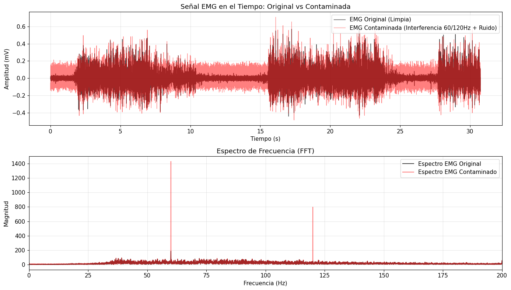
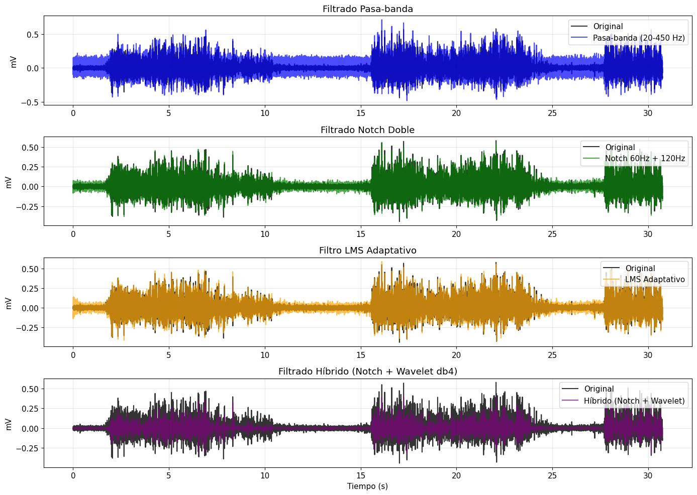
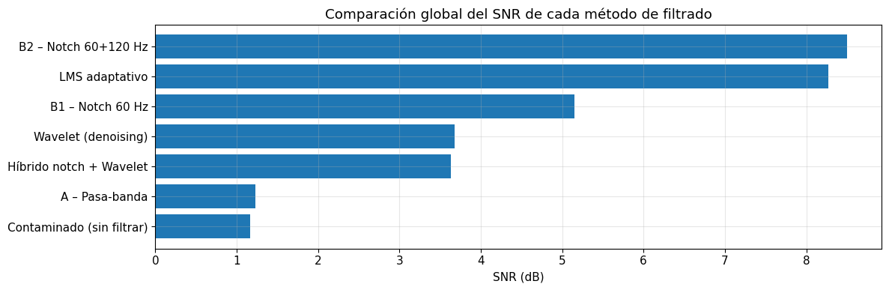

# LABORATORIO 7: Filtros adaptativos y transformada Wavelet

## TEORÍA

### 1. Qué es la transformada Wavelet

La transformada Wavelet permite analizar cómo cambia el contenido frecuencial de una señal a lo largo del tiempo. A diferencia de la transformada de Fourier, utiliza funciones localizadas temporalmente, llamadas wavelets u ondículas, que pueden desplazarse y cambiar de escala.

La transformada de Fourier descompone la señal en senos y cosenos de duración infinita, por lo que indica qué frecuencias contiene la señal pero no en qué instante aparecen. La wavelet tiene duración finita y conserva la información temporal, lo que permite un análisis conjunto en tiempo y frecuencia.

| Característica | Descripción |
|---|---|
| Duración finita | La energía de la wavelet se concentra en un intervalo corto |
| Localización temporal | Permite ubicar el instante en que ocurre cada evento |
| Multiescala | La señal se analiza con distintos grados de compresión de la misma wavelet |

Esto resulta útil para el análisis de señales biomédicas como el ECG, el EEG y el EMG, que son no estacionarias, presentan eventos transitorios de corta duración y combinan componentes rápidas con tendencias lentas.

### 2. Wavelet madre

La wavelet madre, representada como $\psi(t)$, es una función base a partir de la cual se generan otras wavelets mediante escalamiento y traslación.

$$
\psi_{a,b}(t)=\frac{1}{\sqrt{|a|}}\,\psi\left(\frac{t-b}{a}\right)
$$

El parámetro $a$ determina la escala y $b$ la posición temporal, mientras que el factor $1/\sqrt{|a|}$ mantiene la misma energía en todas las escalas. Las escalas pequeñas permiten analizar componentes de mayor frecuencia, mientras que las grandes permiten observar variaciones más lentas.

| Escala | Forma de la wavelet | Frecuencias | Eventos que capta |
|---|---|---|---|
| Pequeña | Comprimida | Altas | Eventos rápidos, como el complejo QRS |
| Grande | Expandida | Bajas | Tendencias lentas, como la deriva de línea de base |

### 3. Transformada Wavelet continua y discreta

La transformada Wavelet continua compara la señal con versiones escaladas y desplazadas de la wavelet madre:

$$
W(a,b)=\frac{1}{\sqrt{|a|}}\int_{-\infty}^{\infty}x(t)\,\psi^{*}\left(\frac{t-b}{a}\right)dt
$$

Cada coeficiente indica qué tanto se parece la señal a la wavelet en un instante y una escala determinados. El resultado se representa en un escalograma, con el tiempo en el eje horizontal, la escala o frecuencia en el eje vertical y la energía de los coeficientes en color. Esta representación se emplea con frecuencia en EEG, audio y sismología.

La transformada Wavelet discreta utiliza bancos de filtros para separar la señal en aproximaciones, asociadas a bajas frecuencias, y detalles, asociados a altas frecuencias. En cada nivel, un filtro pasa-bajas entrega la aproximación A y un filtro pasa-altas entrega el detalle D; ambas salidas se deciman por 2 y la aproximación vuelve a dividirse en el nivel siguiente. Este proceso repetido produce una descomposición multirresolución, en la que los detalles concentran los bordes, los transitorios, los eventos rápidos y el ruido.

La decimación reduce la frecuencia de muestreo conservando una de cada $M$ muestras, $y[n]=x[Mn]$. Aplicada de forma directa produce aliasing, es decir, superposición espectral, distorsión y pérdida de información, por lo que antes de decimar se aplica un filtro pasa-bajas antialiasing. La operación inversa es la interpolación, que inserta ceros entre las muestras y luego filtra, y es la base de la reconstrucción de la señal a partir de sus coeficientes.

El detalle $D_j$ cubre aproximadamente la banda de $F_s/2^{j+1}$ a $F_s/2^{j}$, y la aproximación final $A_L$ la banda de 0 a $F_s/2^{L+1}$. Con una frecuencia de muestreo de 1000 Hz y cuatro niveles se obtiene:

| Nivel | Banda aproximada |
|---|---|
| D1 | 250 a 500 Hz |
| D2 | 125 a 250 Hz |
| D3 | 62.5 a 125 Hz |
| D4 | 31.25 a 62.5 Hz |
| A4 | 0 a 31.25 Hz |

En el ECG se suele llegar a ocho niveles; en ese caso la energía de los complejos QRS se ubica entre D5 y D7 y la deriva de línea de base en la aproximación A8.

### 4. Familias de wavelets

Existen distintas familias de wavelets madre, cada una con propiedades que la hacen más adecuada para cierto tipo de señal.

| Familia | Característica |
|---|---|
| Haar | La más simple. Vale 1 en la primera mitad de su intervalo y −1 en la segunda, por lo que es discontinua, muy rápida y fácil de implementar |
| Daubechies | Muy usada en ECG. La db4 tiene una forma parecida a la de un complejo QRS |
| Symlets | Versión más simétrica de las Daubechies |
| Coiflets | Poseen más momentos nulos |
| Morlet | Senoide modulada por una gaussiana, adecuada para la transformada continua |

La elección de la wavelet madre debe sustentarse en la forma de la señal analizada y en la literatura del área.

### 5. Eliminación de ruido mediante Wavelets

La transformada Wavelet también permite reducir el ruido de una señal mediante la modificación de sus coeficientes antes de reconstruirla. El método parte de que los eventos relevantes producen pocos coeficientes grandes, mientras que el ruido se reparte en muchos coeficientes pequeños.

El nivel de ruido se estima a partir del detalle más fino, y con él se calcula el umbral universal, donde $N$ es el número de muestras:

$$
\sigma=\frac{\text{mediana}(|D_1|)}{0.6745},\qquad \lambda=\sigma\sqrt{2\ln N}
$$

Una técnica utilizada es el thresholding, que puede ser hard, cuando elimina los coeficientes menores a un umbral, o soft, cuando además reduce la magnitud de los coeficientes restantes.

| Regla | Coeficientes menores al umbral | Coeficientes mayores al umbral | Efecto sobre la señal |
|---|---|---|---|
| Hard | Se anulan | Se conservan sin cambios | Preserva la amplitud de los picos, pero puede generar discontinuidades |
| Soft | Se anulan | Se reducen en $\lambda$ | Reconstrucción más suave, con picos ligeramente atenuados |

Después de umbralizar los detalles, la señal se reconstruye con la transformada inversa. La elección del umbral influye en la cantidad de ruido eliminado y en la conservación de la información original; por eso los puntos críticos del procedimiento son el número de niveles de descomposición, la wavelet madre y un umbral adaptado a la señal. El método rinde mejor cuando la información útil se concentra en pocos coeficientes grandes, como ocurre con el QRS del ECG.

### 6. Ruido, interferencia y filtros convencionales

Un registro biomédico contiene la señal fisiológica junto con componentes no deseadas de dos tipos. El ruido es aleatorio, no tiene una estructura predecible y es de banda ancha, por lo que reparte su energía en todas las frecuencias. La interferencia tiene un origen identificable y una estructura definida, como la red eléctrica, que en Perú opera a 60 Hz y genera un armónico en 120 Hz.

En el espectro esta diferencia es evidente. Una interferencia senoidal aparece como un pico estrecho en su frecuencia, mientras que el ruido gaussiano eleva el piso del espectro en todas las frecuencias. Por ello la interferencia puede eliminarse con filtros selectivos, pero el ruido que comparte banda con la señal no puede separarse por completo con un filtro lineal.

Los filtros convencionales tienen coeficientes fijos: se diseñan una vez y se aplican igual a toda la señal.

| Filtro | Deja pasar | Uso típico |
|---|---|---|
| Pasa-bajas | Frecuencias menores a la de corte | Atenuar ruido de alta frecuencia |
| Pasa-altas | Frecuencias mayores a la de corte | Eliminar la deriva de línea de base |
| Pasa-banda | Frecuencias entre dos cortes | Delimitar la banda de la señal, de 0.5 a 40 Hz en ECG y de 20 a 450 Hz en EMG |
| Notch | Todo excepto una banda muy estrecha | Eliminar una interferencia de frecuencia conocida |

En el notch, el factor de calidad Q controla el ancho de la muesca, que es aproximadamente $f_0/Q$. Si el filtro se aplica hacia adelante y hacia atrás con filtfilt, el desfase se cancela y los eventos de la señal no se desplazan en el tiempo.

### 7. Filtros adaptativos y algoritmo LMS

Cuando las características de la contaminación cambian con el tiempo, un filtro de coeficientes fijos pierde eficacia. Un filtro adaptativo ajusta automáticamente sus coeficientes para minimizar el error entre una señal deseada y la salida del filtro. Los auriculares con cancelación activa de ruido aplican este principio: aprenden el ruido ambiental y lo cancelan en tiempo real.

El filtro LMS, por Least Mean Squares, se compone de un filtro FIR adaptativo, la señal de error y un algoritmo de actualización de coeficientes.

| Señal | Significado |
|---|---|
| $d[n]$ | Señal contaminada, formada por la señal fisiológica más la interferencia |
| $x[n]$ | Referencia correlacionada con la interferencia pero no con la señal fisiológica |
| $y[n]$ | Salida del filtro, que estima la interferencia |
| $e[n]$ | Error, que corresponde a la señal limpia estimada |
| $\mathbf{w}$ | Coeficientes o pesos del filtro |
| $\mu$ | Paso o velocidad de aprendizaje |

$$
y[n]=\mathbf{w}^{T}\mathbf{x}[n],\qquad e[n]=d[n]-y[n],\qquad \mathbf{w}[n+1]=\mathbf{w}[n]+2\mu\,e[n]\,\mathbf{x}[n]
$$

La regla también se escribe como $\mathbf{w}[n+1]=\mathbf{w}[n]+\mu\,e[n]\,\mathbf{x}[n]$; el factor 2 solo reescala el paso. Como la señal fisiológica no está correlacionada con la referencia, la única forma de reducir la potencia del error es cancelar la interferencia. Un $\mu$ grande converge rápido pero se vuelve inestable y distorsiona la señal, mientras que un $\mu$ pequeño converge lento pero con mayor precisión. Los pesos parten de cero, de modo que la interferencia permanece en la salida durante el tiempo de convergencia.

Este principio se aplica, por ejemplo, en la extracción del ECG fetal a partir de registros abdominales, donde el ECG materno se superpone al fetal y debe cancelarse para detectar los latidos del feto.

### 8. Métricas de evaluación

La recuperación se cuantifica comparando la señal filtrada $\hat{x}$ con la señal original $x$:

| Métrica | Expresión | Interpretación |
|---|---|---|
| RMSE | $\sqrt{\frac{1}{N}\sum (x-\hat{x})^2}$ | Error promedio en mV; menor es mejor |
| SNR | $10\log_{10}\frac{\sum x^2}{\sum (x-\hat{x})^2}$ | Relación entre señal y error en dB; mayor es mejor |
| Correlación $r$ | Coeficiente de Pearson | Similitud de forma; 1 indica forma idéntica |

Las métricas complementan la inspección visual, pero no la reemplazan. Ninguna métrica aislada describe por completo el resultado, y una SNR alta no garantiza que la morfología sea clínicamente correcta.

### 9. Aplicaciones biomédicas

| Señal | Aplicaciones de la transformada Wavelet |
|---|---|
| ECG | Detección del complejo QRS y análisis de la variabilidad de la frecuencia cardiaca |
| EEG | Detección de epilepsia, separación de bandas cerebrales y eliminación de artefactos |
| EMG | Evaluación de la fatiga muscular y de la activación muscular |

En un flujo de procesamiento, la wavelet ocupa una etapa intermedia. A la señal adquirida se le aplica un preprocesamiento de filtrado, normalización y segmentación; luego se calcula la transformada, se obtienen sus coeficientes, se extraen características y estas alimentan modelos de machine learning o deep learning. Actualmente existen enfoques híbridos que combinan wavelets con redes neuronales convolucionales, como la wavelet scattering, el entrenamiento de CNN sobre escalogramas o el uso de características wavelet como entrada de modelos de aprendizaje automático. En estos enfoques las CNN aprenden sus propios filtros durante el entrenamiento.

## METODOLOGÍA

### 10. Señales utilizadas

El análisis se realizó sobre registros propios adquiridos en laboratorios anteriores con el kit BITalino (r)evolution y el software OpenSignals (r)evolution, en lugar de la señal de ejemplo de la guía. Este informe presenta el procesamiento del EMG de superficie del músculo gastrocnemio, registrado durante contracciones frente a una fuerza contraria.

| Parámetro | Valor |
|---|---|
| Señal | EMG de superficie del gastrocnemio |
| Condición | Contracciones frente a una fuerza contraria |
| Canal | A1 |
| Frecuencia de muestreo | 1000 Hz |
| Resolución del conversor | 10 bits |
| Ganancia del sensor | 1009 |
| Duración | 30.7 s aproximadamente |

El registro muestra tres periodos de contracción, entre 2 y 10.5 s, entre 15.5 y 24 s y desde 27.8 s hasta el final, separados por intervalos de reposo.

### 11. Procesamiento

El procedimiento sigue la guía del laboratorio, desarrollada sobre un ECG, y adapta sus parámetros a la banda del EMG. Se implementó en Python con NumPy, pandas, SciPy y PyWavelets.

Los valores del conversor se llevaron a milivoltios con la función de transferencia del sensor y luego se restó la media para centrar la señal en cero:

$$
EMG_{mV}=\left(\frac{ADC}{2^{n}}-\frac{1}{2}\right)\frac{V_{CC}}{G_{EMG}}\cdot 1000,\qquad V_{CC}=3.3\ \text{V},\quad G_{EMG}=1009,\quad n=10
$$

La señal se contaminó de forma artificial y controlada, para conocer la respuesta correcta y medir qué tanto la recupera cada método:

$$
EMG_{contaminado}=EMG_{original}+A_1\sin(2\pi\,60\,t+\phi_1)+A_2\sin(2\pi\,120\,t+\phi_2)+\text{ruido gaussiano}
$$

La amplitud $A_1$ es igual a la desviación estándar del EMG, $A_2$ equivale a 0.6 veces esa desviación y el ruido gaussiano tiene una desviación de 0.3 veces la del EMG. Las fases se eligieron al azar con una semilla fija, de modo que el resultado es reproducible.

| Método | Implementación | Parámetros |
|---|---|---|
| A. Pasa-banda | Butterworth aplicado con sosfiltfilt | 20 a 450 Hz, orden 4 |
| B1. Notch simple | iirnotch aplicado con filtfilt | 60 Hz, Q = 30 |
| B2. Notch doble | Dos notch en cascada | 60 y 120 Hz, Q = 30 |
| C. LMS adaptativo | Referencias seno y coseno de 60 y 120 Hz, pesos iniciales en cero | μ = 0.005 |
| D. Wavelet | Denoising con umbral universal | db4, 4 niveles, regla soft |
| E. Híbrido | Notch doble seguido del denoising wavelet | Parámetros de B2 y D |

Las métricas RMSE, SNR y correlación se calcularon respecto del EMG original, excluyendo 0.1 s en cada extremo del registro para evitar los efectos de borde.

## RESULTADOS

### 1. Señal original y contaminada

  

Figura 1. EMG original y contaminado en el dominio del tiempo y espectro de frecuencia.

En el dominio del tiempo, la contaminación agrega una banda constante de oscilaciones que se aprecia sobre todo en los intervalos de reposo, donde la actividad muscular es mínima; durante las contracciones queda parcialmente enmascarada por la propia actividad del músculo. En el espectro aparecen dos picos estrechos en 60 y 120 Hz sobre el espectro de banda ancha del EMG. El espectro del EMG original ya muestra un pico pequeño en 60 Hz, lo que evidencia interferencia real de la red eléctrica durante la adquisición.

### 2. Señales filtradas

  

Figura 2. EMG original superpuesto con la salida del pasa-banda, del notch doble, del LMS y del enfoque híbrido.

| Método | Observación |
|---|---|
| Pasa-banda de 20 a 450 Hz | Conserva la forma del EMG, pero la banda de interferencia sigue visible en el reposo, porque 60 y 120 Hz están dentro de su banda de paso |
| Notch doble | La señal filtrada se superpone casi por completo a la original y solo queda una banda delgada de ruido gaussiano en el reposo |
| LMS adaptativo | Resultado muy parecido al del notch; al inicio del registro se observa interferencia residual mientras los pesos convergen |
| Híbrido notch + Wavelet | El reposo queda prácticamente limpio, pero la amplitud de las contracciones se reduce de forma visible |

### 3. Métricas

| Método | RMSE (mV) | SNR (dB) | Correlación r | Mejora de SNR (dB) |
|---|---|---|---|---|
| B2. Notch 60 + 120 Hz | 0.0309 | 8.50 | 0.929 | 7.34 |
| C. LMS adaptativo | 0.0317 | 8.27 | 0.928 | 7.11 |
| B1. Notch 60 Hz | 0.0455 | 5.15 | 0.867 | 3.99 |
| D. Wavelet | 0.0538 | 3.68 | 0.756 | 2.52 |
| E. Híbrido notch + Wavelet | 0.0541 | 3.63 | 0.810 | 2.47 |
| A. Pasa-banda | 0.0714 | 1.23 | 0.779 | 0.07 |
| Contaminado sin filtrar | 0.0719 | 1.16 | 0.778 | 0 |

  

Figura 3. SNR obtenida por cada método respecto del EMG original.

### 4. Análisis

El notch doble obtuvo el mejor resultado, con 8.50 dB y una mejora de 7.34 dB respecto de la señal contaminada. Las interferencias simuladas tienen frecuencias exactas y constantes, que es la condición ideal para este filtro, y sus muescas de unos 2 Hz en 60 Hz y 4 Hz en 120 Hz retiran muy poca actividad muscular. El error que queda corresponde principalmente al ruido gaussiano: si fuera el único componente residual, la SNR alcanzaría unos 10.5 dB, ya que su desviación es 0.3 veces la del EMG. La diferencia restante se explica porque el filtro también elimina el pico real de 60 Hz del registro y la porción del EMG que cae dentro de sus muescas, y la métrica cuenta ambos como error.

El notch solo en 60 Hz se quedó en 5.15 dB porque la interferencia de 120 Hz permanece intacta, lo que confirma que este filtro solo actúa en la frecuencia para la que se diseña.

El LMS alcanzó 8.27 dB, prácticamente el mismo desempeño que el notch doble, sin conocer de antemano la amplitud ni la fase de las interferencias: sus pesos aprendieron esos valores a partir del error. Su ligera desventaja se debe al tiempo de convergencia, de unos cientos de milisegundos con μ = 0.005, durante el cual la interferencia sigue presente; como la evaluación solo excluye 0.1 s en cada extremo, parte de ese transitorio entra en la métrica. La ventaja del LMS se haría evidente si la interferencia cambiara de amplitud o de fase durante el registro.

El pasa-banda de 20 a 450 Hz prácticamente no mejoró la señal, con 1.23 dB frente a 1.16 dB, porque 60 y 120 Hz están dentro de la banda útil del EMG. Solo retira el ruido que cae por debajo de 20 Hz y por encima de 450 Hz, una fracción pequeña del total. En el ECG ocurre lo contrario: su banda de 0.5 a 40 Hz deja ambas interferencias fuera y el pasa-banda sí las elimina. La eficacia de un filtro convencional depende, por tanto, de que la contaminación no comparta banda con la señal.

La wavelet y el enfoque híbrido obtuvieron solo 3.68 y 3.63 dB. La tabla siguiente muestra qué contiene cada nivel de la descomposición en el EMG contaminado:

| Nivel | Banda | Contenido |
|---|---|---|
| D1 | 250 a 500 Hz | Componentes rápidas del EMG y ruido gaussiano |
| D2 | 125 a 250 Hz | EMG y ruido gaussiano |
| D3 | 62.5 a 125 Hz | EMG, ruido gaussiano e interferencia de 120 Hz |
| D4 | 31.25 a 62.5 Hz | EMG, ruido gaussiano e interferencia de 60 Hz |
| A4 | 0 a 31.25 Hz | Inicio de la banda del EMG y ruido gaussiano |

La actividad muscular es de banda ancha y se reparte en todos los niveles con muchos coeficientes pequeños, igual que el ruido, de modo que el umbral no puede separarlos. Además, el detalle D1 también contiene EMG, por lo que la estimación del ruido tiende a ser mayor que la real y el umbral elimina parte de la actividad muscular, lo que explica la reducción de amplitud de la Figura 2. Aplicada sola, la wavelet además deja pasar las interferencias, que generan coeficientes grandes en D3 y D4. El híbrido las elimina con el notch y por eso su correlación es mayor, 0.810 frente a 0.756, aunque ambos pierden amplitud.

Estos resultados muestran por qué las métricas deben leerse junto con las gráficas. El híbrido luce más limpio que las demás salidas en los intervalos de reposo, pero su SNR es baja porque reduce la amplitud de las contracciones, información que en una aplicación real se relaciona con la intensidad del esfuerzo muscular.

## PREGUNTAS

### P1. ¿Por qué es importante conocer la frecuencia de muestreo de una señal biomédica?

La frecuencia de muestreo define el eje de tiempo, $t=n/F_s$, y la frecuencia máxima representable, $F_s/2$. Sin ella no se pueden medir intervalos ni duraciones, y tampoco diseñar filtros, porque las frecuencias de corte, las muescas del notch y las bandas de cada nivel wavelet dependen de $F_s$. En el EMG analizado, $F_s=1000$ Hz permite representar hasta 500 Hz, suficiente para la banda de 20 a 450 Hz.

### P2. ¿Qué diferencia existe entre ruido e interferencia?

El ruido es aleatorio, sin estructura predecible y de banda ancha, como el ruido gaussiano, que reparte su energía en todas las frecuencias. La interferencia tiene un origen identificable y una estructura definida, como la red eléctrica a 60 Hz y su armónico de 120 Hz, y se concentra en frecuencias fijas. El propio registro lo ilustra: el espectro del EMG original ya mostraba un pequeño pico en 60 Hz producido por la red durante la adquisición.

### P3. ¿Por qué una interferencia sinusoidal puede observarse como un pico en el dominio de la frecuencia?

La FFT descompone la señal en senoides y mide cuánto aporta cada frecuencia. Una senoide pura de 60 Hz contiene una sola frecuencia, por lo que toda su energía se concentra en un único punto del espectro. Por eso, en el espectro del EMG contaminado, las interferencias de 60 y 120 Hz se distinguen como dos picos estrechos que sobresalen del espectro de banda ancha del músculo, aunque en el tiempo se mezclen con él.

### P4. ¿Qué sucede cuando aplicamos un filtro demasiado agresivo a una señal ECG?

Un filtro demasiado agresivo elimina componentes que forman parte de la señal fisiológica. En el ECG, un pasa-bajas con corte en 15 Hz remueve buena parte del contenido del QRS, por lo que los complejos se aplanan, se ensanchan y los picos R pierden amplitud. En el EMG se observó un efecto equivalente con el denoising wavelet: el umbral eliminó parte de la actividad muscular y redujo la amplitud de las contracciones.

### P5. ¿Cuál es la principal diferencia conceptual entre un filtro convencional y un filtro adaptativo?

Un filtro convencional tiene coeficientes fijos que se diseñan una vez para una banda determinada. Un filtro adaptativo ajusta sus coeficientes muestra a muestra a partir del error, por lo que puede seguir interferencias cuya amplitud o fase cambian en el tiempo, a cambio de necesitar una señal de referencia y un tiempo de convergencia. En el laboratorio, el LMS alcanzó 8.27 dB sin conocer de antemano la amplitud ni la fase de las interferencias, casi lo mismo que el notch doble.

### P6. ¿Para qué sirve la Transformada Wavelet?

Sirve para analizar una señal en tiempo y escala a la vez. Descompone la señal en aproximaciones, que contienen la parte lenta, y detalles, que contienen la parte rápida, mediante ondas de duración limitada. Así se puede saber en qué instante ocurre cada evento y reducir el ruido anulando los coeficientes pequeños, algo que la FFT no permite porque analiza la señal completa de forma global.

### P7. ¿Por qué la Transformada Wavelet puede resultar útil para analizar señales biomédicas?

Las señales biomédicas no son estacionarias y combinan eventos breves y localizados, como el QRS, con componentes lentas, como las ondas P y T o la deriva de base. La wavelet separa estos elementos por escalas sin perder su ubicación en el tiempo. Su utilidad para eliminar ruido depende de la señal: funciona bien cuando la información se concentra en pocos coeficientes grandes, como en el ECG, y pierde eficacia en el EMG, cuya actividad se reparte en muchos coeficientes pequeños como el ruido.

### P8. ¿Qué información podría perderse durante el proceso de filtrado?

En el ECG, un pasa-banda puede eliminar la deriva de línea de base y el contenido de alta frecuencia del QRS, lo que reduce o redondea los picos R. Un notch elimina también la parte de la señal que cae dentro de su muesca, y el soft thresholding reduce la amplitud de los picos. En el EMG del gastrocnemio, el denoising wavelet eliminó parte de la actividad muscular, lo que en una aplicación real afectaría la estimación de la intensidad de la contracción.

### P9. Si conoces la frecuencia exacta de una interferencia, ¿qué tipo de filtro podrías utilizar?

Un filtro notch centrado en esa frecuencia, que elimina una banda muy estrecha y casi no altera el resto del espectro; si la interferencia tiene armónicos, se colocan varios notch en cascada. En el laboratorio, el notch doble de 60 y 120 Hz fue el método más efectivo, con 8.50 dB. Si la amplitud o la fase de la interferencia cambian en el tiempo, un filtro adaptativo LMS con una referencia a esa frecuencia es una mejor alternativa.

### P10. ¿Por qué no debemos evaluar un filtro únicamente observando visualmente la señal?

La inspección visual es subjetiva y puede llevar a conclusiones equivocadas. En el EMG, el enfoque híbrido luce más limpio en los intervalos de reposo, pero su SNR fue de solo 3.63 dB porque redujo la amplitud de las contracciones. Las métricas cuantifican cuánto se parece la señal filtrada a la original, aunque ninguna basta por sí sola: una SNR alta no garantiza una morfología clínicamente correcta, por lo que ambas evaluaciones deben combinarse.

## CONCLUSIONES

La aplicación de la metodología del laboratorio al EMG del gastrocnemio mostró que la eficacia de cada técnica depende de la relación espectral entre la señal y la contaminación. El notch doble fue el método más efectivo, con 8.50 dB y r = 0.929, porque las interferencias de la red tienen frecuencias exactas y constantes y sus muescas estrechas retiran muy poca actividad muscular.

El LMS logró un desempeño casi igual, 8.27 dB, aprendiendo la amplitud y la fase de las interferencias a partir del error. Su costo es la necesidad de una señal de referencia y de un tiempo de convergencia, y su ventaja frente al notch aparecería con interferencias variables o en aplicaciones en tiempo real. Ninguno de los dos reduce el ruido gaussiano, que comparte banda con el EMG.

El pasa-banda de 20 a 450 Hz es adecuado para delimitar la banda del EMG, pero no sirve contra la red eléctrica porque 60 y 120 Hz quedan dentro de ella, a diferencia del ECG, cuya banda de 0.5 a 40 Hz sí las excluye. El denoising wavelet con umbral universal sobresuavizó la señal y redujo la amplitud de las contracciones, porque el EMG, a diferencia del QRS, no concentra su información en pocos coeficientes grandes.

No existe un método universalmente superior. La elección depende del tipo de señal, del tipo de contaminación y de la información fisiológica que se debe conservar, y la evaluación debe combinar métricas con la inspección visual.

## REFERENCIAS

- Meza, M. Introducción a la Transformada Wavelet: multirate, bancos de filtros y aplicaciones biomédicas. Material de clase, Introducción a Señales Biomédicas, Universidad Peruana Cayetano Heredia, 2026.
- Universidad Peruana Cayetano Heredia. LAB 7, Filtrado de señales II: filtros adaptativos y transformada Wavelet. Guía de laboratorio, Introducción a Señales Biomédicas, 2026.
- Donoho, D. L.; Johnstone, I. M. Ideal spatial adaptation by wavelet shrinkage. Biometrika, volumen 81, número 3, páginas 425 a 455, 1994.
- Widrow, B.; Glover, J. R.; McCool, J. M.; Kaunitz, J.; Williams, C. S.; Hearn, R. H.; Zeidler, J. R.; Dong, E.; Goodlin, R. C. Adaptive noise cancelling: principles and applications. Proceedings of the IEEE, volumen 63, número 12, páginas 1692 a 1716, 1975.
- Lee, G. R.; Gommers, R.; Waselewski, F.; Wohlfahrt, K.; O'Leary, A. PyWavelets: a Python package for wavelet analysis. Journal of Open Source Software, volumen 4, número 36, artículo 1237, 2019.
- Matonia, A.; Jezewski, J.; Kupka, T.; Jezewski, M.; Horoba, K.; Wrobel, J.; Czabanski, R.; Kahankowa, R. Fetal electrocardiograms, direct and abdominal with reference heartbeat annotations. Scientific Data, volumen 7, artículo 200, 2020.
- Ionescu, V.; Hnatiuc, M. Fetal heart rate detection and monitoring from noninvasive abdominal ECG recordings. 2015 E-Health and Bioengineering Conference, Iasi, páginas 1 a 4, 2015.
