# LABORATORIO 9: Análisis de la señal EMG, detección de la actividad muscular y extracción de características

## INTRODUCCIÓN

Una prótesis mioeléctrica, un exoesqueleto de rehabilitación o un sistema que detecta fatiga no interpretan la señal electromiográfica cruda. La resumen en un conjunto pequeño de números llamados características, calculados sobre ventanas cortas de la señal, y a partir de ellos un clasificador toma una decisión. Elegir y calcular bien esas características suele ser más importante que el clasificador que viene después. La pregunta que guía el laboratorio es cómo un dispositivo convierte la actividad eléctrica de un músculo en números que puede interpretar.

Para responderla se recorrió el proceso completo sobre dos registros reales de electromiografía de superficie del bíceps braquial adquiridos con BITalino. El primero, de 69.2 s, se tomó con el músculo en reposo y sirve como referencia del ruido del sistema; el segundo, de 63.1 s, contiene 21 contracciones repetidas separadas por reposo. Las señales se convirtieron a milivoltios, se evaluó su calidad, se filtraron y se detectaron las contracciones con la envolvente RMS. Después el registro se dividió en ventanas etiquetadas como reposo o contracción, se calcularon quince características por ventana y con ellas se entrenaron dos clasificadores clásicos, LDA y SVM. Ese enfoque se comparó con una red neuronal convolucional que aprende sus propias características a partir del espectrograma.

## OBJETIVOS

- Explicar el origen fisiológico de la sEMG y sus rangos típicos de amplitud y frecuencia.
- Convertir, filtrar y evaluar la calidad de una señal real adquirida con BITalino.
- Detectar la actividad muscular, segmentar la señal en ventanas y etiquetar de forma automática el reposo y la contracción.
- Calcular e interpretar características temporales, estadísticas y espectrales.
- Construir una matriz de características y entrenar clasificadores sin fuga de datos.
- Comparar el enfoque clásico con una CNN que aprende sus características a partir del espectrograma.

## TEORÍA

### 1. Origen de la señal sEMG

El músculo esquelético no se contrae en bloque, sino que se organiza en unidades motoras. Cada unidad motora está formada por una motoneurona de la médula espinal y todas las fibras musculares que inerva. Cuando la motoneurona dispara, sus fibras se despolarizan casi al mismo tiempo y producen un potencial de acción de unidad motora, MUAP, una onda bifásica o trifásica de pocos milisegundos. La señal sEMG es la suma de los trenes de MUAP de muchas unidades motoras, desfasados en el tiempo.

El sistema nervioso regula la fuerza con dos mecanismos:

| Mecanismo | Qué ocurre | Efecto en la sEMG |
|---|---|---|
| Reclutamiento | Se activan más unidades motoras, primero las pequeñas según el principio de Henneman | Aumenta la amplitud |
| Codificación por frecuencia | Cada unidad motora dispara más rápido, entre 8 y 30 veces por segundo | Aumentan la amplitud y la densidad de la señal |

Un electrodo de superficie no registra una unidad aislada, sino la suma espacial y temporal de los MUAP de muchas unidades. Por eso la sEMG forma un patrón de interferencia que parece ruido aleatorio, aunque su amplitud y su contenido espectral codifican la activación del músculo. La grasa y la piel que separan el músculo del electrodo actúan como un filtro pasa-bajas, de modo que el ancho de banda que llega a la superficie es menor que el de los potenciales dentro del músculo.

| Propiedad | Valor típico |
|---|---|
| Amplitud | Desde microvoltios en reposo hasta unos 10 mV pico a pico |
| Banda útil | Aproximadamente de 20 a 450 o 500 Hz |
| Energía dominante | 50 a 150 Hz |
| Distribución de amplitudes | Aproximadamente gaussiana de media cero en contracción sostenida |

Estos valores dependen del grosor del tejido adiposo, la posición y la distancia entre electrodos, la temperatura, la impedancia piel electrodo y la fatiga, que desplaza el espectro hacia frecuencias más bajas. Como la señal es pequeña, necesita etapas de preamplificación y amplificación antes de digitalizarse.

### 2. Desafíos de la señal sEMG

| Fuente | Característica | Tratamiento |
|---|---|---|
| Ruido blanco | Aleatorio y presente en toda la banda de 0 a 500 Hz, incluida la banda útil | Se estima con un registro en reposo; el filtrado solo lo reduce fuera de la banda útil |
| Ruido de movimiento | De 0 a 20 Hz por la interfaz piel electrodo y hasta unos 50 Hz por el movimiento de los cables, con máximo entre 1 y 10 Hz | Filtro pasa-altos cerca de 20 Hz y buena fijación de electrodos y cables |
| Interferencia eléctrica | 60 Hz en Perú y sus armónicos | Amplificación diferencial y filtro notch; conviene minimizarla desde la adquisición |
| Diafonía | Actividad de músculos vecinos con el mismo espectro que la sEMG | Colocación adecuada de los electrodos y técnicas de separación |
| ECG | Picos periódicos cerca de 1 Hz en músculos próximos al tórax | Filtro pasa-altos y ubicación de los electrodos |
| Saturación | La señal se aplana en el máximo o el mínimo del conversor | Prevención durante la adquisición; ningún filtro la corrige |

### 3. Adquisición con BITalino

La cadena de adquisición está formada por electrodos de Ag/AgCl, un amplificador diferencial con ganancia de 1009, un filtro analógico, un conversor analógico digital de 10 bits, la transmisión por Bluetooth y el registro en OpenSignals. La configuración es bipolar: dos electrodos se colocan sobre el vientre muscular y uno de referencia en una zona eléctricamente neutra, como el hueso. El amplificador resta los potenciales de los dos electrodos, de modo que la señal común a ambos, como la interferencia de la red, se cancela. Esta capacidad se mide con la razón de rechazo en modo común, CMRR.

La colocación de los electrodos sigue las recomendaciones SENIAM, que definen para cada músculo la postura inicial, la ubicación, la orientación, el tamaño de los electrodos y la distancia entre ellos. Para el bíceps braquial, los electrodos se ubican sobre la línea entre el acromion medial y la fosa cubital, a un tercio de la fosa cubital, orientados en esa misma dirección, con 20 mm entre centros y con la referencia en la muñeca. La piel se limpia antes para reducir la impedancia. En la misma línea, el CEDE-Check es una lista de verificación para diseñar, reportar y evaluar estudios con EMG que exige documentar las características de los electrodos, las condiciones experimentales y los métodos de procesamiento, para que los resultados sean reproducibles y comparables.

Con una frecuencia de muestreo de 1000 Hz la frecuencia de Nyquist es de 500 Hz, suficiente para la banda útil. El conversor de 10 bits entrega enteros de 0 a 1023 y el valor cercano a 512 corresponde a 0 V. Las cuentas se convierten a milivoltios con la función de transferencia del sensor:

$$
\mathrm{EMG}_{mV}=\frac{\left(\frac{ADC}{2^{n}}-\frac{1}{2}\right)V_{CC}}{G_{EMG}}\times 1000,\qquad V_{CC}=3.3\ \mathrm{V},\quad G_{EMG}=1009,\quad n=10
$$

El rango medible resulta de ±1.632 mV y cada cuenta del conversor equivale a 3.19 µV. Cualquier actividad mayor satura el conversor, que se queda fijo en sus valores extremos.

### 4. Qué se puede medir con la sEMG

La sEMG permite medir de forma objetiva tres aspectos de la función muscular: la intensidad de activación, el momento en que se activa cada músculo y su estado fisiológico. Cada uno se asocia con una característica de la señal y con un cálculo concreto:

| Efecto fisiológico | Característica de la señal | Cálculo habitual |
|---|---|---|
| Esfuerzo o fuerza muscular | Amplitud | RMS y detección de picos |
| Momento de activación | Amplitud por encima de un umbral | Envolvente RMS y umbral |
| Fatiga muscular | Aumento de la amplitud y disminución de la frecuencia | Frecuencia mediana |

Al aumentar el torque alrededor de una articulación aumenta la amplitud de la sEMG, lo que permite estudiar cómo cambia la carga entre músculos, tareas o sujetos. Cuantificar cuándo un músculo está activo e inactivo permite reconstruir la secuencia de una tarea y, con varios músculos, estudiar la coactivación. Con la fatiga la amplitud aumenta y la frecuencia media disminuye de forma progresiva, por lo que comparar estas curvas antes y después de un entrenamiento o de una intervención muestra si el músculo resiste mejor la fatiga.

En la práctica clínica la sEMG ayuda a identificar disfunciones frecuentes:

| Disfunción | Qué se observa en la sEMG |
|---|---|
| Exceso de tono basal | Actividad elevada cuando el músculo debería estar relajado, como en la hipertonía |
| Asimetría muscular | Activación desigual entre ambos lados durante un movimiento bilateral |
| Déficit de activación | El músculo trabaja menos de lo que debería durante un movimiento |
| Exceso de coactivación | Activación simultánea excesiva de músculos que deberían alternarse |
| Sinergia y timing alterados | Secuencia o momento de activación anormal entre músculos |

Por ejemplo, una paciente con dolor presentó en los trapecios inferiores una actividad basal 12 veces mayor de lo normal y, en el hombro lesionado, activaba el deltoides izquierdo a la mitad que el derecho. En otro caso, los vastos mediales mostraron solo 53 % de simetría durante una sentadilla. La asimetría se cuantifica con el RMS de cada lado mediante el índice de simetría y la razón de simetría:

$$
SI=\frac{\mathrm{RMS}_{der}-\mathrm{RMS}_{izq}}{0.5\left(\mathrm{RMS}_{der}+\mathrm{RMS}_{izq}\right)}\times 100\%\qquad\qquad
\text{razón de simetría}=\frac{\min\left(\mathrm{RMS}_{der},\mathrm{RMS}_{izq}\right)}{\max\left(\mathrm{RMS}_{der},\mathrm{RMS}_{izq}\right)}\times 100\%
$$

Este análisis sigue un flujo de registro, preprocesamiento, rectificación y envolvente, segmentación, cálculo del RMS, normalización, cálculo de la simetría e interpretación, que comparte sus primeras etapas con el procesamiento de este laboratorio.

### 5. Preprocesamiento

El preprocesamiento elimina la componente continua y las derivas lentas, los artefactos de movimiento por debajo de 20 Hz, el ruido por encima de la banda útil y la interferencia de 60 Hz.

| Filtro | Parámetros | Función |
|---|---|---|
| Pasa-banda Butterworth | 20 a 450 Hz, orden 4, en secciones de segundo orden | Conserva la banda útil con respuesta plana; las secciones de segundo orden dan estabilidad numérica |
| Notch IIR | 60 Hz con Q = 30, ancho cercano a 2 Hz | Elimina la interferencia de la red sin afectar las frecuencias vecinas |
| Filtrado de fase cero | Aplicación hacia adelante y hacia atrás | Evita el desfase; sirve para análisis offline, mientras que un sistema en tiempo real como una prótesis usa filtros causales |

El diseño exige que $0<f_{baja}<f_{alta}<F_s/2$. Para observar cómo se distribuye la potencia entre frecuencias se usa la densidad espectral de potencia, PSD, estimada con el método de Welch. La señal se divide en segmentos solapados, cada segmento se multiplica por una ventana que reduce la fuga espectral, se calcula su periodograma con la FFT y se promedian todos los periodogramas. El resultado es una estimación más estable que un único periodograma y permite calcular la frecuencia media y la frecuencia mediana, útiles para estudiar la fatiga.

### 6. Detección de actividad y segmentación

La envolvente RMS móvil resume la amplitud instantánea de la señal con una ventana de W muestras. El inicio de la actividad se detecta cuando la envolvente supera un umbral calculado a partir del reposo, donde K es un factor de seguridad:

$$
\mathrm{RMS}[n]=\sqrt{\frac{1}{W}\sum_{k=n-W/2}^{n+W/2}x[k]^{2}}\qquad\qquad \mathrm{umbral}=\mu_{reposo}+K\,\sigma_{reposo}
$$

La sEMG es no estacionaria, es decir, sus propiedades cambian en el tiempo, por lo que las características se calculan sobre ventanas cortas. Una ventana más corta mejora la resolución temporal, pero produce estimaciones más ruidosas; en control de prótesis se usan ventanas de 100 a 300 ms por la restricción de latencia. El solapamiento entre ventanas aumenta el número de observaciones, aunque estas dejan de ser independientes entre sí. Las ventanas que mezclan reposo y contracción tienen una etiqueta ambigua y suelen excluirse del entrenamiento.

### 7. Extracción de características

Una característica es una función $f:\mathbb{R}^{N}\rightarrow\mathbb{R}$ que transforma una ventana de N muestras en un número con significado. Las características clásicas de la sEMG se agrupan en familias:

| Familia | Característica | Definición | Intuición |
|---|---|---|---|
| Amplitud | MAV, valor absoluto medio | $\frac{1}{N}\sum \lvert x_i\rvert$ | Amplitud media rectificada |
| Amplitud | MAV1 y MAV2 | MAV ponderado con peso 1 en la mitad central de la ventana y un peso menor en los extremos, constante en MAV1 y lineal en MAV2 | Reducen la influencia de los bordes de la ventana |
| Amplitud | RMS, raíz cuadrática media | $\sqrt{\frac{1}{N}\sum x_i^2}$ | Relacionada con la potencia |
| Amplitud | iEMG, EMG integrada | $\sum \lvert x_i\rvert$ | Área bajo la señal rectificada |
| Amplitud | SSI, integral cuadrática simple | $\sum x_i^2$ | Energía de la ventana |
| Amplitud | VAR, varianza | $\frac{1}{N-1}\sum (x_i-\bar{x})^2$ | Potencia de la señal |
| Complejidad | WL, longitud de onda | $\sum \lvert x_{i+1}-x_i\rvert$ | Longitud del trazo; combina amplitud y frecuencia |
| Complejidad | ZC, cruces por cero | Cambios de signo con un salto de al menos ε | Estimador temporal de la frecuencia |
| Complejidad | SSC, cambios de signo de la pendiente | Cambios de signo de la pendiente que superan ε | Densidad de picos |
| Complejidad | WAMP, amplitud de Willison | Número de veces que $\lvert x_{i+1}-x_i\rvert>\varepsilon$ | Relacionada con el disparo de unidades motoras |
| Estadística | Asimetría | $E[(x-\mu)^3]/\sigma^3$ | Cero si la distribución es simétrica |
| Estadística | Curtosis de Fisher | $E[(x-\mu)^4]/\sigma^4-3$ | Cero si es gaussiana, positiva con picos aislados y negativa si la distribución está aplanada |
| Espectral | MNF, frecuencia media | Centro de masa de la PSD | Frecuencia promedio ponderada por la potencia |
| Espectral | MDF, frecuencia mediana | Frecuencia que divide la potencia en dos mitades | Más robusta al ruido; disminuye con la fatiga |
| Espectral | Potencia por bandas | Fracción de potencia en 20 a 80, 80 a 150 y 150 a 450 Hz | Distribución espectral gruesa |

$$
\mathrm{MNF}=\frac{\sum_j f_j P_j}{\sum_j P_j}\qquad\qquad \sum_{f_j\le \mathrm{MDF}}P_j=\frac{1}{2}\sum_j P_j
$$

MAV, WL, ZC y SSC forman parte del conjunto propuesto por Hudgins y colaboradores para el control de prótesis. ZC, SSC y WAMP usan un umbral de ruido ε para no contar las fluctuaciones del piso de ruido. En contracciones con muchas unidades motoras la sEMG tiende a ser casi gaussiana, con curtosis cercana a cero; con pocas unidades o con artefactos aparecen picos aislados y la curtosis aumenta, mientras que la saturación recorta las colas de la distribución y la empuja hacia valores negativos.

Con la fatiga disminuye la velocidad de conducción de las fibras musculares y los MUAP se ensanchan. Por eso el espectro se desplaza hacia frecuencias más bajas, la MDF y la MNF disminuyen y el RMS suele aumentar, lo que convierte a la frecuencia mediana en uno de los indicadores de fatiga más usados. Además, la amplitud no equivale directamente a fuerza: la relación entre ambas es no lineal, depende del músculo y requiere normalizar, por ejemplo respecto de la contracción voluntaria máxima, %MVC, para comparar sujetos o sesiones.

### 8. Selección e ingeniería de características

Después de la extracción viene la ingeniería de características, que consiste en elegir, transformar y normalizar las características antes de entrenar el modelo. Para medir cuánto separa una característica dos clases se usa la razón de Fisher, que compara la distancia entre las medias con la dispersión de cada clase:

$$
J=\frac{(\mu_1-\mu_2)^2}{\sigma_1^2+\sigma_2^2}
$$

Un valor de J mayor indica una característica más discriminante. También conviene revisar la correlación entre características: dos características muy correlacionadas aportan casi la misma información y solo agregan redundancia al modelo. Algunas transformaciones, como el logaritmo, acercan la distribución de una característica a los supuestos del clasificador.

### 9. Clasificación

El desarrollo de un modelo sigue la metodología CRISP-DM, un ciclo iterativo con seis fases: comprensión del problema, comprensión de los datos, preparación de los datos, modelado, evaluación y despliegue. En señales fisiológicas, la preparación de los datos corresponde al filtrado, el preprocesamiento, la extracción y la ingeniería de características. El flujo clásico de reconocimiento de patrones es señal, preprocesamiento, ventanas, vector de características, normalización, clasificador y decisión. Los modelos del curso se agrupan así:

| Regresión | Clasificación | No supervisado | Deep learning |
|---|---|---|---|
| KNN | KNN | K-Means | DNN |
| SVM | Naive Bayes | PCA | CNN |
| Random Forest | SVM | | RNN |
| Decision tree | Random Forest | | LSTM |
| XGBoost | Decision tree | | |
| | XGBoost | | |

En este laboratorio se compararon dos clasificadores:

| Clasificador | Descripción |
|---|---|
| LDA, análisis discriminante lineal | Muy usado en control mioeléctrico por ser rápido, robusto y con pocos parámetros. Supone clases gaussianas con la misma covarianza y las separa con una frontera lineal |
| SVM con kernel RBF | Construye una frontera de decisión no lineal que maximiza el margen entre las clases |

La normalización z-score se ajusta solo con los datos de entrenamiento, dentro de un pipeline. Con ventanas solapadas al 50 %, dos ventanas vecinas comparten la mitad de sus muestras; si una queda en entrenamiento y la otra en prueba, el modelo ya vio parte de la prueba y su desempeño se sobreestima. Esta fuga de datos se evita con validación por grupos, GroupKFold, en la que cada ciclo de reposo y contracción va completo a entrenamiento o a prueba. Con varios sujetos, el equivalente es dividir por sujeto.

El desempeño se mide con la exactitud balanceada, que promedia el acierto de cada clase y no se ve favorecida cuando una clase tiene más ejemplos que la otra. Un valor de 0.5 equivale a adivinar al azar y 1.0 a acertar todo:

$$
\text{exactitud balanceada}=\frac{1}{2}\left(\frac{VP}{VP+FN}+\frac{VN}{VN+FP}\right)
$$

donde VP y VN son los aciertos en contracción y en reposo, y FN y FP los errores correspondientes.

### 10. Deep learning

En el enfoque clásico el analista decide qué medir a partir del conocimiento fisiológico. En deep learning la red aprende sus propios filtros a partir de los datos.

| Aspecto | Clásico con LDA o SVM | Deep learning con CNN |
|---|---|---|
| Entrada | Vector de unas 15 características | Señal cruda en una CNN 1D o imagen tiempo frecuencia en una CNN 2D |
| Conocimiento experto | Alto, se elige qué medir | Bajo, la red lo descubre |
| Datos necesarios | Pocos | Muchos, con miles de ventanas y varios sujetos |
| Interpretabilidad | Alta | Baja |
| Costo computacional | Mínimo | Alto durante el entrenamiento |

La FFT indica qué frecuencias contiene la señal, pero no cuándo aparecen. La transformada de Fourier de tiempo corto, STFT, aplica la FFT sobre ventanas deslizantes $w[n]$ desplazadas un salto H:

$$
X(m,k)=\sum_n x[n]\,w[n-mH]\,e^{-j2\pi kn/N}
$$

El espectrograma, $\lvert X(m,k)\rvert^2$, es una matriz de tiempo por frecuencia, es decir, una imagen, y las redes convolucionales son eficaces para reconocer patrones en imágenes. Su resolución está limitada por el principio de incertidumbre tiempo frecuencia: una ventana larga mejora la resolución en frecuencia y empeora la temporal. Con segmentos de 64 muestras a 1000 Hz la resolución es de 15.6 Hz y 64 ms. Otras representaciones usadas en sEMG son el escalograma de la transformada wavelet continua, la transformada de Hilbert Huang y las matrices multicanal de la HD-sEMG.

Una CNN combina capas convolucionales, que aplican filtros pequeños sobre la imagen para detectar patrones locales, con normalización por lotes, funciones de activación ReLU y capas de pooling que reducen el tamaño de los mapas. Las capas convolucionales cumplen el papel del extractor de características y la última capa lineal el del clasificador. La red se entrena minimizando la entropía cruzada con un optimizador como Adam.

## METODOLOGÍA

### 11. Registros y montaje

La tabla resume el montaje y los parámetros de adquisición de los dos registros.

| Parámetro | Valor |
|---|---|
| Equipo | BITalino (r)evolution con sensor EMG en el canal A1 |
| Software | OpenSignals (r)evolution, exportación en archivo de texto |
| Músculo | Bíceps braquial |
| Electrodos | Ag/AgCl en configuración bipolar, referencia en la muñeca |
| Frecuencia de muestreo | 1000 Hz |
| Resolución del conversor | 10 bits |
| Ganancia del sensor | 1009 |
| Registro PRUEBA | Contracciones repetidas, 63 150 muestras, 63.1 s, inicio a las 12:18 |
| Registro BASELINE | Reposo, 69 150 muestras, 69.2 s, inicio a las 12:23 |

Los electrodos de medición se colocaron sobre la cara anterior del brazo, en la porción distal del bíceps, y el electrodo de referencia en la muñeca, de forma coherente con la recomendación SENIAM para este músculo. En el registro PRUEBA se realizaron contracciones repetidas del bíceps con el codo flexionado y el puño cerrado, aproximadamente cada 3 s y separadas por reposo. El registro BASELINE se tomó con el brazo relajado unos 5 minutos después de la prueba.

<div align="center">

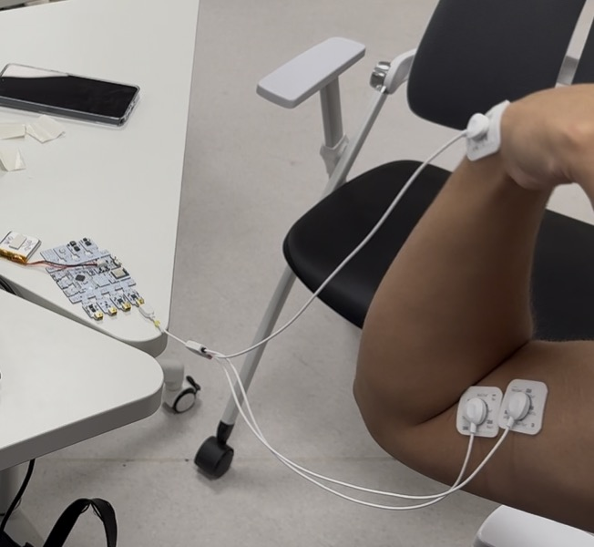
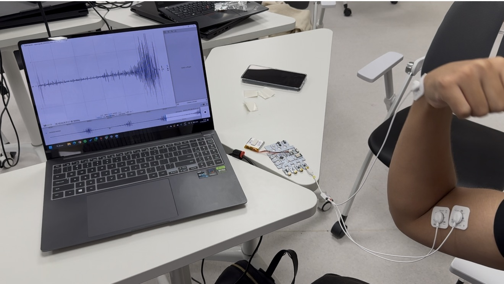

Figura 1. Montaje de los electrodos sobre el bíceps braquial con la referencia en la muñeca y visualización de la señal en OpenSignals durante una contracción.

</div>

### 12. Procesamiento

El procesamiento se realizó en Python sobre Google Colab con NumPy, SciPy, pandas, Matplotlib, scikit-learn y PyTorch. La Figura 2 resume el flujo: la rama superior corresponde al enfoque clásico con características diseñadas y la inferior al enfoque de deep learning, que parte de la misma señal filtrada y de la misma detección de contracciones.

<div align="center">

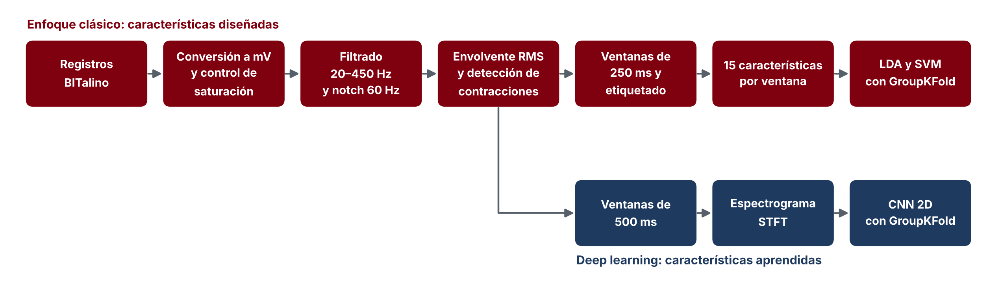

Figura 2. Flujo de procesamiento del laboratorio.

</div>

#### Simulación de la sEMG

Antes de trabajar con los registros se construyó una sEMG sintética para observar cómo surge el patrón de interferencia. Se modeló un MUAP bifásico como la derivada de una gaussiana, se generaron trenes de disparo de 8 a 25 por segundo con una variabilidad de 20 % entre disparos y con amplitudes y duraciones aleatorias, y se sumaron los trenes de 1, 5 y 60 unidades motoras.

#### Lectura y conversión a milivoltios

El archivo de texto de OpenSignals tiene una línea de identificación, una línea con los metadatos en formato JSON y la marca EndOfHeader, seguida de los datos en columnas: el contador nSeq, las entradas y salidas digitales y el canal A1. Se escribió un lector propio que toma la frecuencia de muestreo, la resolución y la posición del canal de la cabecera del archivo, en lugar de suponerlos, y luego se aplicó la función de transferencia del sensor.

```python
def leer_opensignals(ruta, etiqueta_canal="A1"):
    with open(ruta, "r", encoding="utf-8") as f:
        cabecera = [next(f) for _ in range(3)]
    meta = list(json.loads(cabecera[1].lstrip("# ").strip()).values())[0]
    datos = np.loadtxt(ruta, comments="#")
    idx = meta["column"].index(etiqueta_canal)
    meta["bits"] = meta["resolution"][idx]
    return datos[:, idx].astype(float), meta

def adc_a_mV(adc, n_bits=10, vcc=3.3, ganancia=1009):
    return ((adc / 2**n_bits) - 0.5) * vcc / ganancia * 1000
```

#### Control de calidad

Una muestra se consideró saturada cuando el conversor marcaba 0 o 1023. Al revisar cuántas veces aparecía cada valor extremo se observó una acumulación en 1022, por lo que también se evaluó un criterio corregido que incluye ese valor. Para cada ventana se guardó si contenía alguna muestra saturada.

```python
sat_prueba = (adc_prueba <= 0) | (adc_prueba >= 2**N_BITS - 1)   # criterio original: 0 o 1023
sat_corr   = (adc_prueba <= 0) | (adc_prueba >= 2**N_BITS - 2)   # incluye el techo práctico en 1022
```

#### Filtrado y análisis espectral

```python
def filtrar_emg(x, fs=1000, f_baja=20, f_alta=450, orden=4, f_notch=60, q_notch=30):
    if not (0 < f_baja < f_alta < fs / 2):
        raise ValueError("Se requiere 0 < f_baja < f_alta < Fs/2")
    sos = signal.butter(orden, [f_baja, f_alta], btype="bandpass", fs=fs, output="sos")
    y = signal.sosfiltfilt(sos, x - np.mean(x))
    b, a = signal.iirnotch(f_notch, q_notch, fs=fs)
    return signal.filtfilt(b, a, y)
```

La PSD se estimó con el método de Welch con segmentos de 1024 muestras, antes y después de filtrar. Para cuantificar la interferencia se dividió la potencia en 60 Hz entre la mediana de la potencia de las frecuencias vecinas, ubicadas entre 3 y 10 Hz a cada lado. El RMS del reposo filtrado se tomó como piso de ruido para estimar la relación señal ruido:

$$
\mathrm{SNR}=20\log_{10}\left(\frac{\mathrm{RMS}_{prueba}}{\mathrm{RMS}_{reposo}}\right)
$$

#### Detección de contracciones

La envolvente RMS se calculó con una ventana móvil de 200 ms y el umbral con K = 5. Primero se estimó el reposo con el registro BASELINE y, como el resultado no fue válido, después se estimó con el 20 % de muestras de menor envolvente del propio registro PRUEBA. La máscara de actividad se limpió uniendo los segmentos separados por menos de 0.25 s y descartando las activaciones de menos de 0.30 s.

```python
def envolvente_rms(x, fs=1000, ventana_ms=200):
    w = int(fs * ventana_ms / 1000)
    return np.sqrt(np.convolve(x**2, np.ones(w) / w, mode="same"))

env_prueba = envolvente_rms(emg_prueba_f)
ref = env_prueba[env_prueba <= np.percentile(env_prueba, 20)]    # reposo dentro del registro
umbral = ref.mean() + 5 * ref.std()
mascara_activa, contracciones = limpiar_mascara(env_prueba > umbral, hueco_min_s=0.25, dur_min_s=0.30)
```

#### Ventaneo y etiquetado

La señal filtrada se dividió en ventanas de 250 ms con 50 % de solapamiento, de modo que empieza una ventana nueva cada 125 ms. Cada ventana se etiquetó según la fracción de sus muestras que cae dentro de una contracción detectada:

| Etiqueta | Criterio |
|---|---|
| Reposo | 5 % o menos de sus muestras dentro de una contracción |
| Contracción | 80 % o más de sus muestras dentro de una contracción |
| Transición | Valores intermedios; se excluye del entrenamiento por tener una etiqueta ambigua |

Cada ventana recibió además un identificador de ciclo, formado por el reposo previo a una contracción y la propia contracción, que se usa en la validación por grupos.

```python
ventanas, inicios = crear_ventanas(emg_prueba_f, fs=1000, ventana_ms=250, solapamiento=0.5)
frac_activa = np.array([mascara_activa[i:i + 250].mean() for i in inicios])
etiqueta = np.where(frac_activa >= 0.8, "contraccion",
                    np.where(frac_activa <= 0.05, "reposo", "transicion"))
```

#### Extracción de características

Para cada ventana se calcularon 15 características: diez temporales y estadísticas, directamente sobre las muestras, y cinco espectrales, sobre la PSD de Welch de la ventana con segmentos de 128 muestras y limitada a la banda de 20 a 450 Hz. El umbral de ruido de ZC, SSC y WAMP se fijó en tres veces la desviación estándar del reposo filtrado.

```python
EPS = 3 * np.std(emg_base_f)          # umbral de ruido para ZC, SSC y WAMP

def caracteristicas_temporales(x, eps=EPS):
    dx = np.diff(x)
    return {
        "MAV": np.mean(np.abs(x)), "RMS": np.sqrt(np.mean(x**2)),
        "iEMG": np.sum(np.abs(x)), "VAR": np.var(x, ddof=1), "WL": np.sum(np.abs(dx)),
        "ZC": np.sum((x[:-1] * x[1:] < 0) & (np.abs(dx) >= eps)),
        "SSC": np.sum((dx[:-1] * dx[1:] < 0) & ((np.abs(dx[:-1]) >= eps) | (np.abs(dx[1:]) >= eps))),
        "WAMP": np.sum(np.abs(dx) > eps),
        "Asimetria": skew(x), "Curtosis": kurtosis(x, fisher=True, bias=False),
    }

def caracteristicas_frecuenciales(x, fs=1000):
    f, p = signal.welch(x, fs=fs, nperseg=min(128, len(x)))
    banda = (f >= 20) & (f <= 450)
    f, p = f[banda], p[banda]
    acum = np.cumsum(p)
    pot = lambda lo, hi: p[(f >= lo) & (f < hi)].sum() / p.sum()
    return {"MNF": np.sum(f * p) / p.sum(), "MDF": f[np.searchsorted(acum, acum[-1] / 2)],
            "P_20_80": pot(20, 80), "P_80_150": pot(80, 150), "P_150_450": pot(150, 451)}
```

Con todas las ventanas se construyó una matriz de 504 filas por 15 características, a la que se añadieron el tiempo de inicio, la etiqueta, el ciclo y la marca de saturación, y que se exportó como caracteristicas_emg.csv. Sobre las ventanas de reposo y de contracción se calcularon la razón de Fisher de cada característica, diagramas de caja por clase, la correlación entre las características de amplitud y la comparación de las ventanas de contracción con y sin saturación.

#### Clasificación

Se entrenaron un LDA y una SVM con kernel RBF, con C = 1 y gamma en modo scale, ambos precedidos por una normalización z-score dentro de un pipeline. Se evaluaron con GroupKFold de 5 pliegues por ciclo y con exactitud balanceada. Se compararon tres conjuntos de características: las 15, solo el RMS y un conjunto sin amplitud formado por curtosis, asimetría, MNF, MDF y potencias por banda. También se evaluó un árbol de decisión de profundidad 1, que equivale a un único umbral sobre el RMS, un LDA con el logaritmo del RMS y, para estudiar la fuga de datos, una SVM sin características de amplitud validada con KFold aleatorio y con GroupKFold.

```python
modelos = {
    "LDA": make_pipeline(StandardScaler(), LinearDiscriminantAnalysis()),
    "SVM-RBF": make_pipeline(StandardScaler(), SVC(kernel="rbf", C=1.0, gamma="scale")),
}
cv_grupos = GroupKFold(n_splits=5)
for nombre, modelo in modelos.items():
    s = cross_val_score(modelo, X, y, cv=cv_grupos, groups=grupos, scoring="balanced_accuracy")
    print(f"{nombre}: {s.mean():.3f} ± {s.std():.3f}")
```

#### CNN con espectrogramas

Para la CNN se usaron ventanas de 500 ms con el mismo criterio de etiquetado, para que el espectrograma tuviera suficientes columnas, y se descartaron las transiciones. Cada ventana se transformó con la STFT usando segmentos de 64 muestras con 48 de solapamiento; se conservó la banda de 20 a 450 Hz y se tomó el logaritmo de la potencia, lo que dio imágenes de 27 frecuencias por 29 instantes. La red tiene 1330 parámetros entrenables y se entrenó en cada pliegue de GroupKFold durante 40 épocas con Adam, tasa de aprendizaje de 0.01, lotes de 32 imágenes y entropía cruzada, normalizando las imágenes con la media y la desviación del conjunto de entrenamiento. Al final se visualizaron las activaciones de los 8 filtros de la primera capa ante una ventana de contracción.

```python
class CNNEspectrograma(nn.Module):
    def __init__(self, n_clases=2):
        super().__init__()
        self.extractor = nn.Sequential(
            nn.Conv2d(1, 8, 3, padding=1), nn.BatchNorm2d(8), nn.ReLU(), nn.MaxPool2d(2),
            nn.Conv2d(8, 16, 3, padding=1), nn.BatchNorm2d(16), nn.ReLU(), nn.MaxPool2d(2),
            nn.AdaptiveAvgPool2d(1),          # global average pooling
        )
        self.clasificador = nn.Linear(16, n_clases)

    def forward(self, x):
        return self.clasificador(self.extractor(x).flatten(1))
```

## RESULTADOS

### 1. Simulación del patrón de interferencia

<div align="center">

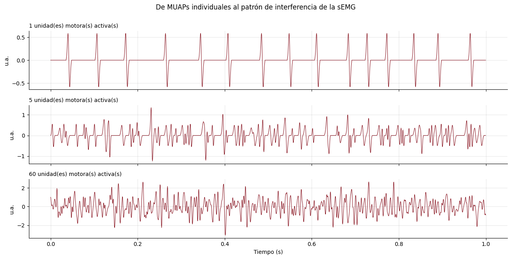

Figura 3. Simulación de la sEMG como suma de trenes de MUAP de 1, 5 y 60 unidades motoras.

</div>

Con una unidad motora cada disparo se distingue como un pico aislado y casi regular. Con cinco unidades los picos empiezan a mezclarse y con 60 ya no se reconoce ningún disparo: la señal parece ruido. Al mismo tiempo, la escala vertical crece de un panel a otro porque más unidades activas producen más amplitud. Esa amplitud y la densidad de cambios de la señal son las propiedades que después miden las características.

### 2. Registros y calidad de la adquisición

<div align="center">

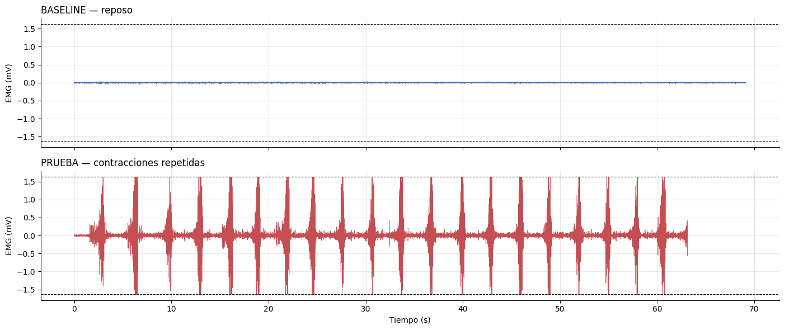

Figura 4. Registros BASELINE y PRUEBA convertidos a milivoltios. Las líneas discontinuas marcan el límite medible del sensor, ±1.632 mV.

</div>

El registro BASELINE es prácticamente una línea plana: el conversor solo varió entre 498 y 524 cuentas, unos 83 µV de pico a pico. El registro PRUEBA muestra 21 ráfagas de actividad, una cada 3 s aproximadamente, y en cada ráfaga la amplitud crece de forma progresiva hasta un máximo y luego cae con rapidez. En este registro el conversor recorrió todo su rango, de 0 a 1023, y varias ráfagas tocan las líneas que marcan el límite del sensor.

| Criterio de saturación | Muestras saturadas | Porcentaje del registro | Ventanas de 250 ms afectadas |
|---|---|---|---|
| ADC igual a 0 o 1023 | 96 | 0.152 % | 52 |
| ADC igual a 0, 1022 o 1023 | 275 | 0.435 % | 68 |

El registro de reposo no tuvo ninguna muestra saturada. En el de contracciones el valor 0 apareció 92 veces y el 1023 solo 4, pero el 1022 apareció 179 veces, frente a 4 del 1021. Esa acumulación indica que el techo práctico del conversor está en 1022 y que el criterio de 0 y 1023 subestima la saturación. Las 52 ventanas saturadas con el criterio original son todas de contracción y equivalen al 28 % de las 188 ventanas de esa clase.

<div align="center">

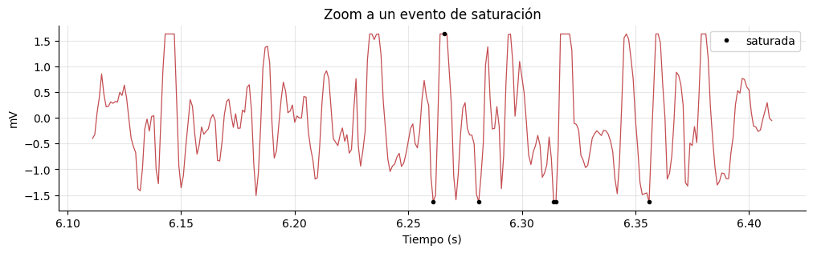

Figura 5. Detalle de un evento de saturación entre 6.1 y 6.4 s. Los puntos marcan las muestras en 0 o 1023; las mesetas superiores sin marcar corresponden al valor 1022.

</div>

En el detalle la señal llega a ±1.6 mV y se queda aplanada por instantes. En esos tramos el potencial real del músculo era mayor y simplemente no se pudo medir.

### 3. Espectro y filtrado

<div align="center">

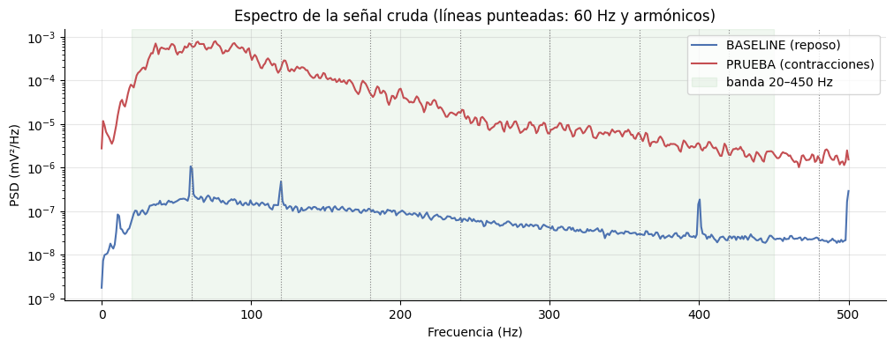

Figura 6. PSD de la señal cruda en reposo y durante las contracciones. Las líneas punteadas marcan 60 Hz y sus armónicos y la zona sombreada la banda de 20 a 450 Hz.

</div>

En el reposo la potencia es muy baja y aparecen picos angostos en 60 y 120 Hz, que corresponden a la red eléctrica y su segundo armónico, además de un pico cerca de 400 Hz que no es múltiplo de 60 Hz y cuyo origen no se puede determinar con estos datos. El espectro de la prueba está entre unas 100 y 10 000 veces por encima del reposo, es máximo por debajo de unos 100 Hz y decae de forma progresiva hacia las frecuencias altas, que es la forma típica de la sEMG. En la prueba no se ve un pico claro en 60 Hz porque la actividad muscular lo enmascara.

<div align="center">

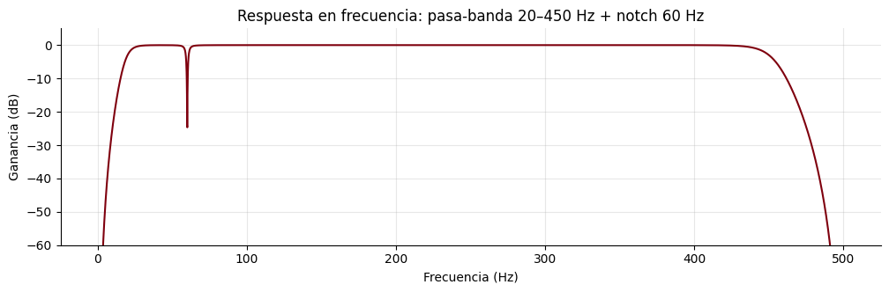

Figura 7. Respuesta en frecuencia del pasa-banda de 20 a 450 Hz combinado con el notch de 60 Hz.

</div>

La ganancia es de 0 dB entre unos 25 y 430 Hz, por lo que la banda útil pasa sin cambios. Por debajo de 20 Hz y por encima de 450 Hz la ganancia cae con rapidez, y en 60 Hz aparece la muesca angosta del notch, que no afecta a las frecuencias vecinas.

<div align="center">

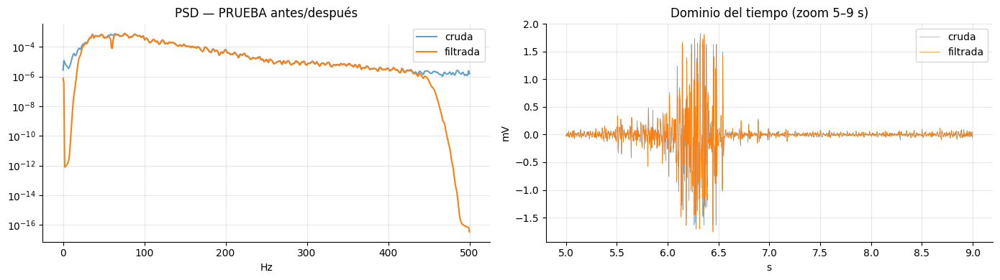

Figura 8. PSD del registro PRUEBA antes y después del filtrado y comparación de ambas señales entre 5 y 9 s.

</div>

Dentro de la banda de 20 a 450 Hz las curvas cruda y filtrada coinciden, lo que confirma que el filtro no deforma la parte útil; fuera de ella la potencia filtrada cae varios órdenes de magnitud. En el tiempo ambas señales casi se superponen, es decir, casi toda la energía ya estaba dentro de la banda útil.

| Parámetro | Resultado |
|---|---|
| Pico de 60 Hz frente a sus vecinas en el reposo | 5.6 veces en la señal cruda y 0.12 veces en la filtrada |
| Pico de 60 Hz frente a sus vecinas en la prueba | 1.2 veces en la señal cruda y 0.16 veces en la filtrada |
| Máximo espectral en los tramos de contracción | 76 Hz |
| Frecuencia mediana en los tramos de contracción | 80 Hz |
| Potencia entre 20 y 150 Hz | 88.9 % |
| Potencia entre 150 y 450 Hz | 11.1 % |
| Potencia por debajo de 50 Hz | 21.3 % |
| RMS del reposo filtrado, piso de ruido | 5.87 µV |
| RMS de la prueba filtrada | 230.21 µV |
| SNR aproximada | 31.9 dB |

Después del notch la potencia en 60 Hz quedó incluso por debajo de la de sus vecinas. La prueba tiene un RMS unas 39 veces mayor que el piso de ruido, lo que da una SNR cercana a 32 dB.

### 4. Detección de contracciones y ventaneo

Con el reposo del registro BASELINE el umbral fue de 8.9 µV y el 98.2 % de la prueba quedó marcado como contracción, lo cual es falso porque la señal muestra reposos claros entre las ráfagas. El reposo dentro de la prueba tenía más amplitud que el BASELINE; puede deberse a que el músculo no se relaja del todo entre repeticiones o a que las condiciones cambiaron entre grabaciones, y con estos datos no se puede determinar la causa. Con el reposo estimado dentro del propio registro el umbral subió a 43.2 µV, unas cinco veces el anterior, y se detectaron 21 contracciones de 1.26 ± 0.28 s.

<div align="center">

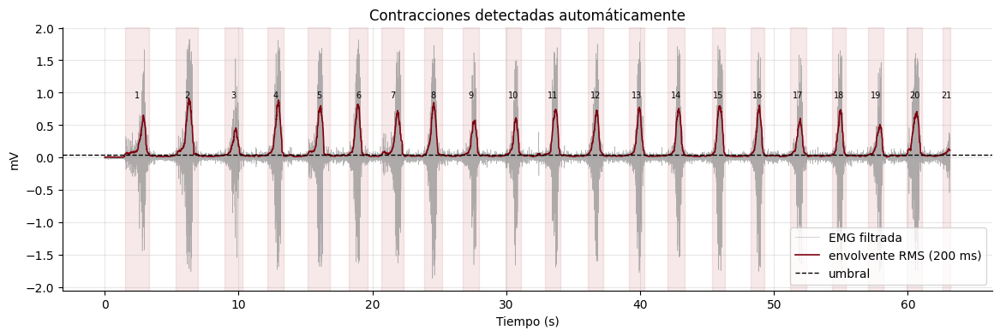

Figura 9. Señal filtrada, envolvente RMS de 200 ms y umbral calculado con el reposo del propio registro. Las franjas numeradas son las contracciones detectadas.

</div>

Cada franja numerada coincide con una ráfaga visible de la señal. La primera contracción empieza a 1.49 s, las siguientes se repiten cada 3.05 s en promedio con cerca de 1.8 s de reposo entre ellas y la última queda cortada al final del registro. Los máximos de la envolvente varían entre unos 0.4 y 0.9 mV de una contracción a otra, por lo que la intensidad no fue constante.

| Etiqueta | Ventanas de 250 ms |
|---|---|
| Reposo | 256 |
| Contracción | 188 |
| Transición | 60 |
| Total | 504 |

De las 504 ventanas, 52 contienen al menos una muestra saturada.

### 5. Características

El umbral de ruido para ZC, SSC y WAMP fue ε = 17.6 µV. Como primera prueba se calcularon las 15 características en una ventana de reposo y una de contracción: el RMS aumentó unas 11 veces, de 0.0076 a 0.0825 mV, ZC pasó de 3 a 41 y WAMP de 4 a 145, mientras que la MDF bajó de 109 a 78 Hz y la potencia entre 150 y 450 Hz pasó de 39 % a 9 %. Como son solo dos ventanas, las conclusiones se obtienen de los promedios de todas, que forman la matriz de características:

| Característica | Reposo | Contracción | Transición |
|---|---|---|---|
| MAV, mV | 0.019 | 0.210 | 0.030 |
| RMS, mV | 0.026 | 0.292 | 0.042 |
| iEMG, mV | 4.79 | 52.44 | 7.39 |
| VAR, mV² | 0.0007 | 0.1412 | 0.0020 |
| WL, mV | 2.73 | 31.24 | 4.08 |
| ZC | 15.7 | 39.3 | 23.9 |
| SSC | 19.9 | 64.4 | 35.1 |
| WAMP | 45.8 | 178.1 | 82.0 |
| Asimetría | 0.34 | 0.24 | 0.43 |
| Curtosis | 2.00 | 3.02 | 3.46 |
| MNF, Hz | 83.1 | 86.5 | 79.0 |
| MDF, Hz | 62.2 | 72.9 | 60.9 |
| Potencia de 20 a 80 Hz | 65.9 % | 58.9 % | 69.7 % |
| Potencia de 80 a 150 Hz | 22.9 % | 31.3 % | 21.4 % |
| Potencia de 150 a 450 Hz | 11.2 % | 9.8 % | 8.8 % |

Las características de amplitud aumentan unas 11 veces en contracción y las ventanas de transición quedan en valores intermedios. ZC, SSC y WAMP se multiplican entre 2.5 y 4 veces. La curtosis es positiva en ambas clases, así que ninguna es perfectamente gaussiana; en la contracción probablemente influye que la amplitud cambia dentro de cada ventana, y la mezcla de tramos de distinta amplitud produce colas más pesadas que una gaussiana. La MDF es unos 11 Hz mayor en contracción y la potencia se desplaza hacia la banda de 80 a 150 Hz, mientras que la MNF casi no cambia.

<div align="center">

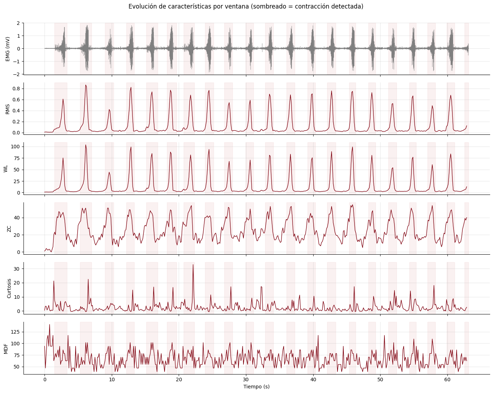

Figura 10. Evolución de RMS, WL, ZC, curtosis y MDF a lo largo del registro. El sombreado marca las contracciones detectadas.

</div>

RMS y WL presentan picos nítidos en cada contracción y valores casi nulos en reposo, por lo que son las curvas más limpias. ZC también sube en cada contracción, pero con menos contraste y una curva más irregular. La curtosis es muy ruidosa, con picos aislados que no siempre coinciden con las contracciones, y la MDF oscila entre unos 40 y 140 Hz de una ventana a otra sin una relación evidente con la actividad.

| Característica | Razón de Fisher | Característica | Razón de Fisher |
|---|---|---|---|
| SSC | 6.62 | P 80 a 150 Hz | 0.32 |
| WAMP | 6.47 | MDF | 0.24 |
| ZC | 5.21 | P 20 a 80 Hz | 0.15 |
| RMS | 1.27 | Curtosis | 0.05 |
| iEMG | 1.10 | P 150 a 450 Hz | 0.03 |
| MAV | 1.10 | MNF | 0.03 |
| WL | 1.06 | Asimetría | 0.02 |
| VAR | 0.59 | | |

<div align="center">

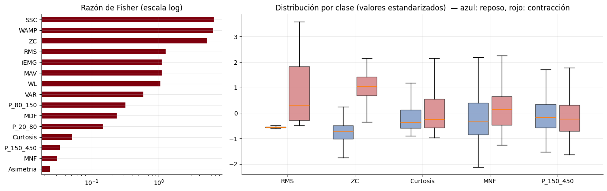

Figura 11. Razón de Fisher de las 15 características en escala logarítmica y distribución por clase de cinco características estandarizadas; azul para reposo y rojo para contracción.

</div>

SSC, WAMP y ZC fueron las características más discriminantes, seguidas por las de amplitud, mientras que MDF, curtosis, MNF y asimetría casi no separan las clases. En los diagramas de caja, RMS y ZC muestran cajas claramente desplazadas entre reposo y contracción, y en curtosis, MNF y potencia de 150 a 450 Hz las cajas se superponen. El RMS queda por debajo de ZC aunque su curva temporal se vea más limpia porque la razón de Fisher penaliza la dispersión: el RMS de la contracción tiene una desviación de 0.236 mV frente a 0.007 mV en reposo, como muestra la caja roja, mucho más alta que la azul.

| | MAV | RMS | iEMG | VAR | WL |
|---|---|---|---|---|---|
| MAV | 1.000 | 0.995 | 1.000 | 0.978 | 0.997 |
| RMS | 0.995 | 1.000 | 0.995 | 0.964 | 0.993 |
| iEMG | 1.000 | 0.995 | 1.000 | 0.978 | 0.997 |
| VAR | 0.978 | 0.964 | 0.978 | 1.000 | 0.976 |
| WL | 0.997 | 0.993 | 0.997 | 0.976 | 1.000 |

Las cinco características de amplitud tienen correlaciones de Pearson entre 0.964 y 1.000, así que miden prácticamente lo mismo. MAV e iEMG tienen correlación de 1.000 porque, con ventanas de tamaño fijo, iEMG es N veces el MAV.

| Ventanas de contracción | Número | RMS medio | Curtosis media | Asimetría media | MDF media |
|---|---|---|---|---|---|
| Sin saturación | 136 | 0.173 mV | 3.72 | 0.283 | 69.5 Hz |
| Con saturación | 52 | 0.604 mV | 1.20 | 0.121 | 82.0 Hz |

<div align="center">

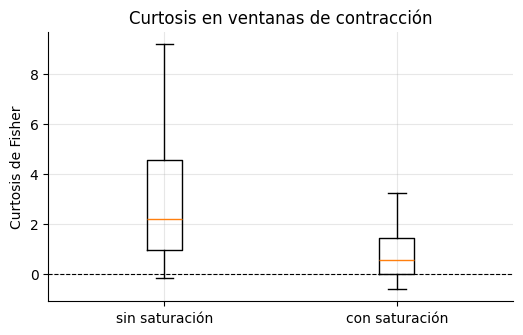

Figura 12. Curtosis de las ventanas de contracción con y sin saturación.

</div>

Las ventanas saturadas son las de contracción más intensa, con un RMS medio unas 3.5 veces mayor, y su curtosis es mucho menor, como predice la teoría: el recorte elimina los valores extremos de la distribución. Su MDF también es mayor, lo que es coherente con que el recorte crea bordes abruptos que añaden contenido de alta frecuencia; sin embargo, en estas ventanas la saturación y la mayor intensidad ocurren a la vez y con estos datos no se pueden separar ambos efectos.

### 6. Clasificación

| Modelo y características | Exactitud balanceada |
|---|---|
| LDA con las 15 características | 0.966 ± 0.023 |
| SVM con las 15 características | 0.972 ± 0.016 |
| LDA solo con RMS | 0.768 ± 0.048 |
| SVM solo con RMS | 0.960 ± 0.020 |
| LDA con el logaritmo del RMS | 0.892 ± 0.036 |
| LDA sin características de amplitud | 0.724 ± 0.047 |
| SVM sin características de amplitud | 0.737 ± 0.052 |
| Un solo umbral sobre el RMS | 0.991 ± 0.011 |

<div align="center">

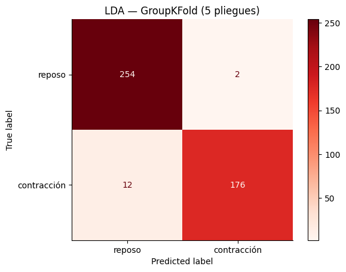

Figura 13. Matriz de confusión del LDA con las 15 características y validación GroupKFold de 5 pliegues.

</div>

El LDA con todas las características clasificó bien 254 de las 256 ventanas de reposo y 176 de las 188 de contracción, lo que equivale a una especificidad de 99.2 % y una sensibilidad de 93.6 %. Su error más frecuente fue confundir contracción con reposo. El mejor resultado lo dio un único umbral sobre el RMS, con 0.991, por encima de los dos clasificadores con las 15 características.

| Clase | RMS medio | Desviación estándar | Asimetría |
|---|---|---|---|
| Reposo | 0.026 mV | 0.007 mV | 0.14 |
| Contracción | 0.292 mV | 0.236 mV | 0.69 |

Con solo el RMS, el LDA rindió mucho peor que la SVM porque el RMS de la contracción es disperso y asimétrico, lo que contradice el supuesto de clases gaussianas con igual covarianza; al usar su logaritmo el LDA subió de 0.768 a 0.892. Sin las características de amplitud la exactitud bajó a 0.724 y 0.737, todavía por encima del azar. En la prueba de fuga de datos, la SVM sin amplitud obtuvo 0.727 con KFold aleatorio y 0.737 con GroupKFold; la diferencia, de 0.01, es mucho menor que la variación entre pliegues, que ronda 0.05, así que en este registro no se observó sobreestimación.

### 7. CNN con espectrogramas

Se obtuvieron 185 espectrogramas de 27 por 29 puntos, 106 de reposo y 79 de contracción.

<div align="center">

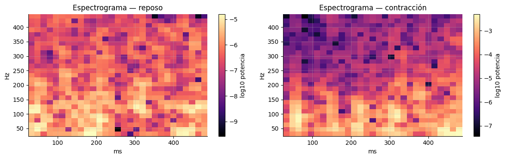

Figura 14. Espectrogramas de una ventana de reposo y una de contracción de 500 ms, en escala logarítmica de potencia.

</div>

La escala de color de la contracción llega a valores cercanos a −3, frente a −5 en el reposo, lo que en escala logarítmica equivale a unas 100 veces más potencia. Además, en la contracción la potencia se concentra en las frecuencias bajas, mientras que en el reposo está repartida de forma más uniforme.

<div align="center">

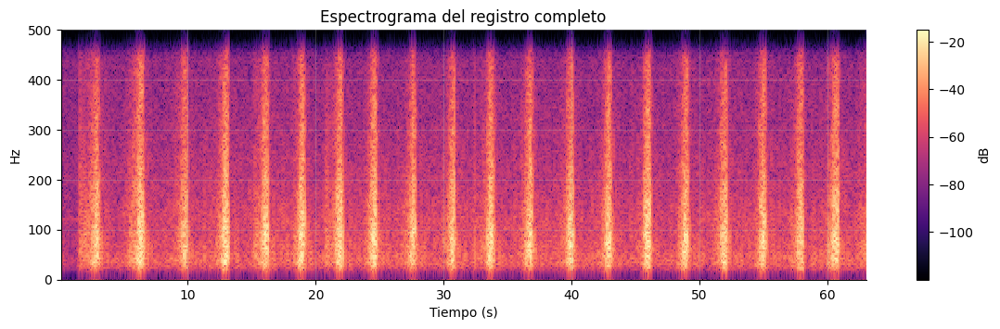

Figura 15. Espectrograma del registro PRUEBA completo.

</div>

En el espectrograma completo aparece una franja vertical brillante por cada contracción. Cada franja se extiende desde las frecuencias bajas hasta las altas, pero es más intensa por debajo de unos 150 Hz, y las zonas por debajo de 20 Hz y por encima de 450 Hz quedan oscuras por el filtrado.

| Pliegue | 1 | 2 | 3 | 4 | 5 | Promedio |
|---|---|---|---|---|---|---|
| Exactitud balanceada | 0.955 | 1.000 | 1.000 | 0.967 | 0.969 | 0.978 ± 0.019 |

<div align="center">

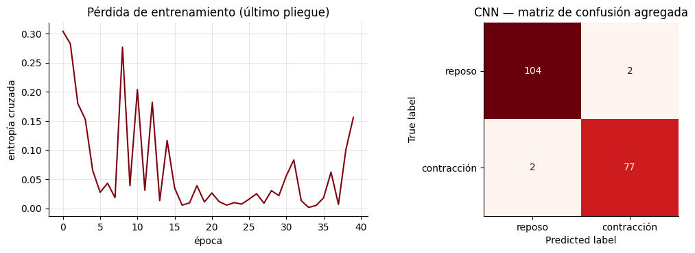

Figura 16. Pérdida de entrenamiento en el último pliegue y matriz de confusión agregada de la CNN.

</div>

Con los cinco pliegues juntos, la CNN clasificó bien 104 de 106 ventanas de reposo y 77 de 79 de contracción, con solo 4 errores en 185 imágenes. La pérdida baja con rapidez en las primeras 5 épocas, pero luego presenta saltos bruscos, de hasta 0.28 en la época 8, y vuelve a subir al final hasta cerca de 0.15. Es un entrenamiento inestable, que probablemente mejoraría con una tasa de aprendizaje menor, como 0.001, o deteniendo el entrenamiento cuando la pérdida es mínima.

<div align="center">

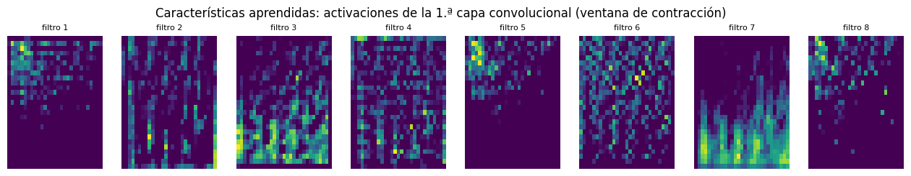

Figura 17. Activaciones de los 8 filtros de la primera capa convolucional ante una ventana de contracción. En cada recuadro las frecuencias bajas están abajo y las altas arriba.

</div>

Los filtros no responden igual: el filtro 7 se activa sobre todo en las frecuencias bajas, mientras que los filtros 1, 5 y 8 lo hacen en las altas. Cada filtro aprendió por sí solo a fijarse en una zona distinta del espectrograma. Son características aprendidas que, a diferencia del RMS o la MDF, no tienen un nombre ni una fórmula fisiológica, y esa es la pérdida de interpretabilidad del deep learning.

### 8. Síntesis de resultados

| Aspecto | Resultado |
|---|---|
| Frecuencia de muestreo y resolución | 1000 Hz y 10 bits |
| Rango y resolución del sensor | ±1.632 mV y 3.19 µV por cuenta |
| Saturación en la prueba | 0.152 % con el criterio de 0 y 1023, y 0.435 % al incluir 1022 |
| Piso de ruido y SNR | 5.87 µV y 31.9 dB |
| Energía de la contracción | 88.9 % entre 20 y 150 Hz, con frecuencia mediana de 80 Hz |
| Contracciones detectadas | 21, de 1.26 ± 0.28 s |
| Ventanas de 250 ms | 256 de reposo, 188 de contracción y 60 de transición |
| Características más discriminantes | SSC, WAMP y ZC |
| LDA y SVM con 15 características | 0.966 y 0.972 de exactitud balanceada |
| Umbral único sobre el RMS | 0.991 de exactitud balanceada |
| CNN con espectrogramas | 0.978 de exactitud balanceada |

Los resultados aplican dos de las mediciones generales que permite la sEMG: la intensidad de activación se cuantificó con el RMS y el momento de activación con el umbral sobre la envolvente.

## PREGUNTAS

### P1. Con 1 unidad motora, ¿puedes distinguir cada disparo? ¿Y con 60?

Con una unidad motora sí: cada disparo aparece como un pico aislado y separado del siguiente. Con 60 unidades no, porque los MUAP se superponen en el tiempo y forman un patrón continuo de interferencia en el que ningún disparo individual es reconocible. Con cinco unidades se observa la transición, con picos que empiezan a mezclarse.

### P2. ¿Qué mecanismo fisiológico representa pasar de 5 a 60 unidades?

Representa el reclutamiento. Para producir más fuerza el sistema nervioso activa más unidades motoras, y cada una suma sus MUAP a la señal registrada, por lo que la amplitud aumenta.

### P3. Si la señal con 60 unidades motoras parece ruido, ¿por qué sigue siendo útil? ¿Qué cambia entre las tres gráficas que sí podríamos medir?

La señal conserva información en propiedades globales que sí se pueden medir. La principal es la amplitud, que crece al pasar de 1 a 5 y a 60 unidades y que se cuantifica con el RMS. También aumenta la densidad de la señal, es decir, cuántas veces sube y baja por segundo, que se cuantifica con los cruces por cero y los cambios de pendiente. Esas propiedades son precisamente las características que se calculan sobre cada ventana.

### P4. ¿Qué porcentaje de muestras está saturado? ¿Te parece aceptable?

Con el criterio de 0 y 1023 se saturaron 96 muestras, el 0.152 % del registro; al incluir el techo práctico de 1022 la cifra sube a 275 muestras, el 0.435 %. El porcentaje parece pequeño, pero no está repartido al azar: se concentra en las contracciones más fuertes. Las 52 ventanas saturadas son todas de contracción y representan el 28 % de esa clase, así que para un análisis de amplitud o de forma de la señal no es despreciable.

### P5. ¿Qué cambiarías en la adquisición para evitarlo?

La ganancia del sensor de BITalino es fija, así que la solución está en el protocolo y en el hardware: pedir contracciones de menor intensidad, por ejemplo un porcentaje controlado de la contracción voluntaria máxima, usar un sensor o amplificador con mayor rango de entrada o revisar la colocación de los electrodos. La corrección debe hacerse antes de grabar, porque ningún filtro posterior recupera los valores perdidos.

### P6. ¿Por qué el baseline sirve como registro de ruido del sistema?

Con el músculo en reposo casi no hay actividad voluntaria, así que lo que se registra es lo que el sistema mide sin señal: ruido electrónico, interferencia de la red y ruido de la interfaz piel electrodo. En este caso el conversor solo varió entre 498 y 524 cuentas y el RMS del reposo filtrado fue de 5.87 µV, que se tomó como piso de ruido. Sin embargo, el baseline describe el ruido en las condiciones en que se grabó: se registró unos 5 minutos después de la prueba y su nivel resultó menor que el del reposo entre contracciones.

### P7. ¿Era visible el pico de 60 Hz en el espectro crudo? ¿Desapareció tras el notch?

En el baseline sí: la potencia en 60 Hz era 5.6 veces la de las frecuencias vecinas y también aparecía un pico en 120 Hz. En la prueba casi no se distinguía, con 1.2 veces, porque la actividad muscular lo enmascara. Después del notch desapareció en ambos registros, con relaciones de 0.12 y 0.16; al ser menores que 1, en 60 Hz queda incluso menos potencia que en las frecuencias vecinas, que es la muesca del filtro.

### P8. ¿En qué rango de frecuencias se concentra la energía durante la contracción? ¿Coincide con la teoría?

En los tramos de contracción el máximo espectral está en 76 Hz y la frecuencia mediana en 80 Hz. El 88.9 % de la potencia se encuentra entre 20 y 150 Hz y solo el 11.1 % entre 150 y 450 Hz. Coincide con la teoría, que ubica la energía dominante de la sEMG entre 50 y 150 Hz.

### P9. ¿Por qué no se recomienda usar un pasa-bajos de 50 Hz para limpiar la sEMG?

Porque eliminaría la mayor parte de la señal. Solo el 21.3 % de la potencia de la contracción está por debajo de 50 Hz, de modo que se perdería cerca del 79 % de la actividad muscular, incluido el máximo de 76 Hz. Además, ese filtro dejaría pasar los artefactos de movimiento, que se ubican justamente en las frecuencias bajas.

### P10. ¿Qué características quedaron arriba en el ranking de Fisher? ZC, SSC y WAMP usan el umbral ε: ¿miden solo frecuencia o también amplitud?

Quedaron arriba SSC con 6.62, WAMP con 6.47 y ZC con 5.21. Estas características también miden amplitud, porque solo cuentan un evento cuando el cambio supera ε = 17.6 µV. Si la señal crece, más cambios superan ese umbral y el conteo aumenta aunque la frecuencia real no cambie. Por eso ZC pasa de 15.7 en reposo a 39.3 en contracción y WAMP de 45.8 a 178.1; en la práctica son una mezcla de amplitud y frecuencia.

### P11. ¿Por qué RMS, MAV, iEMG y VAR obtienen rankings tan parecidos? ¿Aportan información distinta?

Porque miden prácticamente lo mismo: sus correlaciones están entre 0.964 y 1.000. MAV e iEMG tienen correlación de 1.000 porque, con ventanas de tamaño fijo, iEMG es N veces el MAV. No aportan información distinta, y en un clasificador conviene conservar una o dos, por ejemplo RMS y WL, para no agregar redundancia.

### P12. ¿Cómo cambia la curtosis en las ventanas saturadas? ¿Qué harías con esas ventanas en un estudio real?

La curtosis media de las ventanas de contracción baja de 3.72 sin saturación a 1.20 con saturación, porque el recorte elimina las colas de la distribución de amplitudes. En un estudio real esas ventanas deben marcarse y reportarse, y los resultados deben analizarse con y sin ellas. Eliminarlas sin más sesga el análisis hacia las contracciones débiles, ya que aquí son las más intensas, con un RMS medio de 0.604 mV. Lo ideal es evitar la saturación desde la adquisición.

### P13. Reposo frente a contracción es una tarea sencilla: ¿bastaría un umbral en RMS? ¿Para qué sirve entonces un vector de muchas características?

Sí. Un único umbral sobre el RMS alcanzó una exactitud balanceada de 0.991, mayor que la del LDA y la SVM con las 15 características. El vector de muchas características se vuelve necesario en tareas más difíciles, como distinguir gestos de flexión, extensión o pinza: todos implican contracción y la amplitud sola no alcanza, por lo que se necesitan características de forma y de frecuencia, normalmente de varios músculos.

### P14. Sin las características de amplitud, ¿sigue habiendo información para separar las clases? ¿Qué indica eso sobre el contenido espectral de la contracción?

Sí, aunque mucha menos: se obtuvo 0.724 con LDA y 0.737 con SVM, por encima del azar pero lejos de 0.97. El espectro de la contracción sí es distinto del reposo, con una MDF media de 72.9 Hz frente a 62.2 Hz y una potencia entre 80 y 150 Hz de 31 % frente a 23 %. Sin embargo, esas diferencias son pequeñas frente a la variabilidad entre ventanas, por eso el rendimiento es moderado.

### P15. Con solo RMS, el LDA rinde bastante peor que la SVM. ¿Qué ocurre al usar el logaritmo del RMS?

El LDA sube de 0.768 a 0.892. En reposo el RMS es estable, con media de 0.026 mV y desviación de 0.007 mV, mientras que en contracción tiene media de 0.292 mV, desviación de 0.236 mV y asimetría de 0.69. El LDA supone que ambas clases son gaussianas con la misma dispersión y por eso ubica mal su frontera. El logaritmo comprime los valores grandes y acerca los datos a ese supuesto, aunque no llega al 0.991 del umbral simple, que no supone nada sobre la forma de los datos.

### P16. ¿Hubo diferencia entre KFold aleatorio y GroupKFold? ¿Por qué siempre se debe reportar la validación por grupos o por sujetos?

En este registro no hubo diferencia apreciable: 0.727 con KFold aleatorio y 0.737 con GroupKFold, una diferencia menor que la variación entre pliegues. Aun así, la validación por grupos debe reportarse siempre porque es la única que garantiza evaluar con datos realmente nuevos: con ventanas solapadas, una división aleatoria puede poner en entrenamiento y en prueba dos ventanas que comparten la mitad de sus muestras. Con varias personas, el equivalente es dividir por sujeto para saber si el modelo funciona en alguien que nunca vio. Que aquí no apareciera la sobreestimación no garantiza que no ocurra con otros datos o características.

### P17. ¿La CNN superó al LDA con características clásicas? Considerando el costo y la interpretabilidad, ¿cuál elegirías para esta tarea?

Numéricamente un poco: la CNN obtuvo 0.978 ± 0.019, el LDA 0.966 ± 0.023 y la SVM 0.972 ± 0.016. La diferencia es menor que la variación entre pliegues y la comparación no es exacta, porque la CNN usó 185 ventanas de 500 ms y el LDA 444 ventanas de 250 ms. El dato decisivo es que un solo umbral en RMS logró 0.991 sin entrenamiento costoso y con total interpretabilidad, así que para esta tarea el umbral en RMS o el LDA son la mejor elección.

### P18. Con unas 200 imágenes de un solo sujeto, ¿qué pasaría con la CNN si se probara en otra persona?

Con estos datos no se puede medir, pero es probable que su rendimiento baje. La amplitud y el espectro de la sEMG dependen de la anatomía, del tejido adiposo y de la posición de los electrodos, que cambian entre personas, y con solo 185 imágenes la red pudo aprender detalles propios de este registro. Para comprobarlo habría que registrar a varias personas y evaluar dividiendo por sujeto.

### P19. Otra opción es una CNN 1D sobre la señal cruda de cada ventana, sin STFT. ¿Qué ventaja y qué desventaja tendría?

La ventaja es que la red aprendería directamente de la señal, sin tener que elegir el tamaño de segmento ni el solapamiento de la STFT, que imponen un compromiso entre la resolución temporal y la frecuencial. La desventaja es que tendría que descubrir por sí sola la estructura en frecuencia, lo que suele requerir más datos y más parámetros, justo lo que aquí escasea.

### P20. ¿Qué características usarías para una prótesis que debe decidir en menos de 300 ms?

Características rápidas de calcular y estables con ventanas cortas, como las de amplitud y complejidad: RMS o MAV, WL, ZC, SSC y WAMP. Se obtienen con operaciones simples sobre las muestras y, con ventanas de 250 ms, ya separaron bien las clases, con razones de Fisher entre 1.06 y 6.62. Las características espectrales necesitan estimar un espectro, lo que con pocas muestras es impreciso: con esas mismas ventanas la MDF y la MNF casi no separaron las clases, con 0.24 y 0.03, así que en ventanas más cortas serían todavía menos fiables.

### P21. ¿Cómo cambiaría el análisis con varios canales en lugar de uno?

El vector de características se calcularía en cada canal y se concatenaría; por ejemplo, 4 canales con 5 características darían 20 valores por ventana. Así se podrían distinguir gestos según qué músculos se activan y cuánto, y no solo si hay actividad. Los canales también podrían ordenarse como una imagen para una CNN, como en la HD-sEMG.

### P22. ¿Qué haría falta para que el modelo funcione en otro sujeto?

Registrar a varios sujetos, normalizar la amplitud respecto de la contracción voluntaria máxima de cada uno, estandarizar la colocación de los electrodos con SENIAM y evaluar con validación por sujeto, entrenando con unas personas y probando con otras. El umbral de reposo cambió de 8.9 a 43.2 µV entre dos registros del mismo sujeto, así que entre personas las diferencias serán mayores.

## CONCLUSIONES

La sEMG es la suma de los MUAP de muchas unidades motoras. Aunque forma un patrón de interferencia parecido al ruido, su amplitud y su contenido espectral reflejan el reclutamiento y la frecuencia de disparo, y esas propiedades globales son las que se convierten en características para que un dispositivo pueda interpretar la actividad muscular.

La calidad de la adquisición condiciona todo el análisis. El registro de contracciones alcanzó los límites del conversor en las contracciones más intensas: solo el 0.435 % de las muestras estaba saturado, pero afectó al 28 % de las ventanas de contracción y redujo su curtosis media de 3.72 a 1.20. La saturación no se corrige después, por lo que debe prevenirse con contracciones de intensidad controlada o un sensor de mayor rango.

El filtrado pasa-banda de 20 a 450 Hz con notch de 60 Hz eliminó la interferencia de la red sin deformar la banda útil, donde ya se encontraba casi toda la energía de la señal. La contracción concentró el 88.9 % de su potencia entre 20 y 150 Hz, con una frecuencia mediana de 80 Hz, y la relación señal ruido fue de unos 31.9 dB. La detección de actividad mostró, además, que la referencia de reposo debe medirse en las mismas condiciones que la señal analizada: el umbral obtenido con el registro de reposo marcó como activo el 98.2 % de la prueba, mientras que el reposo estimado dentro del propio registro permitió detectar las 21 contracciones.

Entre las características, SSC, WAMP y ZC fueron las más discriminantes porque combinan amplitud y frecuencia a través del umbral ε, mientras que MAV, RMS, iEMG, VAR y WL resultaron casi redundantes entre sí. Para separar reposo y contracción, un solo umbral sobre el RMS superó al LDA, a la SVM y a la CNN. Los vectores con muchas características y los modelos de deep learning se justifican en tareas más complejas, como reconocer varios gestos con varios canales, y en todos los casos deben evaluarse con validación por grupos o por sujeto para evitar la fuga de datos.

## REFERENCIAS

- Meza, M. Tratamiento de señal EMG. Electromiograma: análisis de la señal, detección de la actividad muscular y extracción de características. Material de clase, Introducción a Señales Biomédicas, Universidad Peruana Cayetano Heredia, 2026.
- Universidad Peruana Cayetano Heredia. Análisis de la señal EMG y extracción de características. Guía de laboratorio, Introducción a Señales Biomédicas, 2026.
- De Luca, C. J. The use of surface electromyography in biomechanics. Journal of Applied Biomechanics, volumen 13, número 2, páginas 135 a 163, 1997.
- De Luca, C. J. Surface electromyography: detection and recording. DelSys Incorporated, 2002.
- Hermens, H. J.; Freriks, B.; Disselhorst-Klug, C.; Rau, G. Development of recommendations for SEMG sensors and sensor placement procedures. Journal of Electromyography and Kinesiology, volumen 10, número 5, páginas 361 a 374, 2000.
- Besomi, M.; Devecchi, V.; Falla, D.; McGill, K.; Kiernan, M. C.; Merletti, R.; van Dieën, J. H.; Tucker, K.; Clancy, E. A.; Søgaard, K.; Hug, F.; Carson, R. G.; Perreault, E.; Gandevia, S.; Besier, T.; Rothwell, J. C.; Enoka, R. M.; Holobar, A.; Disselhorst-Klug, C.; Wrigley, T.; Lowery, M.; Farina, D.; Hodges, P. W. Consensus for experimental design in electromyography (CEDE) project: checklist for reporting and critically appraising studies using EMG (CEDE-Check). Journal of Electromyography and Kinesiology, volumen 76, artículo 102874, 2024.
- Boyer, M.; Bouyer, L.; Roy, J. S.; Campeau-Lecours, A. Reducing noise, artifacts and interference in single-channel EMG signals: a review. Sensors, volumen 23, número 6, artículo 2927, 2023.
- Chowdhury, R. H.; Reaz, M. B. I.; Ali, M. A. B. M.; Bakar, A. A. A.; Chellappan, K.; Chang, T. G. Surface electromyography signal processing and classification techniques. Sensors, volumen 13, número 9, páginas 12431 a 12466, 2013.
- Arozi, M.; Caesarendra, W.; Ariyanto, M.; Munadi, M.; Setiawan, J. D.; Glowacz, A. Pattern recognition of single-channel sEMG signal using PCA and ANN method to classify nine hand movements. Symmetry, volumen 12, número 4, artículo 541, 2020.
- Hudgins, B.; Parker, P.; Scott, R. N. A new strategy for multifunction myoelectric control. IEEE Transactions on Biomedical Engineering, volumen 40, número 1, páginas 82 a 94, 1993.
- Phinyomark, A.; Phukpattaranont, P.; Limsakul, C. Feature reduction and selection for EMG signal classification. Expert Systems with Applications, volumen 39, número 8, páginas 7420 a 7431, 2012.
- Welch, P. The use of fast Fourier transform for the estimation of power spectra: a method based on time averaging over short, modified periodograms. IEEE Transactions on Audio and Electroacoustics, volumen 15, número 2, páginas 70 a 73, 1967.
- Chapman, P.; Clinton, J.; Kerber, R.; Khabaza, T.; Reinartz, T.; Shearer, C.; Wirth, R. CRISP-DM 1.0: step-by-step data mining guide. SPSS, 2000.
- Atzori, M.; Cognolato, M.; Müller, H. Deep learning with convolutional neural networks applied to electromyography data: a resource for the classification of movements for prosthetic hands. Frontiers in Neurorobotics, volumen 10, artículo 9, 2016.
- PLUX Wireless Biosignals. BITalino (r)evolution: EMG sensor datasheet.
