# LABORATORIO 11: Tratamiento de la señal ECG, detección de latidos y extracción de características para clasificación

## INTRODUCCIÓN

Un monitor Holter, un reloj que avisa de una posible fibrilación auricular o un sistema que clasifica arritmias no leen el electrocardiograma como lo haría un cardiólogo frente al papel. Primero localizan cada latido, después lo resumen en un conjunto pequeño de números llamados características y, con ellos, un clasificador decide a qué grupo pertenece. Un latido de 600 ms registrado a 1000 Hz contiene 600 muestras muy redundantes, mientras que unas pocas medidas con significado, como la altura del pico R, el tiempo transcurrido desde el latido anterior o la posición de la onda T, bastan para describirlo. La pregunta que guía el laboratorio es si esas características permiten reconocer en qué condición fisiológica se registró cada latido.

Para responderla se siguió el flujo del artículo de Subba y Chingtham, que describe cada latido con características morfológicas, estadísticas, espectrales y wavelet y compara cinco algoritmos de aprendizaje automático. El flujo se aplicó a doce registros de ECG de un mismo participante adquiridos con BITalino en cuatro condiciones, basal, hiperventilación, hipoventilación y después de un ejercicio aeróbico, y en las tres derivaciones de Einthoven. Primero se revisaron los datos: duración, paquetes perdidos, saturación, polaridad del QRS, intervalos RR anómalos y frecuencia cardiaca. Después, con la derivación DI, se filtró la señal, se detectaron los picos R con el algoritmo de Pan y Tompkins, se recortó cada latido, se calcularon 24 características agrupadas en cinco familias y se compararon cinco clasificadores con una validación por bloques de tiempo que evita la fuga de datos.

## OBJETIVOS

- Describir el origen del ECG, sus ondas y las derivaciones de Einthoven, y relacionarlos con la forma de los latidos registrados.
- Leer los registros de BITalino, convertirlos a milivoltios y evaluar su calidad mediante los paquetes perdidos, la saturación, la polaridad y los intervalos RR anómalos.
- Calcular la frecuencia cardiaca por condición y por derivación e interpretar sus diferencias fisiológicas.
- Filtrar el ECG y detectar los picos R con el algoritmo de Pan y Tompkins.
- Segmentar los latidos y extraer características de ritmo, morfología, estadísticas básicas, estadísticas de orden superior y frecuencia.
- Comparar cinco clasificadores con una validación que evite la fuga de datos e identificar de dónde proviene la información que utilizan.

## TEORÍA

### 1. Origen de la señal ECG

El electrocardiograma registra desde la superficie del cuerpo la actividad eléctrica del corazón. Cada latido empieza en el nodo sinoauricular, ubicado en la aurícula derecha, que actúa como marcapasos natural. El impulso recorre las aurículas hasta el nodo auriculoventricular, donde se retrasa para que los ventrículos terminen de llenarse antes de contraerse, y luego avanza por el haz de His, sus ramas derecha e izquierda y las fibras de Purkinje, que activan las células ventriculares casi al mismo tiempo. Mientras la excitación se propaga, cada región activada se comporta como un dipolo eléctrico. La suma de esos dipolos forma un vector cardiaco que cambia de tamaño y de dirección durante el latido, y lo que registra cada par de electrodos es la proyección de ese vector sobre la línea que los une.

| Componente | Qué representa |
|---|---|
| Onda P | Despolarización de las aurículas; deflexión pequeña y de bajo voltaje |
| Intervalo PR | Tiempo desde el inicio de la activación auricular hasta el inicio de la ventricular, incluido el retraso del nodo auriculoventricular |
| Complejo QRS | Despolarización de los ventrículos; es la deflexión de mayor amplitud y la más rápida del latido |
| Segmento ST | Ventrículos completamente despolarizados, antes de la repolarización |
| Onda T | Repolarización de los ventrículos; es lenta y suele ser la más difícil de delimitar |
| Intervalo QT | Duración total de la despolarización y la repolarización ventricular |

En el papel milimetrado del electrocardiógrafo cada cuadro pequeño mide 1 mm y 10 mm en vertical equivalen a 1 mV. Sobre ese trazado se aplican criterios de normalidad como los siguientes:

| Hallazgo | Interpretación |
|---|---|
| Frecuencia entre 60 y 100 lpm con ritmo sinusal | Ritmo normal en reposo; por debajo de 60 lpm se habla de bradicardia y por encima de 100 lpm de taquicardia |
| Intervalo PR mayor de 0.20 s | Posible bloqueo auriculoventricular de primer grado |
| Complejo QRS mayor de 0.12 s | Posible bloqueo de rama o arritmia ventricular |
| Intervalo QT prolongado | Riesgo de torsades de pointes y de otras arritmias |
| Elevación del segmento ST | Posible infarto agudo de miocardio |

### 2. Derivaciones de Einthoven

Una derivación es la diferencia de potencial entre dos puntos del cuerpo, y cada una mira el vector cardiaco desde un ángulo distinto. Las tres derivaciones bipolares de Einthoven forman un triángulo en el plano frontal con electrodos en el brazo derecho, RA, el brazo izquierdo, LA, y la pierna izquierda, LL. Los mismos puntos pueden trasladarse al tronco, sobre ambas clavículas y la cresta ilíaca izquierda, que son zonas óseas con poca actividad muscular.

| Derivación | Diferencia que mide | Ángulo en el plano frontal |
|---|---|---|
| DI | LA − RA | 0° |
| DII | LL − RA | 60° |
| DIII | LL − LA | 120° |

Cuando el vector cardiaco apunta hacia el electrodo positivo de una derivación la deflexión es positiva, cuando apunta en sentido contrario es negativa y cuando es casi perpendicular resulta pequeña o bifásica. Por eso un mismo latido tiene una forma distinta en cada derivación, y medidas como la amplitud del pico R solo pueden compararse dentro de una misma derivación. Si las tres se registran al mismo tiempo se cumple la ley de Einthoven:

$$
\mathrm{DII}=\mathrm{DI}+\mathrm{DIII}
$$

Con BITalino las derivaciones no se registran al mismo tiempo, sino una después de otra reubicando los electrodos. Cada derivación corresponde entonces a un momento distinto de la sesión y esa relación no puede verificarse con los datos.

### 3. Adquisición con BITalino

El sensor de ECG de BITalino tiene tres cables: el electrodo positivo, IN+, el negativo, IN−, y la referencia, REF. Incluye un amplificador diferencial con ganancia de 1100, una razón de rechazo en modo común de 86 dB y un ancho de banda analógico de 0.5 a 40 Hz. La placa digitaliza la señal con un conversor de 10 bits y la envía por Bluetooth a OpenSignals, que la guarda en un archivo de texto. Las cuentas del conversor se convierten a milivoltios con la función de transferencia del sensor:

$$
\mathrm{ECG}_{mV}=\frac{\left(\frac{ADC}{2^{n}}-\frac{1}{2}\right)V_{CC}}{G_{ECG}}\times 1000,\qquad V_{CC}=3.3\ \mathrm{V},\quad G_{ECG}=1100,\quad n=10
$$

El rango medible resulta de ±1.5 mV y cada cuenta equivale a 2.93 µV. Con una frecuencia de muestreo de 1000 Hz la frecuencia de Nyquist es de 500 Hz, muy por encima de la banda del sensor. El archivo guarda además el contador nSeq, que avanza de 0 a 15 y vuelve a empezar; un salto distinto de 1 indica que se perdieron muestras en la transmisión. Cuando el potencial supera el rango del sensor el conversor se queda fijo en sus valores extremos y la señal se satura. En la práctica el conversor de BITalino se queda en 1022 cuentas, por lo que se consideran saturadas las muestras iguales a 0 o mayores o iguales a 1022.

### 4. Ruido y filtrado

| Problema | Origen | Frecuencia | Tratamiento |
|---|---|---|---|
| Deriva de la línea base | Respiración y movimiento del tórax y de los electrodos | Menos de 0.5 Hz | Pasa-altos de 0.5 Hz |
| Interferencia de la red eléctrica | Instalación eléctrica, 60 Hz en Perú | 60 Hz | Filtro notch de 60 Hz |
| Ruido muscular y electrónico | Músculos cercanos y electrónica del equipo | Principalmente por encima de 40 Hz | Pasa-bajos de 40 Hz |
| Artefactos de movimiento | Cambios bruscos en la interfaz piel electrodo | Se superponen con la banda del ECG | Buena fijación de electrodos y cables; ningún filtro los elimina por completo |

El laboratorio usa un pasa-banda Butterworth de 0.5 a 40 Hz y un notch de 60 Hz aplicados hacia adelante y hacia atrás, es decir, con filtrado de fase cero. Así las ondas no se desplazan en el tiempo, lo que es indispensable cuando después se mide dónde está el pico R o cuánto tarda en llegar la onda T. La banda de 0.5 a 40 Hz es la habitual en monitoreo: conserva la forma de P, QRS y T y basta para detectar los latidos y medir el ritmo. Para el ECG diagnóstico de adultos la American Heart Association recomienda conservar hasta 150 Hz, porque un corte superior más bajo reduce la amplitud y la agudeza del QRS, y un corte inferior de 0.05 Hz, o de hasta 0.67 Hz cuando el filtro digital es de fase cero, para no deformar el segmento ST.

Para comparar la señal antes y después de filtrar se usa la densidad espectral de potencia, PSD, estimada con el método de Welch: la señal se divide en segmentos solapados, cada segmento se multiplica por una ventana, se calcula su periodograma y se promedian todos los periodogramas.

### 5. Detección del QRS: algoritmo de Pan y Tompkins

Para analizar latidos primero hay que encontrarlos, y el punto más fácil de localizar es el pico R, el más alto y rápido del latido. El algoritmo de Pan y Tompkins, publicado en 1985, es el detector de QRS más conocido. Su idea es resaltar lo que hace único al QRS, cambios muy rápidos y grandes, y atenuar las ondas P y T, que son lentas.

| Paso | Operación | Propósito |
|---|---|---|
| 1 | Pasa-banda de 5 a 15 Hz | Conserva la banda donde se concentra la energía del QRS y atenúa P, T y la deriva |
| 2 | Derivada | Resalta las pendientes, que en el QRS son las más empinadas del latido |
| 3 | Cuadrado | Vuelve positivos todos los valores y agranda más las pendientes grandes que las pequeñas |
| 4 | Integración en una ventana móvil de 150 ms | Convierte cada QRS en una sola joroba suave, de ancho parecido al del complejo |
| 5 | Umbral y periodo refractario de 250 ms | Cada joroba que supera el umbral es un latido, y no se aceptan dos latidos separados por menos de 250 ms, que equivaldría a más de 240 lpm |
| 6 | Ubicación del pico R | Se busca el máximo del ECG filtrado dentro de ±100 ms de cada joroba |

$$
y[n]=\frac{1}{W}\sum_{k=-W/2}^{W/2}\left(\frac{d\,x_{5\text{-}15}}{dt}[n-k]\right)^{2},\qquad W=150\ \mathrm{ms},\qquad \mathrm{umbral}=0.3\,P_{99}(y)
$$

donde $x_{5\text{-}15}$ es el ECG filtrado entre 5 y 15 Hz y $P_{99}$ el percentil 99 de la señal integrada. El algoritmo original usa umbrales adaptativos, que se actualizan con los niveles de señal y de ruido, y una búsqueda hacia atrás para recuperar latidos perdidos; la versión del laboratorio es una simplificación con un umbral fijo para todo el registro.

### 6. Frecuencia cardiaca, intervalos RR y control de calidad

El intervalo RR es el tiempo entre dos picos R consecutivos, y la frecuencia cardiaca instantánea, en latidos por minuto, es FC = 60/RR. La gráfica de la FC latido a latido en función del tiempo se llama tacograma. La FC no es constante, porque el sistema nervioso autónomo la ajusta de forma continua, y cada maniobra del laboratorio la modifica de una manera esperable:

| Condición | Efecto esperado sobre el ECG |
|---|---|
| Basal | FC de reposo con pequeñas oscilaciones ligadas a la respiración: aumenta al inspirar y disminuye al espirar, lo que se conoce como arritmia sinusal respiratoria |
| Hiperventilación | Las respiraciones profundas y repetidas amplifican esas oscilaciones y tienden a aumentar la FC |
| Hipoventilación | Al retener la respiración la FC tiende a disminuir por la activación del nervio vago, como parte de la respuesta a la apnea; si la retención empieza con una inspiración profunda, el aire en los pulmones también puede modificar la amplitud del QRS |
| Aeróbica | FC elevada por la demanda metabólica y la activación simpática, que disminuye de forma progresiva durante la recuperación |

La repolarización ventricular también depende de la FC: cuando el corazón late más rápido, el intervalo QT y la distancia entre el pico R y la onda T se acortan. Por eso el QT suele corregirse con la fórmula de Bazett:

$$
QT_c=\frac{QT}{\sqrt{RR}}
$$

Los intervalos RR también sirven como control de calidad. Un RR que se aleja más de 35 % de la mediana de sus vecinos se considera anómalo, porque suele indicar un artefacto contado como latido o un latido que no se detectó:

$$
\left|RR_k-\widetilde{RR}_k\right|>0.35\,\widetilde{RR}_k
$$

donde $\widetilde{RR}_k$ es la mediana de los 9 intervalos centrados en $RR_k$. La polaridad se revisa con la asimetría de la señal filtrada. Un ECG con el QRS hacia arriba tiene picos positivos aislados y asimetría positiva; si la asimetría es negativa, la señal se invierte para que el pico principal quede positivo. Con la saturación y los RR anómalos cada archivo se clasifica con un semáforo de calidad:

| Estado | Criterio |
|---|---|
| Bueno | Sin saturación y sin RR anómalos |
| Revisar | Algunos RR anómalos, menos de 10 % |
| Problemático | Saturación o 10 % o más de RR anómalos |

### 7. Segmentación en latidos

Una vez ubicado cada pico R se recorta una ventana desde 200 ms antes hasta 400 ms después de él. A 1000 Hz cada latido queda como un vector de 600 muestras con el pico R en la muestra 200, y la ventana incluye la onda P antes del pico R y el final del QRS y la onda T después. Se descartan el primer y el último latido, que no tienen un RR a ambos lados, y los latidos con un RR anómalo antes o después. Cada latido válido es una fila de la tabla de datos.

### 8. Extracción de características

Una característica es un número que resume una propiedad útil de la señal. El laboratorio describe cada latido con cinco familias de características, 24 en total:

| Familia | Qué describe | Características |
|---|---|---|
| Ritmo | Cuándo llegó el latido | RR previo, RR siguiente y FC instantánea, calculada con el RR previo |
| Morfología | Qué forma tiene | Amplitudes de P, Q, R, S y T, duración de Q a S y tiempo del pico R a la onda T |
| Estadísticas básicas | Cómo se reparten sus valores | Media, mediana, desviación estándar y percentiles 25 y 75 |
| Orden superior, HOS | Si es simétrico y si tiene picos aislados | Asimetría y curtosis |
| Frecuencia | De qué frecuencias está hecho | Con la FFT, frecuencia dominante, potencia de 0.5 a 40 Hz y fracción de 5 a 15 Hz; con la wavelet, energía relativa de 4 niveles |

Las medidas morfológicas se toman directamente sobre la forma del latido, como si se usara una regla sobre el papel del electrocardiógrafo. Todas las amplitudes se miden respecto de la línea isoeléctrica, estimada en el segmento PR:

| Medida | Ventana de búsqueda respecto del pico R |
|---|---|
| Línea isoeléctrica | Promedio entre −100 y −60 ms |
| Amplitud P | Máximo entre −200 y −80 ms |
| Amplitud Q | Mínimo entre −60 y 0 ms |
| Amplitud R | Valor en el pico R |
| Amplitud S | Mínimo entre 0 y 80 ms |
| Duración de Q a S | Tiempo entre los puntos Q y S, que aproxima la duración del QRS |
| Amplitud T y tiempo de R a T | Máximo entre 150 y 400 ms y su distancia al pico R |

Son aproximaciones con ventanas fijas; los programas clínicos usan algoritmos de delineación que buscan el inicio y el final de cada onda. En el artículo base los picos R se detectan con la función indexes de la librería peakutils y la ventana típica también va de 200 ms antes a 400 ms después del pico R.

Las estadísticas básicas tratan las 600 muestras del latido como un conjunto de valores. La asimetría y la curtosis son los momentos centrados de tercer y cuarto orden:

$$
\text{asimetría}=\frac{E\left[(x-\mu)^3\right]}{\sigma^3}\qquad\qquad \text{curtosis}=\frac{E\left[(x-\mu)^4\right]}{\sigma^4}-3
$$

La curtosis en exceso vale cero para una distribución gaussiana. Un latido con un pico R alto y estrecho sobre una línea casi plana tiene asimetría positiva y curtosis alta. Estas estadísticas de orden superior capturan información no lineal de la forma y ayudan a separar latidos de morfología parecida.

Las características espectrales se calculan con la FFT de cada latido sin su media y multiplicado por una ventana de Hann $w[n]$:

$$
P[k]=\left|\sum_{n=0}^{N-1}\left(x[n]-\bar{x}\right)w[n]\,e^{-j2\pi kn/N}\right|^{2},\qquad N=1024
$$

La frecuencia dominante es la de mayor potencia entre 0.5 y 40 Hz, la potencia en banda es la suma de $P[k]$ en ese rango dividida entre la frecuencia de muestreo y la fracción de 5 a 15 Hz indica qué parte de esa potencia pertenece a la banda del QRS, la misma del primer paso de Pan y Tompkins.

La FFT indica qué frecuencias tiene el latido, pero no en qué parte del latido aparecen. La transformada wavelet discreta, DWT, pasa la señal por un filtro pasa-bajos y uno pasa-altos y reduce a la mitad el número de muestras. La salida del pasa-altos forma los coeficientes de detalle de ese nivel, y la del pasa-bajos, la aproximación, se vuelve a descomponer. Cada nivel cubre la mitad de la banda del anterior y conserva la ubicación temporal, como un ecualizador que separa el latido en capas. Con la wavelet Daubechies 4, db4, cuya forma recuerda a un QRS, y 6 niveles a 1000 Hz:

| Nivel | Banda aproximada | Contenido |
|---|---|---|
| cA6, aproximación | 0 a 7.8 Hz | Ondas lentas, P y T |
| cD6 | 7.8 a 15.6 Hz | Parte principal del QRS |
| cD5 | 15.6 a 31 Hz | Bordes rápidos del QRS |
| cD4 | 31 a 62.5 Hz | Muy poca energía, porque la señal se filtró en 40 Hz |
| cD3 a cD1 | Más de 62.5 Hz | Prácticamente vacíos; no se usan |

La característica de cada nivel es su energía relativa, es decir, la fracción de la energía total del latido que queda en ese nivel:

$$
E_j=\frac{\sum_k c_j[k]^2}{\sum_i\sum_k c_i[k]^2}
$$

En el artículo base la wavelet también se usa en el preprocesamiento, con las familias bior4.4 y db4, para eliminar ruido y la deriva de la línea base, y sus coeficientes de detalle se emplean como características.

### 9. Clasificación

La cadena completa de un sistema de este tipo empieza con el acondicionamiento de la señal, formado por el transductor y el preamplificador, sigue con el filtrado analógico, la amplificación, la conversión analógica digital y el filtrado digital, y termina con la extracción de características, por ejemplo con wavelets, y el clasificador de machine learning. Estas dos últimas etapas siguen la metodología CRISP-DM, un ciclo iterativo con seis fases: comprensión del problema, comprensión de los datos, preparación de los datos, modelado, evaluación y despliegue.

El resultado de la extracción es una tabla de datos: cada fila es un latido, cada columna una característica y una columna adicional, el objetivo, indica la clase que el modelo debe aprender. En el espacio de características cada latido es un punto, y si las clases forman grupos separados un clasificador puede trazar fronteras entre ellos. En este laboratorio se compararon los cinco algoritmos del artículo base:

| Algoritmo | Idea | Configuración |
|---|---|---|
| Árbol de decisión | Hace preguntas de sí o no sobre una característica a la vez hasta decidir | Profundidad máxima de 5 |
| Regresión logística | Combina las características con pesos y calcula la probabilidad de cada clase | Hasta 3000 iteraciones |
| Random Forest | Entrena muchos árboles con muestras y características elegidas al azar y decide por votación | 200 árboles |
| KNN | Asigna la clase mayoritaria de los k latidos conocidos más parecidos | k = 5 |
| SVM | Busca la frontera que deja el mayor margen entre las clases; con kernel RBF la frontera puede ser curva | Kernel RBF |

Antes de cada modelo las características se estandarizan con z-score, ajustado solo con los datos de entrenamiento dentro de un pipeline, para que las que tienen valores grandes, como el RR en milisegundos, no dominen a las pequeñas, como las energías relativas.

Un modelo se evalúa con datos que no vio al entrenar, pero los latidos consecutivos de un mismo registro son casi idénticos. Si los latidos se mezclan al azar, el modelo se entrena con un latido y se evalúa con el siguiente, que es casi una copia, y su desempeño se sobreestima. Esa fuga de datos se evita agrupando los latidos en bloques de 10 s y enviando cada bloque completo a entrenamiento o a prueba con StratifiedGroupKFold, que además procura que cada pliegue tenga todas las clases.

El desempeño se mide con la exactitud y con el F1 macro, que da el mismo peso a cada clase aunque una tenga más latidos que las demás. Con K clases, adivinar al azar da 1/K, es decir, 0.25 con cuatro condiciones:

$$
\text{exactitud}=\frac{\text{latidos bien clasificados}}{\text{total de latidos}}\qquad\qquad
F1_k=\frac{2\,P_k\,S_k}{P_k+S_k}\qquad\qquad
F1_{macro}=\frac{1}{K}\sum_{k=1}^{K}F1_k
$$

donde $P_k$ es la precisión de la clase k, la fracción de latidos asignados a k que realmente son de k, y $S_k$ su sensibilidad, la fracción de latidos de k que el modelo reconoció.

### 10. Deep learning

En el enfoque clásico el analista decide qué medir a partir del conocimiento fisiológico; en deep learning la red aprende sus propias características a partir de los datos. Para usar redes convolucionales, que son eficaces con imágenes, el ECG se transforma en una representación de tiempo y frecuencia: el espectrograma de la transformada de Fourier de tiempo corto, STFT, o el escalograma de la transformada wavelet continua, CWT. En esas imágenes ritmos como la fibrilación auricular, la taquicardia supraventricular, la bradicardia sinusal y el ritmo sinusal producen patrones distintos que la red puede aprender.

| Enfoque | Entrada | Idea | Ejemplo |
|---|---|---|---|
| CNN 2D | Espectrograma de la STFT | Trata la representación de tiempo y frecuencia como una imagen y aprende sus propios filtros | Cinco tipos de latido de la base MIT-BIH clasificados con 99.00 % de exactitud |
| CNN preentrenadas | Espectrograma, espectrograma logarítmico, espectrograma de Mel, MFCC y escalograma | Redes como VGGNet, ResNet, Xception o DenseNet, ya entrenadas con muchas imágenes, se ajustan a la nueva tarea | Identificación de personas por su ECG |
| CNN bimodal | Imagen del trazado y escalograma de la CWT | Combina dos representaciones del mismo registro | Clasificación de enfermedades cardiovasculares |
| LSTM | Secuencia de muestras o de características codificadas | Red recurrente con memoria, adecuada para series temporales | Arritmias clasificadas con características de un autoencoder convolucional y más de 99 % de exactitud |
| Datos sintéticos | Modelos matemáticos, transformaciones o modelos generativos | Generan ECG artificiales para ampliar bases de datos pequeñas o desbalanceadas | Sumas de gaussianas por onda, ruido añadido, deformación temporal, autoencoders variacionales, GAN y modelos de difusión |

En los modelos matemáticos de suma de gaussianas, como el modelo dinámico de McSharry y colaboradores, cada onda P, Q, R, S y T se define por su posición, su amplitud y su ancho, de modo que cambiar esos parámetros produce latidos artificiales con distintas morfologías.

## METODOLOGÍA

### 11. Registros y montaje

La tabla resume el montaje y los parámetros de adquisición de los doce registros.

| Parámetro | Valor |
|---|---|
| Equipo | BITalino (r)evolution, canal analógico A2 |
| Sensor | ECG; la cabecera de los archivos lo identifica como EGGBIT |
| Software | OpenSignals (r)evolution, exportación en archivo de texto |
| Frecuencia de muestreo | 1000 Hz |
| Resolución del conversor | 10 bits |
| Ganancia del sensor | 1100 |
| Electrodos | Ag/AgCl en la clavícula u hombro derecho, RA, la clavícula u hombro izquierdo, LA, y la cresta ilíaca izquierda, LL |
| Registros | 12 archivos, 4 condiciones por 3 derivaciones, de un mismo participante |
| Sesión | 11 de setiembre de 2026, entre las 11:53 y las 12:23 |

| Condición | Qué hizo el participante | Duración de los registros |
|---|---|---|
| Basal | Reposo con respiración normal | 30.4 a 31.9 s |
| Hiperventilación | Ciclos repetidos de inhalar, mantener y exhalar | 30.8 a 31.1 s |
| Hipoventilación | Retener la respiración el mayor tiempo posible | 31.8 a 42.9 s |
| Aeróbica | Registro inmediatamente después de unos 3 minutos de ejercicio | 31.6 a 35.2 s |

Las condiciones se registraron en el orden basal, hiperventilación, hipoventilación y aeróbica. Dentro de cada condición las tres derivaciones se grabaron una después de otra, con entre 1.3 y 2.4 minutos de diferencia, reubicando los cables del sensor sobre los tres puntos de medición.

### 12. Procesamiento

El procesamiento se realizó en Python sobre Google Colab con NumPy, pandas, SciPy, Matplotlib, PyWavelets y scikit-learn. La Figura 1 resume el flujo: en la Parte A se revisaron los doce registros para conocer su calidad y elegir una derivación, y en la Parte B se recorrió el camino del artículo base con esa derivación.

<div align="center">

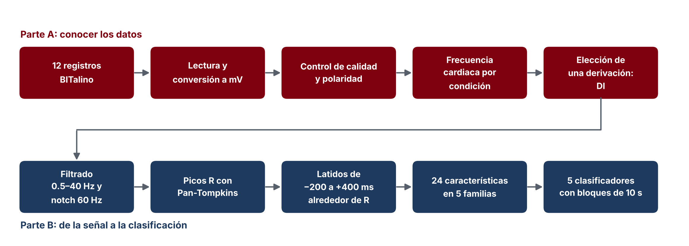

Figura 1. Flujo de procesamiento del laboratorio.

</div>

#### Lectura y conversión a milivoltios

El archivo de OpenSignals tiene una cabecera con los metadatos en formato JSON y las columnas nSeq, I1, I2, O1, O2 y A2. La función de lectura toma la frecuencia de muestreo, la resolución y el canal de la propia cabecera. Como el nombre del sensor, EGGBIT, no contiene la palabra ECG, el canal se tomó como el primer canal analógico registrado, A2. En la misma lectura se contaron los saltos de nSeq y las muestras saturadas.

```python
def leer_ecg(ruta):
    with open(ruta, "r", encoding="utf-8", errors="ignore") as f:
        cabecera = [f.readline() for _ in range(3)]
    meta = list(json.loads(cabecera[1].lstrip("# ").strip()).values())[0]
    sensores, etiquetas = meta.get("sensor", []), meta.get("label", [])
    canal = next((e for s, e in zip(sensores, etiquetas) if "ECG" in s.upper()), etiquetas[0])
    idx = meta["column"].index(canal)
    n_bits = meta["resolution"][idx]
    datos = pd.read_csv(ruta, sep=r"\s+", comment="#", header=None).iloc[:, :len(meta["column"])]
    adc, nseq = datos.iloc[:, idx].to_numpy(dtype=float), datos.iloc[:, 0].to_numpy(dtype=int)
    return {"ecg_mV": ((adc / 2**n_bits) - 0.5) * 3.3 / 1100 * 1000,
            "fs": int(meta["sampling rate"]), "hora": meta.get("time", "-"),
            "perdidos": int(np.sum((np.diff(nseq) % 16) != 1)),
            "saturadas": int(np.sum((adc <= 0) | (adc >= 2**n_bits - 2)))}
```

#### Filtrado

```python
def filtrar_ecg(x, fs=1000):
    sos = signal.butter(3, [0.5, 40], btype="bandpass", fs=fs, output="sos")
    y = signal.sosfiltfilt(sos, x - np.mean(x))      # pasa-banda de fase cero
    b, a = signal.iirnotch(60, 30, fs=fs)
    return signal.filtfilt(b, a, y)                   # notch de 60 Hz con Q = 30
```

La PSD se estimó con el método de Welch con segmentos de 4096 muestras, antes y después de filtrar. Para cuantificar la interferencia de la red se dividió la potencia en 60 Hz entre la mediana de la potencia de las frecuencias ubicadas entre 3 y 10 Hz a cada lado.

#### Detección de picos R y control de calidad

```python
def detectar_picos_R(ecg, fs=1000, factor_umbral=0.3):
    sos = signal.butter(2, [5, 15], btype="bandpass", fs=fs, output="sos")
    paso1 = signal.sosfiltfilt(sos, ecg)                       # 1. pasa-banda de 5 a 15 Hz
    paso2 = np.gradient(paso1) * fs                            # 2. derivada
    paso3 = paso2**2                                           # 3. cuadrado
    w = int(0.150 * fs)
    paso4 = np.convolve(paso3, np.ones(w) / w, mode="same")    # 4. integración de 150 ms
    umbral = factor_umbral * np.percentile(paso4, 99)          # 5. umbral y refractario de 250 ms
    jorobas, _ = signal.find_peaks(paso4, height=umbral, distance=int(0.25 * fs))
    v = int(0.1 * fs)                                          # 6. máximo del ECG a ±100 ms
    return np.unique([max(0, j - v) + np.argmax(ecg[max(0, j - v): j + v]) for j in jorobas])

def rr_anomalos(picos, fs=1000, tolerancia=0.35):
    rr = np.diff(picos) / fs
    mediana_local = pd.Series(rr).rolling(9, center=True, min_periods=1).median().to_numpy()
    return rr, np.abs(rr - mediana_local) > tolerancia * mediana_local

y = filtrar_ecg(registro["ecg_mV"])
invertida = skew(y) < 0                  # QRS negativo: se invierte la señal
ecg = -y if invertida else y
```

Los doce archivos pasaron por este proceso y para cada uno se registraron los latidos detectados, los latidos válidos, el porcentaje de RR anómalos y el estado del semáforo. La FC media se calculó como 60 dividido entre el promedio de los RR no anómalos, y la FC al inicio y al final con los primeros y los últimos cinco RR no anómalos. Con esos resultados se eligió la derivación DI para la Parte B, en la que ninguna condición necesitó inversión.

#### Segmentación

```python
ANTES, DESPUES = int(0.200 * FS), int(0.400 * FS)      # 200 ms antes y 400 ms después del pico R
validos = [k for k in range(1, len(picos) - 1)
           if picos[k] - ANTES >= 0 and picos[k] + DESPUES <= len(ecg)
           and not anomalo[k - 1] and not anomalo[k]]
latidos = np.array([ecg[picos[k] - ANTES: picos[k] + DESPUES] for k in validos])
```

#### Extracción de características

```python
ms = lambda v: int(round(v * FS / 1000))     # milisegundos a muestras
i0 = ANTES                                    # posición del pico R dentro del latido

def caracteristicas_ritmo_morfologia(lat, rr_prev, rr_next):
    iso = np.mean(lat[i0 - ms(100): i0 - ms(60)])               # línea isoeléctrica en el segmento PR
    x = lat - iso
    iQ = i0 - ms(60) + np.argmin(x[i0 - ms(60): i0])
    iS = i0 + np.argmin(x[i0: i0 + ms(80)])
    iT = i0 + ms(150) + np.argmax(x[i0 + ms(150): i0 + ms(400)])
    return {"RR_prev_ms": rr_prev * 1000, "RR_next_ms": rr_next * 1000, "FC_lpm": 60 / rr_prev,
            "amp_P": np.max(x[i0 - ms(200): i0 - ms(80)]), "amp_Q": x[iQ], "amp_R": x[i0],
            "amp_S": x[iS], "amp_T": x[iT],
            "dur_QS_ms": (iS - iQ) / FS * 1000, "t_RT_ms": (iT - i0) / FS * 1000}

def caracteristicas_estadisticas(lat):
    return {"media": np.mean(lat), "mediana": np.median(lat), "desv_est": np.std(lat),
            "p25": np.percentile(lat, 25), "p75": np.percentile(lat, 75),
            "asimetria": skew(lat), "curtosis": kurtosis(lat)}

def caracteristicas_espectrales(lat, fs=FS, nfft=1024):
    x = (lat - np.mean(lat)) * np.hanning(len(lat))
    f = np.fft.rfftfreq(nfft, 1 / fs)
    P = np.abs(np.fft.rfft(x, nfft))**2
    banda = (f >= 0.5) & (f <= 40)
    return {"f_dominante_Hz": f[banda][np.argmax(P[banda])],
            "potencia_0.5_40": P[banda].sum() / fs,
            "frac_5_15Hz": P[(f >= 5) & (f <= 15)].sum() / P[banda].sum()}

def caracteristicas_wavelet(lat, wavelet="db4", nivel=6):
    coef = pywt.wavedec(lat - np.mean(lat), wavelet, level=nivel)    # [cA6, cD6, cD5, cD4, cD3, cD2, cD1]
    E = np.array([np.sum(c**2) for c in coef]); E = E / E.sum()
    return {"wav_E_cA6": E[0], "wav_E_cD6": E[1], "wav_E_cD5": E[2], "wav_E_cD4": E[3]}
```

Con todos los latidos válidos se construyó una tabla de 163 filas por 24 características, a la que se añadieron la clase, el archivo y el instante del pico R, y que se exportó como caracteristicas_ecg.csv. Para comparar las condiciones se calcularon los promedios por clase y diagramas de caja de ocho características estandarizadas.

#### Clasificación

```python
MODELOS = {
    "Árbol de Decisión":   lambda: DecisionTreeClassifier(max_depth=5, random_state=0),
    "Regresión Logística": lambda: LogisticRegression(max_iter=3000),
    "Random Forest":       lambda: RandomForestClassifier(n_estimators=200, random_state=0),
    "KNN (k=5)":           lambda: KNeighborsClassifier(n_neighbors=5),
    "SVM (RBF)":           lambda: SVC(kernel="rbf"),
}
nuevo_modelo = lambda nombre: make_pipeline(StandardScaler(), MODELOS[nombre]())

grupos = (tabla["archivo"] + "_b" + (tabla["t_R"] // 10).astype(int).astype(str)).to_numpy()   # bloques de 10 s
cv = StratifiedGroupKFold(n_splits=3, shuffle=True, random_state=0)
for nombre in MODELOS:
    s = cross_validate(nuevo_modelo(nombre), tabla[CARACTERISTICAS], tabla["clase"],
                       cv=cv, groups=grupos, scoring=["accuracy", "f1_macro"])
```

Los latidos de cada archivo se agruparon en bloques de 10 s según el instante de su pico R. El número de pliegues se fijó en el número de bloques de la condición con menos bloques, que fue hiperventilación con 3. Para el modelo con mejor F1 se calculó la matriz de confusión con las predicciones de los tres pliegues, y la importancia de cada característica se obtuvo de un Random Forest entrenado con todos los latidos. Después se repitió la comparación con solo las tres características de ritmo y con solo las 21 restantes, que describen la forma del latido. Por último, para medir el efecto de la fuga de datos, el Random Forest con solo características de forma se evaluó también con StratifiedKFold de 3 pliegues, que mezcla los latidos al azar.

## RESULTADOS

### 1. Registros y calidad de la adquisición

Los doce archivos tienen una frecuencia de muestreo de 1000 Hz y una resolución de 10 bits, y ninguno presentó paquetes perdidos.

<div align="center">

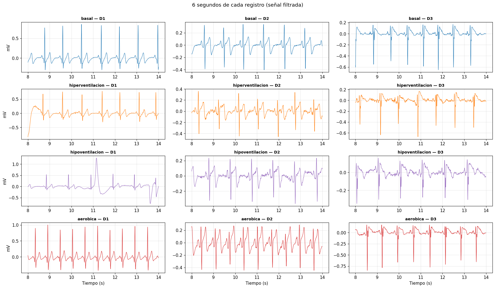

Figura 2. Seis segundos de cada registro filtrado. Las filas son las condiciones y las columnas las derivaciones.

</div>

En DI el QRS apunta hacia arriba en las cuatro condiciones, con un pico R alto y una onda S pequeña. En DII el complejo es bifásico, con un pico R de 0.2 a 0.36 mV seguido de una onda S algo más profunda, de −0.27 a −0.45 mV, y en DIII es predominantemente negativo, con deflexiones de −0.2 a −0.85 mV. Los latidos están más juntos en aeróbica y más separados en hipoventilación. En hipoventilación DI aparece una onda lenta de 1.25 mV cerca de 11.2 s y una deflexión negativa de −0.75 mV cerca de 13.6 s que no son latidos, y en hiperventilación DI una deflexión lenta de −0.8 mV al inicio de la ventana mostrada, cerca de 8 s.

| Condición | Derivación | Duración, s | Saturadas | QRS original | Detectados | Válidos | RR anómalos | Estado |
|---|---|---|---|---|---|---|---|---|
| Basal | DI | 31.6 | 0 | Positivo | 37 | 35 | 0.0 % | Bueno |
| Basal | DII | 30.4 | 0 | Negativo | 33 | 31 | 0.0 % | Bueno |
| Basal | DIII | 31.9 | 0 | Negativo | 37 | 35 | 0.0 % | Bueno |
| Hiperventilación | DI | 30.9 | 0 | Positivo | 38 | 36 | 0.0 % | Bueno |
| Hiperventilación | DII | 31.1 | 0 | Negativo | 40 | 38 | 0.0 % | Bueno |
| Hiperventilación | DIII | 30.8 | 0 | Negativo | 37 | 33 | 5.6 % | Revisar |
| Hipoventilación | DI | 42.9 | 70 | Positivo | 50 | 33 | 24.5 % | Problemático |
| Hipoventilación | DII | 31.8 | 0 | Negativo | 32 | 30 | 0.0 % | Bueno |
| Hipoventilación | DIII | 33.9 | 0 | Negativo | 34 | 32 | 0.0 % | Bueno |
| Aeróbica | DI | 35.2 | 0 | Positivo | 61 | 59 | 0.0 % | Bueno |
| Aeróbica | DII | 31.6 | 0 | Negativo | 50 | 48 | 0.0 % | Bueno |
| Aeróbica | DIII | 32.4 | 0 | Negativo | 49 | 47 | 0.0 % | Bueno |

Diez archivos quedaron en buen estado. Las derivaciones DII y DIII se invirtieron en las cuatro condiciones, y DI en ninguna. Solo hipoventilación DI tuvo muestras saturadas: las 70 se concentran entre 35.36 y 35.43 s, en el techo del conversor de 1022 cuentas. En ese registro el conversor recorrió casi todo su rango, de 98 a 1022 cuentas, mientras que en los demás se mantuvo entre 189 y 880.

<div align="center">

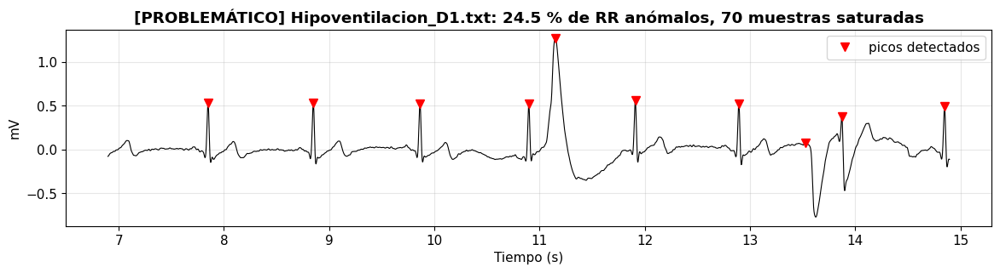

Figura 3. Detalle de hipoventilación en DI entre 7 y 15 s. Los triángulos marcan los picos detectados.

</div>

Los 12 RR anómalos de hipoventilación DI se agrupan en dos episodios, de 10.9 a 13.9 s y de 31.0 a 36.3 s. En el detalle se ve una onda ancha de 1.25 mV en 11.15 s y una deflexión negativa en 13.6 s, compatibles con artefactos de movimiento, que el detector contó como latidos. Esos falsos latidos producen intervalos de solo 252 y 347 ms, y en el segundo episodio el RR más corto fue de 90 ms. La saturación coincide con el artefacto de mayor amplitud del registro, en 35.4 s.

<div align="center">

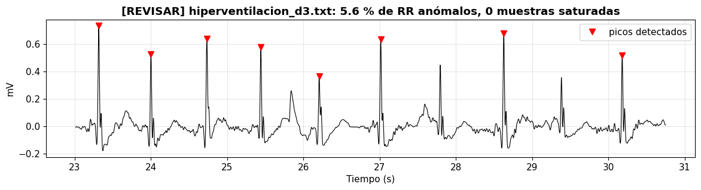

Figura 4. Detalle de hiperventilación en DIII entre 23 y 31 s.

</div>

En hiperventilación DIII el problema es el contrario. Los dos RR anómalos, de 1.61 y 1.55 s entre 27.0 y 30.2 s, duran el doble de un RR normal porque los latidos de 27.8 y 29.4 s, con un pico R más bajo que el resto, no superaron el umbral y quedaron sin detectar.

### 2. Frecuencia cardiaca por condición y derivación

| Condición | Derivación | Hora de inicio | FC media, lpm | FC al inicio, lpm | FC al final, lpm |
|---|---|---|---|---|---|
| Basal | DI | 11:55:32 | 69.9 | 71.3 | 70.3 |
| Basal | DII | 11:53:20 | 65.6 | 64.1 | 65.4 |
| Basal | DIII | 11:57:19 | 68.3 | 69.7 | 61.3 |
| Hiperventilación | DI | 12:04:25 | 74.8 | 77.5 | 81.7 |
| Hiperventilación | DII | 12:02:42 | 76.7 | 76.5 | 83.1 |
| Hiperventilación | DIII | 12:00:20 | 76.7 | 83.3 | 81.1 |
| Hipoventilación | DI | 12:07:50 | 61.8 | 76.4 | 56.4 |
| Hipoventilación | DII | 12:09:49 | 60.5 | 65.7 | 57.2 |
| Hipoventilación | DIII | 12:11:06 | 59.2 | 63.9 | 57.4 |
| Aeróbica | DI | 12:20:17 | 103.0 | 109.8 | 104.3 |
| Aeróbica | DII | 12:21:49 | 94.6 | 98.7 | 97.2 |
| Aeróbica | DIII | 12:23:19 | 90.4 | 93.2 | 93.2 |

<div align="center">

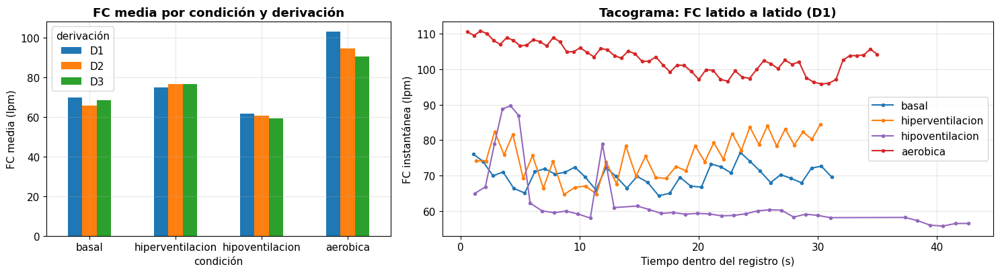

Figura 5. FC media por condición y derivación, y tacograma de los cuatro registros de DI.

</div>

En las tres derivaciones la FC fue mayor en aeróbica, seguida de hiperventilación, basal e hipoventilación. En el tacograma de hipoventilación la FC sube de unos 65 a 90 lpm en los primeros 4 s, cae a unos 60 lpm hacia los 6 s y sigue bajando hasta unos 56 lpm al final; el hueco entre 31 y 37 s corresponde a los RR anómalos excluidos. En aeróbica la FC baja de unos 110 a 96 lpm en los primeros 30 s y repunta a unos 105 lpm en los últimos segundos. En hiperventilación oscila entre unos 65 y 84 lpm con una tendencia creciente, y en basal se mantiene entre unos 64 y 77 lpm. En aeróbica la FC media disminuyó de DI a DIII en el mismo orden en que se grabaron las derivaciones.

### 3. Filtrado

<div align="center">

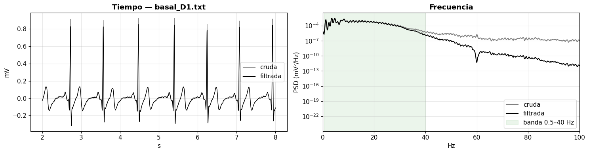

Figura 6. Registro basal en DI antes y después del filtrado, en el tiempo y en la frecuencia. La franja verde marca la banda de 0.5 a 40 Hz.

</div>

En el tiempo la señal filtrada queda centrada en cero y conserva la forma de P, QRS y T. El pico R filtrado es un poco más bajo que el crudo, con un promedio de 0.819 mV frente a 0.891 mV, porque el corte de 40 Hz elimina parte del contenido de alta frecuencia del QRS. En la frecuencia ambas curvas coinciden por debajo de unos 25 Hz; por encima de 40 Hz la potencia filtrada cae varios órdenes de magnitud y en 60 Hz aparece la muesca del notch.

| Registro | Pico de 60 Hz frente a sus vecinas en la señal cruda |
|---|---|
| Aeróbica DII | 23.5 veces |
| Basal DII | 8.9 veces |
| Aeróbica DIII | 7.1 veces |
| Hipoventilación DII | 5.1 veces |
| Basal DI | 4.0 veces |
| Resto de registros | Entre 0.9 y 3.3 veces |

El pico de 60 Hz se distinguía en diez de los doce registros crudos y los valores más altos aparecieron en DII. Después del filtrado la relación quedó por debajo de 0.01 en los doce archivos, es decir, la interferencia desapareció.

### 4. Detección de picos R

<div align="center">

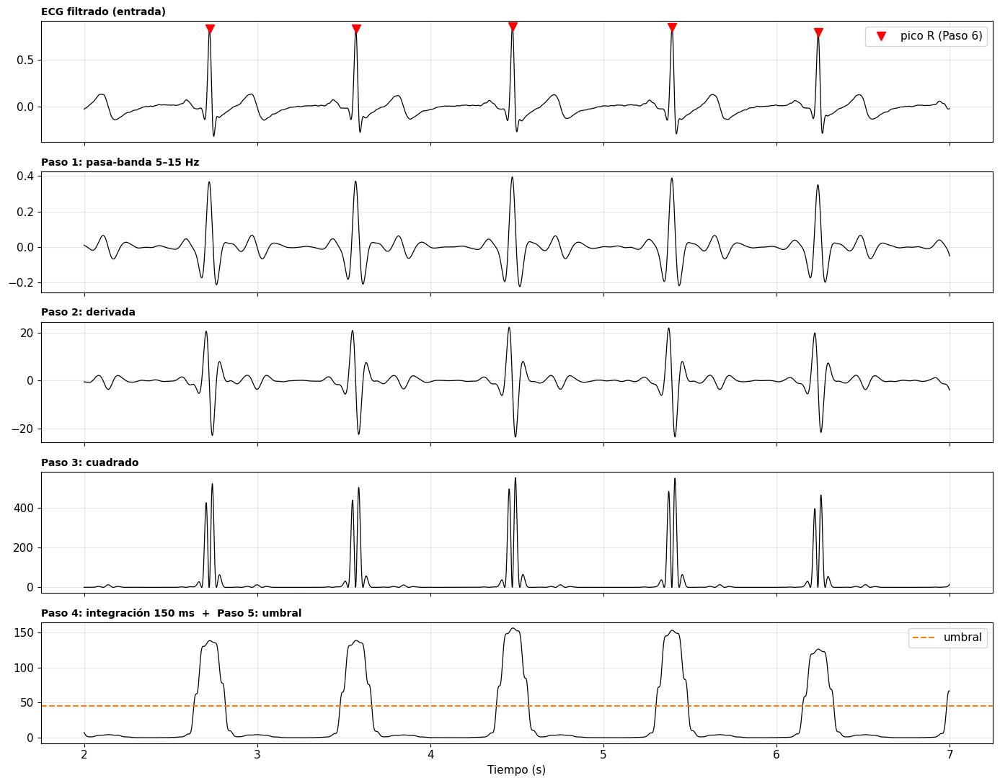

Figura 7. Pasos del algoritmo de Pan y Tompkins sobre el registro basal en DI entre 2 y 7 s.

</div>

Después del pasa-banda de 5 a 15 Hz las ondas P y T casi desaparecen y el QRS queda como una oscilación rápida. En la derivada el QRS alcanza en promedio 22.6 mV/s, mientras que en la zona de la onda T la pendiente máxima es de 3.7 mV/s, unas 6 veces menos. El cuadrado amplía esa diferencia a unas 37 veces, con picos de hasta unos 550 en el QRS. Tras la integración cada latido es una sola meseta de entre 125 y 155, muy por encima del umbral de 45.2.

<div align="center">

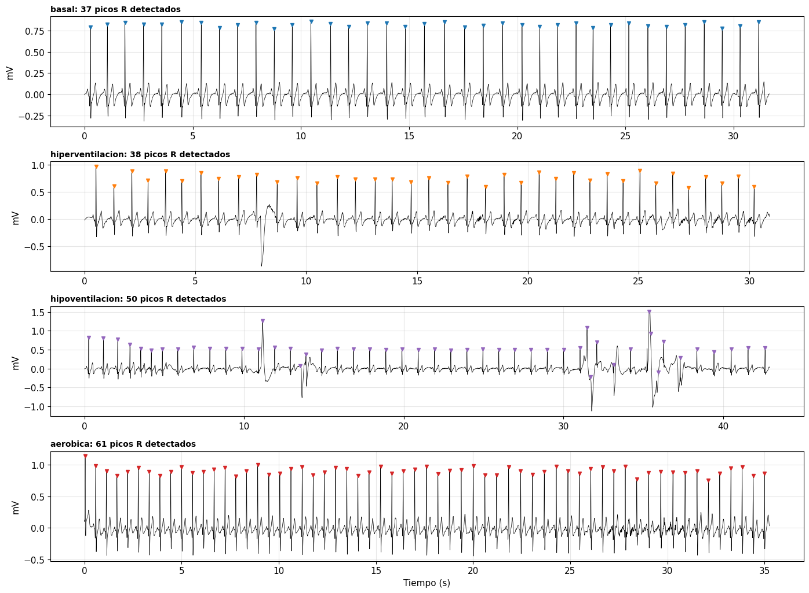

Figura 8. Picos R detectados en los cuatro registros de DI.

</div>

En basal, hiperventilación y aeróbica cada triángulo cae sobre un pico R, con 37, 38 y 61 detecciones, y la deflexión lenta de hiperventilación cerca de 8 s no se confundió con un latido. En hipoventilación hubo 50 detecciones: fuera de los dos episodios de artefacto las marcas caen sobre los picos R, pero dentro de ellos varias marcas caen sobre ondas que no son latidos.

### 5. Segmentación y latido promedio

| Condición | Latidos válidos en DI |
|---|---|
| Basal | 35 |
| Hiperventilación | 36 |
| Hipoventilación | 33 |
| Aeróbica | 59 |
| Total | 163 |

La matriz de latidos tiene 163 filas por 600 muestras. Aeróbica aporta más latidos porque su FC es mayor, de modo que las clases no están balanceadas.

<div align="center">

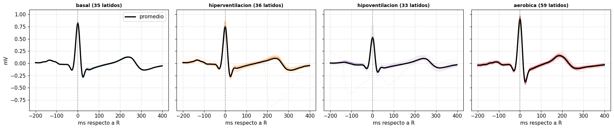

Figura 9. Latidos válidos de cada condición superpuestos y su promedio en negro.

</div>

Los latidos basales son casi idénticos entre sí. En hiperventilación un latido presenta una deflexión negativa de unos −0.85 mV entre 200 y 300 ms, y en hipoventilación algunos trazos se apartan del promedio antes del pico R, de modo que el control por RR no eliminó todos los efectos de los artefactos. En aeróbica los 59 latidos son muy parecidos y la onda T aparece antes.

<div align="center">

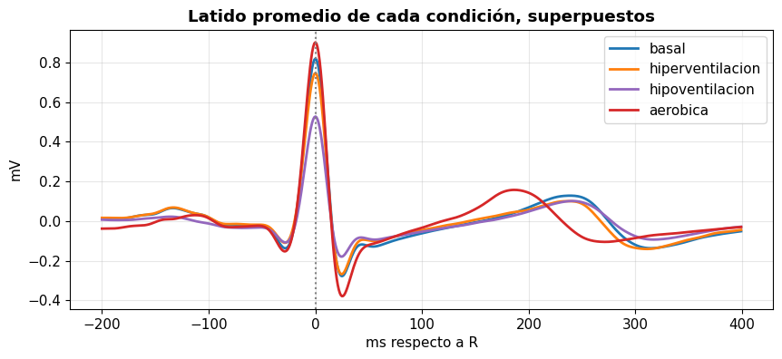

Figura 10. Latido promedio de cada condición.

</div>

Al superponer los promedios, aeróbica tiene el pico R más alto, cerca de 0.9 mV, y la onda S más profunda, cerca de −0.38 mV, mientras que hipoventilación tiene el pico R más bajo, cerca de 0.52 mV, y la onda S menos profunda. La onda T de aeróbica alcanza su máximo cerca de 185 ms después del pico R, frente a unos 240 ms en las otras tres condiciones.

### 6. Características

<div align="center">

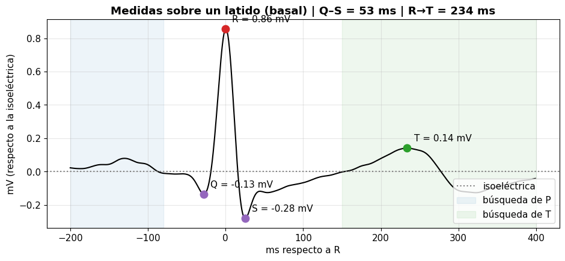

Figura 11. Medidas morfológicas sobre un latido basal. Las franjas marcan las ventanas de búsqueda de las ondas P y T.

</div>

| Característica del latido de ejemplo | Valor |
|---|---|
| RR previo | 922 ms |
| RR siguiente | 844 ms |
| FC instantánea | 65.1 lpm |
| Amplitud P | 0.080 mV |
| Amplitud Q | −0.134 mV |
| Amplitud R | 0.856 mV |
| Amplitud S | −0.279 mV |
| Amplitud T | 0.141 mV |
| Duración de Q a S | 53 ms |
| Tiempo de R a T | 234 ms |

Los puntos Q, R, S y T quedaron sobre las ondas correspondientes. La duración de Q a S, 53 ms, es menor que el límite de 0.12 s para el QRS, aunque esta medida solo aproxima la duración del complejo porque no incluye su inicio ni su final.

<div align="center">

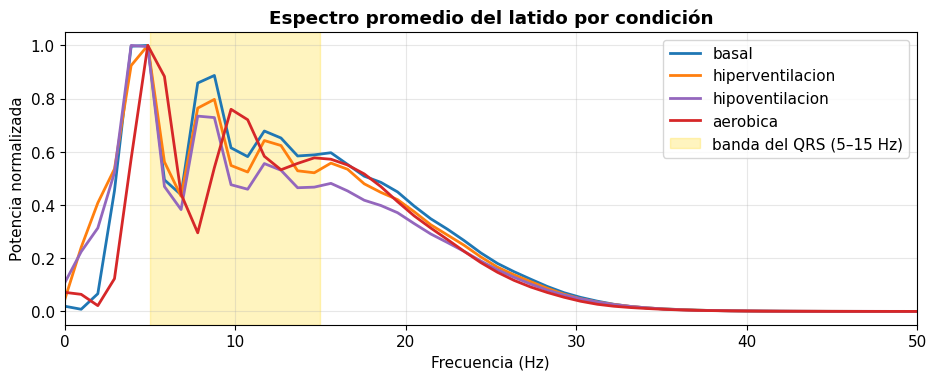

Figura 12. Espectro promedio del latido por condición, normalizado a su máximo. La franja amarilla marca la banda del QRS de 5 a 15 Hz.

</div>

En las cuatro condiciones el espectro tiene su máximo entre 4 y 5 Hz, presenta picos secundarios dentro de la banda de 5 a 15 Hz y casi no tiene potencia por encima de 35 Hz. Aeróbica tiene la mayor fracción de potencia en la banda del QRS, 0.484, frente a valores de 0.437 a 0.461 en las demás.

<div align="center">

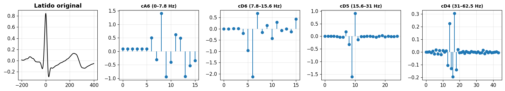

Figura 13. Latido basal de ejemplo y sus coeficientes de la DWT con db4 en los niveles cA6, cD6, cD5 y cD4.

</div>

Los niveles tienen 16, 16, 25 y 44 coeficientes, y en los tres niveles de detalle los coeficientes grandes se concentran en la posición del QRS. Las energías relativas del latido de ejemplo fueron 0.341 en cA6, 0.416 en cD6, 0.227 en cD5 y 0.015 en cD4, de modo que los niveles cD3 a cD1 suman apenas 0.1 % de la energía.

| Característica | Basal | Hiperventilación | Hipoventilación | Aeróbica |
|---|---|---|---|---|
| RR previo, ms | 858.0 | 805.1 | 963.3 | 582.7 |
| RR siguiente, ms | 860.1 | 802.4 | 976.0 | 583.3 |
| FC, lpm | 70.1 | 75.0 | 63.4 | 103.1 |
| Amplitud P, mV | 0.080 | 0.080 | 0.071 | 0.054 |
| Amplitud Q, mV | −0.124 | −0.101 | −0.082 | −0.133 |
| Amplitud R, mV | 0.833 | 0.756 | 0.556 | 0.922 |
| Amplitud S, mV | −0.264 | −0.259 | −0.154 | −0.359 |
| Amplitud T, mV | 0.143 | 0.140 | 0.135 | 0.186 |
| Duración de Q a S, ms | 53.1 | 53.2 | 55.1 | 54.0 |
| Tiempo de R a T, ms | 238.0 | 233.8 | 242.5 | 187.0 |
| Media, mV | 0.001 | 0.000 | −0.005 | −0.002 |
| Mediana, mV | −0.019 | −0.014 | −0.015 | −0.031 |
| Desviación estándar, mV | 0.154 | 0.148 | 0.108 | 0.169 |
| Percentil 25, mV | −0.086 | −0.081 | −0.071 | −0.073 |
| Percentil 75, mV | 0.040 | 0.043 | 0.028 | 0.021 |
| Asimetría | 2.908 | 2.586 | 2.600 | 2.882 |
| Curtosis | 11.681 | 10.317 | 10.004 | 12.125 |
| Frecuencia dominante, Hz | 4.44 | 4.88 | 4.11 | 4.93 |
| Potencia de 0.5 a 40 Hz | 3.833 | 3.500 | 1.806 | 5.032 |
| Fracción de 5 a 15 Hz | 0.461 | 0.443 | 0.437 | 0.484 |
| Energía cA6 | 0.338 | 0.364 | 0.410 | 0.290 |
| Energía cD6 | 0.408 | 0.381 | 0.362 | 0.428 |
| Energía cD5 | 0.238 | 0.241 | 0.215 | 0.266 |
| Energía cD4 | 0.015 | 0.014 | 0.013 | 0.016 |

Las diferencias más grandes están en el ritmo, con un RR de 583 ms en aeróbica frente a 963 ms en hipoventilación, y en algunas medidas de forma: el pico R de hipoventilación es 33 % más bajo que el basal, el tiempo de R a T se acorta unos 50 ms en aeróbica y la potencia del latido en hipoventilación es menos de la mitad de la basal. La duración de Q a S casi no cambia entre condiciones. La curtosis es alta en todas, entre 10 y 12, porque el pico R es estrecho y el resto del latido casi plano. La FC de esta tabla difiere un poco de la de la Sección 2 porque aquí se promedia la FC de cada latido válido, mientras que allí se divide 60 entre el RR medio de todos los RR no anómalos.

<div align="center">

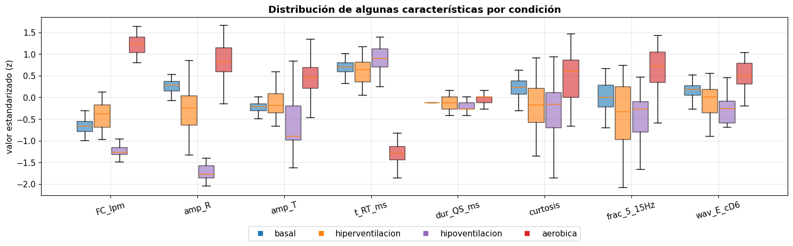

Figura 14. Distribución por condición de ocho características estandarizadas con z-score.

</div>

La FC separa con claridad aeróbica, con valores altos, e hipoventilación, con valores bajos, del resto. La amplitud del pico R separa hipoventilación, cuya caja queda por debajo de todas las demás, y ubica aeróbica por encima de basal. El tiempo de R a T separa aeróbica, mientras que las otras tres condiciones se superponen. En la duración de Q a S, la curtosis, la fracción de 5 a 15 Hz y la energía de cD6 las cajas se superponen casi por completo, salvo aeróbica, que tiende a valores mayores. En casi todas las características la caja de hiperventilación es la más ancha y se superpone con la de basal.

### 7. Clasificación

La tabla tenía 163 latidos agrupados en 16 bloques de 10 s y se validó con 3 pliegues; con cuatro clases el azar corresponde a 0.25.

| Modelo | Exactitud | F1 macro |
|---|---|---|
| Árbol de decisión | 0.824 ± 0.114 | 0.673 ± 0.032 |
| Regresión logística | 0.898 ± 0.074 | 0.811 ± 0.150 |
| Random Forest | 0.910 ± 0.108 | 0.827 ± 0.123 |
| KNN con k = 5 | 0.856 ± 0.146 | 0.770 ± 0.163 |
| SVM con kernel RBF | 0.897 ± 0.084 | 0.873 ± 0.099 |

<div align="center">

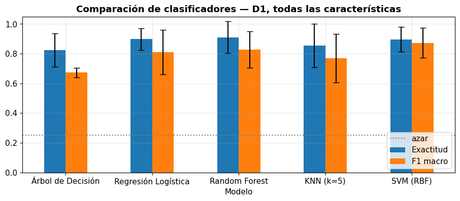

Figura 15. Exactitud y F1 macro de los cinco clasificadores con las 24 características. Las barras negras indican la desviación entre pliegues y la línea punteada el azar.

</div>

Los cinco modelos quedaron muy por encima del azar. Random Forest obtuvo la mayor exactitud y la SVM el mayor F1 macro, pero las diferencias entre ambos, de 0.013 en exactitud y 0.046 en F1, son menores que la variación entre pliegues, que va de 0.08 a 0.12. El árbol de decisión fue el modelo más débil en F1. En todos los modelos el F1 macro quedó por debajo de la exactitud, porque la exactitud da más peso a aeróbica, la clase con más latidos y una de las mejor reconocidas, mientras que el F1 macro da el mismo peso a hiperventilación, la más difícil.

<div align="center">

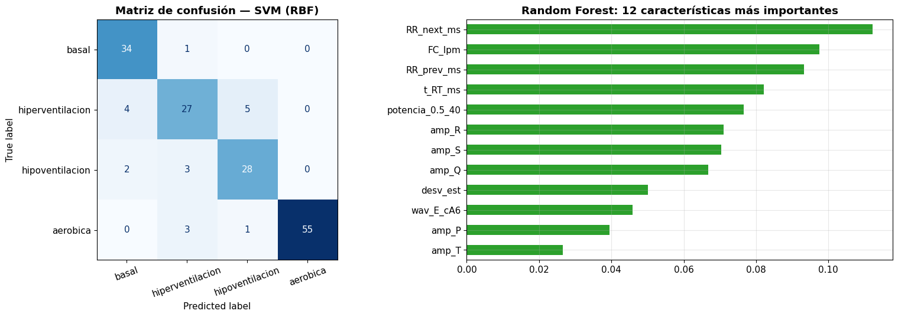

Figura 16. Matriz de confusión de la SVM con las predicciones de los tres pliegues e importancia de las 12 características más usadas por el Random Forest.

</div>

| Condición real | Predicha basal | Predicha hiperventilación | Predicha hipoventilación | Predicha aeróbica | Sensibilidad |
|---|---|---|---|---|---|
| Basal | 34 | 1 | 0 | 0 | 97.1 % |
| Hiperventilación | 4 | 27 | 5 | 0 | 75.0 % |
| Hipoventilación | 2 | 3 | 28 | 0 | 84.8 % |
| Aeróbica | 0 | 3 | 1 | 55 | 93.2 % |

La SVM clasificó bien 144 de los 163 latidos. Hiperventilación fue la condición con más errores, confundida con basal y con hipoventilación, y ningún latido de otra condición fue clasificado como aeróbica. En el Random Forest las características más importantes fueron el RR siguiente, la FC y el RR previo, seguidas del tiempo de R a T, la potencia de 0.5 a 40 Hz y las amplitudes de R, S y Q.

| Modelo | F1 con todas | F1 solo ritmo | F1 solo forma |
|---|---|---|---|
| Árbol de decisión | 0.673 | 0.718 | 0.564 |
| Regresión logística | 0.811 | 0.562 | 0.702 |
| Random Forest | 0.827 | 0.725 | 0.772 |
| KNN con k = 5 | 0.770 | 0.632 | 0.723 |
| SVM con kernel RBF | 0.873 | 0.711 | 0.805 |

<div align="center">

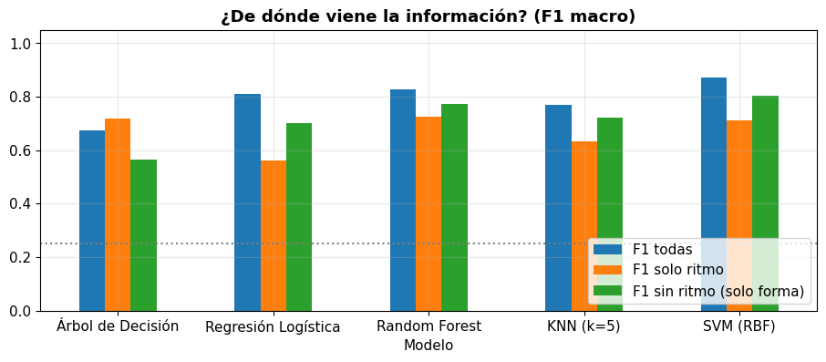

Figura 17. F1 macro con las 24 características, solo con las tres de ritmo y solo con las 21 de forma.

</div>

Sin las características de ritmo el F1 bajó entre 0.05 y 0.11, pero se mantuvo muy por encima del azar, y en cuatro de los cinco modelos la forma sola superó al ritmo solo. La excepción fue el árbol de decisión, que obtuvo con solo el ritmo un F1 mayor que con todas las características. En la prueba de fuga de datos, el Random Forest con solo características de forma alcanzó un F1 de 0.951 al mezclar los latidos al azar y de 0.772 con la validación por bloques, una diferencia de 0.18.

### 8. Síntesis de resultados

| Aspecto | Resultado |
|---|---|
| Registros | 12 archivos de 30.4 a 42.9 s, a 1000 Hz y 10 bits, sin paquetes perdidos |
| Calidad | 10 archivos buenos, hiperventilación DIII por revisar e hipoventilación DI problemática |
| Polaridad | QRS positivo en DI; DII y DIII invertidas en las cuatro condiciones |
| FC media en DI | Aeróbica 103.0, hiperventilación 74.8, basal 69.9 e hipoventilación 61.8 lpm |
| Interferencia de 60 Hz | Hasta 23.5 veces sus vecinas en la señal cruda; eliminada tras el filtrado |
| Latidos válidos en DI | 163: 35 basales, 36 de hiperventilación, 33 de hipoventilación y 59 de aeróbica |
| Cambios de forma | Pico R más bajo en hipoventilación, 0.556 mV, y onda T más temprana en aeróbica, 187 ms |
| Mejor clasificador | SVM con F1 macro de 0.873 ± 0.099 |
| Solo características de forma | F1 macro de 0.805 con SVM |
| Fuga de datos | Random Forest con solo forma: 0.951 al mezclar al azar frente a 0.772 por bloques |

## PREGUNTAS

### P1. ¿Cuántos archivos tienes y cuánto dura cada uno? ¿Alguno dura menos de 30 s?

Hay 12 archivos, uno por cada combinación de las cuatro condiciones y las tres derivaciones. Duran entre 30.4 s, el registro basal en DII, y 42.9 s, el de hipoventilación en DI. Ninguno dura menos de 30 s, aunque el registro basal en DII apenas supera ese límite. Los registros de hipoventilación son los de duración más variable, de 31.8 a 42.9 s.

### P2. ¿Hay paquetes perdidos o muestras saturadas? ¿En qué archivos?

No hubo paquetes perdidos: en los doce archivos el contador nSeq avanzó siempre de uno en uno. Solo hipoventilación en DI tuvo muestras saturadas, 70 en total, todas entre 35.36 y 35.43 s y en el techo del conversor de 1022 cuentas, durante un artefacto de gran amplitud. Es también el único registro en que el conversor recorrió casi todo su rango, de 98 a 1022 cuentas; en los demás se mantuvo entre 189 y 880.

### P3. Según la hora de inicio, ¿en qué orden se grabaron las derivaciones de cada condición?

| Condición | Primera | Segunda | Tercera |
|---|---|---|---|
| Basal | DII, 11:53:20 | DI, 11:55:32 | DIII, 11:57:19 |
| Hiperventilación | DIII, 12:00:20 | DII, 12:02:42 | DI, 12:04:25 |
| Hipoventilación | DI, 12:07:50 | DII, 12:09:49 | DIII, 12:11:06 |
| Aeróbica | DI, 12:20:17 | DII, 12:21:49 | DIII, 12:23:19 |

Las condiciones se grabaron en una sesión de unos 30 minutos, en el orden basal, hiperventilación, hipoventilación y aeróbica. Las derivaciones de una misma condición no se registraron al mismo tiempo sino una tras otra, con entre 1.3 y 2.4 minutos de diferencia, y el orden no fue el mismo en todas las condiciones. Entre el último registro de hipoventilación y el primero de aeróbica pasaron unos 9 minutos, intervalo en el que se realizó el ejercicio.

### P4. ¿En qué derivación el QRS es claramente positivo? ¿En cuál es negativo o bifásico?

En DI el QRS es claramente positivo en las cuatro condiciones, con un pico R de 0.5 a 1 mV y una onda S pequeña. En DII es bifásico: un pico R de 0.2 a 0.36 mV seguido de una onda S algo más profunda, de −0.27 a −0.45 mV. En DIII es predominantemente negativo, con deflexiones de −0.2 a −0.85 mV. Con un eje eléctrico normal se esperaría un QRS positivo también en DII. El patrón observado, positivo en DI y negativo en DIII, puede deberse a un eje desviado a la izquierda, a la ubicación de los electrodos sobre el tronco o a la conexión de los cables, y con estos datos no se puede distinguir entre esas causas.

### P5. ¿En qué condición se ven los latidos más juntos? ¿Detectas algún artefacto a simple vista?

Los latidos están más juntos en aeróbica, con un RR medio de 583 ms, frente a 858 ms en basal, 805 ms en hiperventilación y 963 ms en hipoventilación. A simple vista hay artefactos en hipoventilación DI, con una onda lenta de 1.25 mV cerca de 11.2 s y una deflexión negativa de −0.75 mV cerca de 13.6 s, y en hiperventilación DI, con una deflexión lenta de −0.8 mV cerca de 8 s. Ninguna de esas ondas tiene la forma de un latido.

### P6. ¿Qué archivos quedaron marcados como problemáticos o por revisar? Mirando el zoom, ¿qué tipo de problema tienen?

Hipoventilación DI quedó como problemático por sus 70 muestras saturadas y su 24.5 % de RR anómalos. Su problema son los artefactos de movimiento: ondas lentas y grandes que no son latidos, concentradas entre 10.9 y 13.9 s y entre 31.0 y 36.3 s, que el detector contó como latidos y que generaron RR tan cortos como 90 ms; el artefacto más grande, en 35.4 s, además saturó el conversor. Hiperventilación DIII quedó por revisar con 5.6 % de RR anómalos y sin saturación. Su problema son dos latidos no detectados, en 27.8 y 29.4 s, cuyo pico R era más bajo que el de los demás latidos; por eso aparecen dos RR de 1.61 y 1.55 s, el doble de lo normal.

### P7. ¿Qué derivaciones se invirtieron? ¿Coincide con lo observado en P4?

Se invirtieron DII y DIII en las cuatro condiciones, ocho registros en total, y DI en ninguna. Coincide con P4: DI tiene el QRS positivo, DIII negativo y DII bifásico, con una onda S más profunda que el pico R, por lo que su asimetría resultó negativa y la regla la invirtió. Después de invertir DII, el máximo que se mide como pico R corresponde en realidad a la onda S invertida, de modo que en esa derivación las amplitudes pierden su nombre anatómico.

### P8. Ordena las condiciones de mayor a menor FC. ¿Es lo que esperabas fisiológicamente?

El orden fue aeróbica, de 90.4 a 103.0 lpm, hiperventilación, de 74.8 a 76.7 lpm, basal, de 65.6 a 69.9 lpm, e hipoventilación, de 59.2 a 61.8 lpm, y se repitió en las tres derivaciones. Es lo esperado. El ejercicio eleva la FC por la demanda metabólica y la activación simpática, y el registro se tomó durante la recuperación; en DI incluso superó los 100 lpm, una taquicardia sinusal fisiológica. Las respiraciones profundas y repetidas de la hiperventilación aumentan la FC respecto de la basal, y la retención de la respiración la reduce por activación del nervio vago, hasta valores cercanos al límite de 60 lpm.

### P9. En el tacograma, ¿en qué condición la FC cambia durante el registro? ¿Cómo lo explicas?

El cambio más marcado ocurre en hipoventilación. La FC sube de unos 65 a 90 lpm en los primeros 4 s y luego cae a unos 60 lpm y sigue bajando hasta unos 56 lpm al final; en DI pasó de 76.4 lpm al inicio a 56.4 lpm al final, y en DII y DIII también bajó, de 65.7 a 57.2 y de 63.9 a 57.4 lpm. La subida inicial es compatible con la inspiración profunda previa a la retención, porque la inspiración acelera el corazón, y la caída posterior con la bradicardia de la apnea mediada por el nervio vago. Aeróbica también cambia: la FC baja de unos 110 a 96 lpm en 30 s por la recuperación después del ejercicio. En hiperventilación la FC oscila entre unos 65 y 84 lpm con cada ciclo respiratorio, una arritmia sinusal respiratoria amplificada, y tiende a subir, de 77.5 a 81.7 lpm en DI. La basal es la más estable.

### P10. En la condición aeróbica, ¿la FC es igual en las tres derivaciones? Según la hora, ¿por qué crees que pasa esto?

No. Fue de 103.0 lpm en DI, 94.6 lpm en DII y 90.4 lpm en DIII, y las derivaciones se grabaron justamente en ese orden, a las 12:20:17, 12:21:49 y 12:23:19. Durante esos tres minutos el participante se estaba recuperando del ejercicio, así que su FC seguía bajando; dentro de DI también bajó de 109.8 a 104.3 lpm. La diferencia no se debe a la derivación, porque la FC es la misma para todo el corazón, sino al momento en que se grabó cada una.

### P11. ¿Qué derivación eliges para la Parte B y por qué?

Se eligió DI. Tiene las cuatro condiciones, es la única con QRS positivo en todas ellas, por lo que no necesita inversión y las amplitudes de P, Q, R, S y T conservan su nombre anatómico, y su pico R es alto y estrecho, de 0.56 a 0.92 mV en promedio, lo que facilita la detección. Su punto débil es hipoventilación DI, el único registro problemático, pero el control por RR excluye los latidos cercanos a los artefactos y quedaron 33 latidos válidos. DII tenía sus cuatro registros en buen estado, pero su QRS bifásico obligó a invertirla en todas las condiciones, y DIII tenía un archivo por revisar y el QRS negativo. Se trabaja con una sola derivación porque cada una produce latidos de forma distinta y, al mezclarlas, el clasificador aprendería a reconocer la derivación en lugar de la condición.

### P12. ¿Cada triángulo cae sobre un pico R? ¿Ves latidos sin marcar, que serían falsos negativos, o marcas sobre ruido, que serían falsos positivos?

En basal, hiperventilación y aeróbica sí: cada triángulo cae sobre un pico R, no se ven latidos sin marcar y ninguno de los tres registros tuvo RR anómalos. Incluso la deflexión lenta de hiperventilación cerca de 8 s se ignoró correctamente. En hipoventilación hay falsos positivos: dentro de los episodios de artefacto, entre 10.9 y 13.9 s y entre 31.0 y 36.3 s, el detector marcó ondas que no son latidos, lo que explica las 50 detecciones y los 12 RR anómalos. Fuera de esos episodios las marcas caen sobre los picos R. Los falsos negativos aparecieron en hiperventilación DIII, fuera de la derivación elegida.

### P13. ¿Por qué la derivada ayuda a distinguir el QRS de la onda T, aunque la onda T también sea grande?

Porque la derivada mide qué tan rápido cambia la señal, no qué tan alta es. El QRS sube y baja en unas pocas decenas de milisegundos, mientras que la onda T lo hace en unos 150 a 200 ms. En el registro basal en DI, después del pasa-banda de 5 a 15 Hz, la derivada alcanzó en promedio 22.6 mV/s en el QRS y solo 3.7 mV/s en la zona de la onda T, unas 6 veces menos, y al elevar al cuadrado la diferencia pasó a unas 37 veces. Además, el pasa-banda ya había atenuado buena parte de la onda T por su contenido de baja frecuencia, así que una onda T grande pero lenta queda muy por debajo del umbral.

### P14. Comparando los latidos promedio, ¿cambia la altura del pico R?

Sí. La amplitud media del pico R fue de 0.922 mV en aeróbica, 0.833 mV en basal, 0.756 mV en hiperventilación y 0.556 mV en hipoventilación, es decir, 33 % menor que la basal. En el registro de hipoventilación el pico R baja de unos 0.8 a 0.5 mV durante los primeros 4 s, justo cuando la FC sube por la inspiración profunda, y luego se mantiene bajo. Es coherente con retener la respiración con los pulmones llenos: el aire aumenta la impedancia entre el corazón y los electrodos y modifica la posición del corazón, lo que reduce la amplitud del QRS. Aeróbica tiene además la onda S más profunda, −0.359 mV frente a −0.264 mV en basal.

### P15. ¿La onda T está a la misma distancia del R y tiene la misma altura en todas las condiciones?

No. En aeróbica la onda T llega antes, a 187 ms del pico R, frente a 238 ms en basal, 234 ms en hiperventilación y 242 ms en hipoventilación, porque la repolarización ventricular se acorta cuando la FC aumenta, igual que el intervalo QT. También es más alta, 0.186 mV frente a valores de 0.135 a 0.143 mV en las demás. Entre basal, hiperventilación e hipoventilación la onda T es casi igual en posición y en altura.

### P16. Mirando los diagramas de caja, ¿qué dos características separan mejor las condiciones? ¿Tiene sentido fisiológico?

La FC y la amplitud del pico R. La FC separa aeróbica, con valores altos, e hipoventilación, con valores bajos, del resto, y la amplitud del pico R separa hipoventilación, cuya caja queda por debajo de todas, y ubica aeróbica por encima de basal. Juntas distinguen tres grupos: aeróbica, hipoventilación y el par basal e hiperventilación. El tiempo de R a T también separa aeróbica, pero aporta casi la misma información que la FC, porque se acorta cuando la FC aumenta. Tiene sentido fisiológico: la FC refleja la respuesta autonómica al ejercicio y a la apnea, y la amplitud del pico R el efecto del volumen pulmonar durante la retención de la respiración.

### P17. ¿Qué dos condiciones se parecen más entre sí en casi todas las características?

Basal e hiperventilación. Sus cajas se superponen en todas las características graficadas y sus promedios son muy cercanos: FC de 70.1 y 75.0 lpm, pico R de 0.833 y 0.756 mV, onda T de 0.143 y 0.140 mV, tiempo de R a T de 238 y 234 ms y duración de Q a S de 53.1 y 53.2 ms.

### P18. ¿Qué clasificador obtuvo el mejor F1? ¿Coincide con el artículo base? ¿La diferencia con el segundo es mayor que la variación entre pliegues?

El mejor F1 macro fue el de la SVM, con 0.873 ± 0.099, seguido del Random Forest, con 0.827 ± 0.123. En exactitud el orden se invierte y Random Forest queda primero con 0.910, lo que coincide con el artículo base, donde fue el mejor modelo con una exactitud cercana a 98 %; en F1 macro, en cambio, no coincide. La diferencia de F1 entre la SVM y el Random Forest, 0.046, es menor que la variación entre pliegues, de 0.10 a 0.12, así que no se puede afirmar que uno sea mejor que el otro; con solo tres pliegues y un participante, las diferencias pequeñas entre modelos no son confiables.

### P19. En la matriz de confusión, ¿qué condiciones se confunden más entre sí? Relaciónalo con P16 y P17.

Hiperventilación es la condición más confundida: se reconocieron 27 de 36 latidos y 4 se asignaron a basal y 5 a hipoventilación. Le sigue hipoventilación, con 28 de 33, que perdió 2 latidos hacia basal y 3 hacia hiperventilación. Basal acertó 34 de 35 y aeróbica 55 de 59, y ningún latido de otra condición fue clasificado como aeróbica. Esto coincide con los diagramas de caja: basal e hiperventilación se superponen en casi todas las características, y la caja de hiperventilación, la más ancha en la FC y en la amplitud del pico R, se acerca por abajo a la de hipoventilación. Basal se reconoce bien porque sus latidos son muy uniformes, pero los de hiperventilación, más variables, caen a veces en su región. Aeróbica, que la FC separa con claridad, fue la mejor reconocida después de basal.

### P20. Al quitar el ritmo, ¿cuánto cambió el F1? ¿Qué te dice eso sobre la forma del latido en tus condiciones?

El F1 bajó entre 0.05 y 0.11: de 0.873 a 0.805 en la SVM, de 0.827 a 0.772 en Random Forest, de 0.770 a 0.723 en KNN, de 0.811 a 0.702 en regresión logística y de 0.673 a 0.564 en el árbol de decisión. Aun así, la forma sola quedó muy por encima del azar y en cuatro de los cinco modelos superó al ritmo solo, por lo que la forma del latido sí cambia con la condición: el pico R baja al retener la respiración y la onda T llega antes después del ejercicio. Hay que matizar que el tiempo de R a T depende de la FC, así que parte de la información del ritmo sigue presente de forma indirecta en el conjunto de forma.

### P21. ¿Hubo diferencia entre mezclar al azar y validar por bloques? ¿Por qué el valor al azar no es confiable?

Sí. El Random Forest con solo características de forma obtuvo un F1 de 0.951 al mezclar los latidos al azar y de 0.772 al validar por bloques, 0.18 menos. El valor al azar no es confiable porque los latidos consecutivos de un mismo archivo son casi copias: comparten el contacto de los electrodos, el patrón respiratorio y el mismo momento del registro. Al mezclarlos, el modelo se evalúa con latidos casi idénticos a los que usó para entrenar y mide cuánto memorizó el registro, no cuánto generaliza. Con los bloques de 10 s los latidos de prueba provienen de tramos de tiempo que el modelo no vio. Aun así, todos los bloques de una condición vienen del mismo archivo, de modo que el modelo podría estar aprendiendo rasgos del registro además de la fisiología.

## CONCLUSIONES

Un latido de 600 muestras puede resumirse en 24 características con significado fisiológico. Con ellas, los cinco clasificadores reconocieron la condición en que se registró cada latido muy por encima del azar: el mejor F1 macro fue de 0.873 con la SVM, frente a 0.25 al azar, y la mayor exactitud, de 0.910, la obtuvo Random Forest, aunque las diferencias entre modelos fueron menores que la variación entre pliegues.

La revisión previa de los datos condicionó todo el análisis. El control automático encontró artefactos de movimiento con saturación en hipoventilación DI, dos latidos no detectados en hiperventilación DIII y un QRS bifásico o negativo en DII y DIII que obligó a invertirlas. También mostró que las diferencias de FC entre derivaciones de una misma condición, de 103.0 a 90.4 lpm en aeróbica, se deben al momento en que se grabó cada derivación y no a la derivación, porque BITalino no registra las tres a la vez. Por eso se trabajó con una sola derivación, DI, la única con el QRS positivo en las cuatro condiciones.

El filtrado de 0.5 a 40 Hz con notch de 60 Hz eliminó la interferencia de la red sin desplazar las ondas, a costa de reducir el pico R en unos 0.07 mV. El algoritmo de Pan y Tompkins detectó todos los latidos de los registros limpios, porque tras la derivada y el cuadrado el QRS queda unas 37 veces por encima de la onda T, pero contó como latidos los artefactos de hipoventilación. El control de los intervalos RR permitió excluir esos latidos antes de extraer las características.

Las características de ritmo fueron las más importantes para Random Forest, pero la forma del latido también distingue las condiciones: sin ellas, la SVM mantuvo un F1 de 0.805. Los cambios de forma son coherentes con la fisiología, con un pico R más bajo al retener la respiración y una onda T más temprana después del ejercicio. La forma de validar resultó tan importante como el modelo, porque mezclar los latidos al azar infló el F1 de 0.772 a 0.951. Finalmente, los resultados describen a un solo participante en una sola sesión, con unos 30 s por condición, y no pueden generalizarse a otras personas; en el artículo base las clases eran tipos de latido de muchos pacientes, mientras que aquí fueron condiciones fisiológicas de un mismo sujeto.

## REFERENCIAS

- Meza, M. Extracción de características para clasificación de señales ECG. Material de clase, Introducción a Señales Biomédicas, Universidad Peruana Cayetano Heredia, 2026.
- Universidad Peruana Cayetano Heredia. Tratamiento de la señal ECG: detección de latidos y extracción de características para clasificación. Guía de laboratorio, Introducción a Señales Biomédicas, 2026.
- Subba, T.; Chingtham, T. Comparative analysis of machine learning algorithms with advanced feature extraction for ECG signal classification. IEEE Access, volumen 12, 2024.
- Pan, J.; Tompkins, W. J. A real-time QRS detection algorithm. IEEE Transactions on Biomedical Engineering, volumen 32, número 3, páginas 230 a 236, 1985.
- Sörnmo, L.; Laguna, P. Bioelectrical signal processing in cardiac and neurological applications. Elsevier Academic Press, 2005.
- Kligfield, P.; Gettes, L. S.; Bailey, J. J.; Childers, R.; Deal, B. J.; Hancock, E. W.; van Herpen, G.; Kors, J. A.; Macfarlane, P.; Mirvis, D. M.; Pahlm, O.; Rautaharju, P.; Wagner, G. S. Recommendations for the standardization and interpretation of the electrocardiogram: part I: the electrocardiogram and its technology. Circulation, volumen 115, número 10, páginas 1306 a 1324, 2007.
- Bazett, H. C. An analysis of the time-relations of electrocardiograms. Heart, volumen 7, páginas 353 a 370, 1920.
- Mallat, S. G. A theory for multiresolution signal decomposition: the wavelet representation. IEEE Transactions on Pattern Analysis and Machine Intelligence, volumen 11, número 7, páginas 674 a 693, 1989.
- Breiman, L. Random forests. Machine Learning, volumen 45, número 1, páginas 5 a 32, 2001.
- Cortes, C.; Vapnik, V. Support-vector networks. Machine Learning, volumen 20, número 3, páginas 273 a 297, 1995.
- Chapman, P.; Clinton, J.; Kerber, R.; Khabaza, T.; Reinartz, T.; Shearer, C.; Wirth, R. CRISP-DM 1.0: step-by-step data mining guide. SPSS, 2000.
- Huang, J.; Chen, B.; Yao, B.; He, W. ECG arrhythmia classification using STFT-based spectrogram and convolutional neural network. IEEE Access, volumen 7, páginas 92871 a 92880, 2019.
- Byeon, Y. H.; Kwak, K. C. Pre-configured deep convolutional neural networks with various time-frequency representations for biometrics from ECG signals. Applied Sciences, volumen 9, número 22, artículo 4810, 2019.
- Yoon, T.; Kang, D. Bimodal CNN for cardiovascular disease classification by co-training ECG grayscale images and scalograms. Scientific Reports, volumen 13, 2023.
- Yildirim, Ö.; Baloglu, U. B.; Tan, R. S.; Ciaccio, E. J.; Acharya, U. R. A new approach for arrhythmia classification using deep coded features and LSTM networks. Computer Methods and Programs in Biomedicine, volumen 176, páginas 121 a 133, 2019.
- McSharry, P. E.; Clifford, G. D.; Tarassenko, L.; Smith, L. A. A dynamical model for generating synthetic electrocardiogram signals. IEEE Transactions on Biomedical Engineering, volumen 50, número 3, páginas 289 a 294, 2003.
- Zanchi, B.; Monachino, G.; Fiorillo, L.; Conte, G.; Auricchio, A.; Tzovara, A.; Faraci, F. D. Synthetic ECG signals generation: a scoping review. Computers in Biology and Medicine, volumen 184, artículo 109453, 2025.
- PLUX Wireless Biosignals. BITalino (r)evolution: electrocardiography ECG sensor datasheet.
