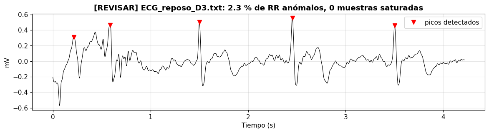

# LABORATORIO 11: Tratamiento de la señal ECG, detección de latidos y extracción de características para clasificación

## INTRODUCCIÓN

Un monitor Holter, un reloj que avisa de una posible fibrilación auricular o un sistema que clasifica arritmias no leen el electrocardiograma como lo haría un cardiólogo frente al papel. Primero localizan cada latido, después lo resumen en un conjunto pequeño de números llamados características y, con ellos, un clasificador decide a qué grupo pertenece. Un latido de 600 ms registrado a 1000 Hz contiene 600 muestras muy redundantes, mientras que unas pocas medidas con significado, como la altura del pico R, el tiempo transcurrido desde el latido anterior o la posición de la onda T, bastan para describirlo. La pregunta que guía el laboratorio es si esas características permiten reconocer en qué condición fisiológica se registró cada latido.

Para responderla se siguió el flujo del artículo de Subba y Chingtham, que describe cada latido con características morfológicas, estadísticas, espectrales y wavelet y compara cinco algoritmos de aprendizaje automático. El flujo se aplicó a doce registros de ECG de un mismo participante adquiridos con BITalino en cuatro condiciones, basal, hiperventilación, hipoventilación y después de un ejercicio aeróbico, y en las tres derivaciones de Einthoven. Primero se revisaron los datos: duración, paquetes perdidos, saturación, polaridad del QRS, intervalos RR anómalos y frecuencia cardiaca. Después, con la derivación DI, se filtró la señal, se detectaron los picos R con el algoritmo de Pan y Tompkins, se recortó cada latido, se calcularon 24 características agrupadas en cinco familias y se compararon cinco clasificadores con una validación por bloques de tiempo que evita la fuga de datos. Al final se repitió la clasificación en DII y DIII para comparar las tres derivaciones.

## OBJETIVOS

- Describir el origen del ECG, sus ondas y las derivaciones de Einthoven, y relacionarlos con la forma de los latidos registrados.
- Leer los registros de BITalino, convertirlos a milivoltios y evaluar su calidad mediante los paquetes perdidos, la saturación, la polaridad y los intervalos RR anómalos.
- Calcular la frecuencia cardiaca por condición y por derivación e interpretar sus diferencias fisiológicas.
- Filtrar el ECG y detectar los picos R con el algoritmo de Pan y Tompkins.
- Segmentar los latidos y extraer características de ritmo, morfología, estadísticas básicas, estadísticas de orden superior y frecuencia.
- Comparar cinco clasificadores con una validación que evite la fuga de datos e identificar de dónde proviene la información que utilizan.

## TEORÍA

### 1. Origen de la señal ECG

El electrocardiograma registra desde la superficie del cuerpo la actividad eléctrica del corazón. Cada latido empieza en el nodo sinoauricular, ubicado en la aurícula derecha, que actúa como marcapasos natural. El impulso recorre las aurículas hasta el nodo auriculoventricular, donde se retrasa para que los ventrículos terminen de llenarse antes de contraerse, y luego avanza por el haz de His, sus ramas derecha e izquierda y las fibras de Purkinje, que activan las células ventriculares casi al mismo tiempo. Mientras la excitación se propaga, cada región activada se comporta como un dipolo eléctrico. La suma de esos dipolos forma un vector cardiaco que cambia de tamaño y de dirección durante el latido, y lo que registra cada par de electrodos es la proyección de ese vector sobre la línea que los une.

| Componente | Qué representa |
|---|---|
| Onda P | Despolarización de las aurículas; deflexión pequeña y de bajo voltaje |
| Intervalo PR | Tiempo desde el inicio de la activación auricular hasta el inicio de la ventricular, incluido el retraso del nodo auriculoventricular |
| Complejo QRS | Despolarización de los ventrículos; es la deflexión de mayor amplitud y la más rápida del latido |
| Segmento ST | Ventrículos completamente despolarizados, antes de la repolarización |
| Onda T | Repolarización de los ventrículos; es lenta y suele ser la más difícil de delimitar |
| Intervalo QT | Duración total de la despolarización y la repolarización ventricular |

En el papel milimetrado del electrocardiógrafo cada cuadro pequeño mide 1 mm y 10 mm en vertical equivalen a 1 mV. Sobre ese trazado se aplican criterios de normalidad como los siguientes:

| Hallazgo | Interpretación |
|---|---|
| Frecuencia entre 60 y 100 lpm con ritmo sinusal | Ritmo normal en reposo; por debajo de 60 lpm se habla de bradicardia y por encima de 100 lpm de taquicardia |
| Intervalo PR mayor de 0.20 s | Posible bloqueo auriculoventricular de primer grado |
| Complejo QRS mayor de 0.12 s | Posible bloqueo de rama o arritmia ventricular |
| Intervalo QT prolongado | Riesgo de torsades de pointes y de otras arritmias |
| Elevación del segmento ST | Posible infarto agudo de miocardio |

### 2. Derivaciones de Einthoven

Una derivación es la diferencia de potencial entre dos puntos del cuerpo, y cada una mira el vector cardiaco desde un ángulo distinto. Las tres derivaciones bipolares de Einthoven forman un triángulo en el plano frontal con electrodos en el brazo derecho, RA, el brazo izquierdo, LA, y la pierna izquierda, LL. Los mismos puntos pueden trasladarse al tronco, sobre ambas clavículas y la cresta ilíaca izquierda, que son zonas óseas con poca actividad muscular.

| Derivación | Diferencia que mide | Ángulo en el plano frontal |
|---|---|---|
| DI | LA − RA | 0° |
| DII | LL − RA | 60° |
| DIII | LL − LA | 120° |

Cuando el vector cardiaco apunta hacia el electrodo positivo de una derivación la deflexión es positiva, cuando apunta en sentido contrario es negativa y cuando es casi perpendicular resulta pequeña o bifásica. Por eso un mismo latido tiene una forma distinta en cada derivación, y medidas como la amplitud del pico R solo pueden compararse dentro de una misma derivación. Si las tres se registran al mismo tiempo se cumple la ley de Einthoven:

$$
\mathrm{DII}=\mathrm{DI}+\mathrm{DIII}
$$

Con BITalino las derivaciones no se registran al mismo tiempo, sino una después de otra reubicando los electrodos. Cada derivación corresponde entonces a un momento distinto de la sesión y esa relación no puede verificarse con los datos.

### 3. Adquisición con BITalino

El sensor de ECG de BITalino tiene tres cables: el electrodo positivo, IN+, el negativo, IN−, y la referencia, REF. Incluye un amplificador diferencial con ganancia de 1100, una razón de rechazo en modo común de 86 dB y un ancho de banda analógico de 0.5 a 40 Hz. La placa digitaliza la señal con un conversor de 10 bits y la envía por Bluetooth a OpenSignals, que la guarda en un archivo de texto. Las cuentas del conversor se convierten a milivoltios con la función de transferencia del sensor:

$$
\mathrm{ECG}_{mV}=\frac{\left(\frac{ADC}{2^{n}}-\frac{1}{2}\right)V_{CC}}{G_{ECG}}\times 1000,\qquad V_{CC}=3.3\ \mathrm{V},\quad G_{ECG}=1100,\quad n=10
$$

El rango medible resulta de ±1.5 mV y cada cuenta equivale a 2.93 µV. Con una frecuencia de muestreo de 1000 Hz la frecuencia de Nyquist es de 500 Hz, muy por encima de la banda del sensor. El archivo guarda además el contador nSeq, que avanza de 0 a 15 y vuelve a empezar; un salto distinto de 1 indica que se perdieron muestras en la transmisión. Cuando el potencial supera el rango del sensor el conversor se queda fijo en sus valores extremos y la señal se satura. En la práctica el conversor de BITalino se queda en 1022 cuentas, por lo que se consideran saturadas las muestras iguales a 0 o mayores o iguales a 1022.

### 4. Ruido y filtrado

| Problema | Origen | Frecuencia | Tratamiento |
|---|---|---|---|
| Deriva de la línea base | Respiración y movimiento del tórax y de los electrodos | Menos de 0.5 Hz | Pasa-altos de 0.5 Hz |
| Interferencia de la red eléctrica | Instalación eléctrica, 60 Hz en Perú | 60 Hz | Filtro notch de 60 Hz |
| Ruido muscular y electrónico | Músculos cercanos y electrónica del equipo | Principalmente por encima de 40 Hz | Pasa-bajos de 40 Hz |
| Artefactos de movimiento | Cambios bruscos en la interfaz piel electrodo | Se superponen con la banda del ECG | Buena fijación de electrodos y cables; ningún filtro los elimina por completo |

El laboratorio usa un pasa-banda Butterworth de 0.5 a 40 Hz y un notch de 60 Hz aplicados hacia adelante y hacia atrás, es decir, con filtrado de fase cero. Así las ondas no se desplazan en el tiempo, lo que es indispensable cuando después se mide dónde está el pico R o cuánto tarda en llegar la onda T. La banda de 0.5 a 40 Hz es la habitual en monitoreo: conserva la forma de P, QRS y T y basta para detectar los latidos y medir el ritmo. Para el ECG diagnóstico de adultos la American Heart Association recomienda conservar hasta 150 Hz, porque un corte superior más bajo reduce la amplitud y la agudeza del QRS, y un corte inferior de 0.05 Hz, o de hasta 0.67 Hz cuando el filtro digital es de fase cero, para no deformar el segmento ST.

Para comparar la señal antes y después de filtrar se usa la densidad espectral de potencia, PSD, estimada con el método de Welch: la señal se divide en segmentos solapados, cada segmento se multiplica por una ventana, se calcula su periodograma y se promedian todos los periodogramas.

### 5. Detección del QRS: algoritmo de Pan y Tompkins

Para analizar latidos primero hay que encontrarlos, y el punto más fácil de localizar es el pico R, el más alto y rápido del latido. El algoritmo de Pan y Tompkins, publicado en 1985, es el detector de QRS más conocido. Su idea es resaltar lo que hace único al QRS, cambios muy rápidos y grandes, y atenuar las ondas P y T, que son lentas.

| Paso | Operación | Propósito |
|---|---|---|
| 1 | Pasa-banda de 5 a 15 Hz | Conserva la banda donde se concentra la energía del QRS y atenúa P, T y la deriva |
| 2 | Derivada | Resalta las pendientes, que en el QRS son las más empinadas del latido |
| 3 | Cuadrado | Vuelve positivos todos los valores y agranda más las pendientes grandes que las pequeñas |
| 4 | Integración en una ventana móvil de 150 ms | Convierte cada QRS en una sola joroba suave, de ancho parecido al del complejo |
| 5 | Umbral y periodo refractario de 250 ms | Cada joroba que supera el umbral es un latido, y no se aceptan dos latidos separados por menos de 250 ms, que equivaldría a más de 240 lpm |
| 6 | Ubicación del pico R | Se busca el máximo del ECG filtrado dentro de ±100 ms de cada joroba |

$$
y[n]=\frac{1}{W}\sum_{k=-W/2}^{W/2}\left(\frac{d\,x_{5\text{-}15}}{dt}[n-k]\right)^{2},\qquad W=150\ \mathrm{ms},\qquad \mathrm{umbral}=0.3\,P_{99}(y)
$$

donde $x_{5\text{-}15}$ es el ECG filtrado entre 5 y 15 Hz y $P_{99}$ el percentil 99 de la señal integrada. El algoritmo original usa umbrales adaptativos, que se actualizan con los niveles de señal y de ruido, y una búsqueda hacia atrás para recuperar latidos perdidos; la versión del laboratorio es una simplificación con un umbral fijo para todo el registro.

### 6. Frecuencia cardiaca, intervalos RR y control de calidad

El intervalo RR es el tiempo entre dos picos R consecutivos, y la frecuencia cardiaca instantánea, en latidos por minuto, es FC = 60/RR. La gráfica de la FC latido a latido en función del tiempo se llama tacograma. La FC no es constante, porque el sistema nervioso autónomo la ajusta de forma continua, y cada maniobra del laboratorio la modifica de una manera esperable:

| Condición | Efecto esperado sobre el ECG |
|---|---|
| Basal | FC de reposo con pequeñas oscilaciones ligadas a la respiración: aumenta al inspirar y disminuye al espirar, lo que se conoce como arritmia sinusal respiratoria |
| Hiperventilación | Las respiraciones profundas y repetidas amplifican esas oscilaciones y tienden a aumentar la FC |
| Hipoventilación | Al retener la respiración la FC tiende a disminuir por la activación del nervio vago, como parte de la respuesta a la apnea; si la retención empieza con una inspiración profunda, el aire en los pulmones también puede modificar la amplitud del QRS |
| Aeróbica | FC elevada por la demanda metabólica y la activación simpática, que disminuye de forma progresiva durante la recuperación |

La repolarización ventricular también depende de la FC: cuando el corazón late más rápido, el intervalo QT y la distancia entre el pico R y la onda T se acortan. Por eso el QT suele corregirse con la fórmula de Bazett:

$$
QT_c=\frac{QT}{\sqrt{RR}}
$$

Los intervalos RR también sirven como control de calidad. Un RR que se aleja más de 35 % de la mediana de sus vecinos se considera anómalo, porque suele indicar un artefacto contado como latido o un latido que no se detectó:

$$
\left|RR_k-\widetilde{RR}_k\right|>0.35\,\widetilde{RR}_k
$$

donde $\widetilde{RR}_k$ es la mediana de los 9 intervalos centrados en $RR_k$. La polaridad se revisa con la asimetría de la señal filtrada. Un ECG con el QRS hacia arriba tiene picos positivos aislados y asimetría positiva; si la asimetría es negativa, la señal se invierte para que el pico principal quede positivo. Con la saturación y los RR anómalos cada archivo se clasifica con un semáforo de calidad:

| Estado | Criterio |
|---|---|
| Bueno | Sin saturación y sin RR anómalos |
| Revisar | Algunos RR anómalos, menos de 10 % |
| Problemático | Saturación o 10 % o más de RR anómalos |

### 7. Segmentación en latidos

Una vez ubicado cada pico R se recorta una ventana desde 200 ms antes hasta 400 ms después de él. A 1000 Hz cada latido queda como un vector de 600 muestras con el pico R en la muestra 200, y la ventana incluye la onda P antes del pico R y el final del QRS y la onda T después. Se descartan el primer y el último latido, que no tienen un RR a ambos lados, y los latidos con un RR anómalo antes o después. Cada latido válido es una fila de la tabla de datos.

### 8. Extracción de características

Una característica es un número que resume una propiedad útil de la señal. El laboratorio describe cada latido con cinco familias de características, 24 en total:

| Familia | Qué describe | Características |
|---|---|---|
| Ritmo | Cuándo llegó el latido | RR previo, RR siguiente y FC instantánea, calculada con el RR previo |
| Morfología | Qué forma tiene | Amplitudes de P, Q, R, S y T, duración de Q a S y tiempo del pico R a la onda T |
| Estadísticas básicas | Cómo se reparten sus valores | Media, mediana, desviación estándar y percentiles 25 y 75 |
| Orden superior, HOS | Si es simétrico y si tiene picos aislados | Asimetría y curtosis |
| Frecuencia | De qué frecuencias está hecho | Con la FFT, frecuencia dominante, potencia de 0.5 a 40 Hz y fracción de 5 a 15 Hz; con la wavelet, energía relativa de 4 niveles |

Las medidas morfológicas se toman directamente sobre la forma del latido, como si se usara una regla sobre el papel del electrocardiógrafo. Todas las amplitudes se miden respecto de la línea isoeléctrica, estimada en el segmento PR:

| Medida | Ventana de búsqueda respecto del pico R |
|---|---|
| Línea isoeléctrica | Promedio entre −100 y −60 ms |
| Amplitud P | Máximo entre −200 y −80 ms |
| Amplitud Q | Mínimo entre −60 y 0 ms |
| Amplitud R | Valor en el pico R |
| Amplitud S | Mínimo entre 0 y 80 ms |
| Duración de Q a S | Tiempo entre los puntos Q y S, que aproxima la duración del QRS |
| Amplitud T y tiempo de R a T | Máximo entre 150 y 400 ms y su distancia al pico R |

Son aproximaciones con ventanas fijas; los programas clínicos usan algoritmos de delineación que buscan el inicio y el final de cada onda. En el artículo base los picos R se detectan con la función indexes de la librería peakutils y la ventana típica también va de 200 ms antes a 400 ms después del pico R.

Las estadísticas básicas tratan las 600 muestras del latido como un conjunto de valores. La asimetría y la curtosis son los momentos centrados de tercer y cuarto orden:

$$
\text{asimetría}=\frac{E\left[(x-\mu)^3\right]}{\sigma^3}\qquad\qquad \text{curtosis}=\frac{E\left[(x-\mu)^4\right]}{\sigma^4}-3
$$

La curtosis en exceso vale cero para una distribución gaussiana. Un latido con un pico R alto y estrecho sobre una línea casi plana tiene asimetría positiva y curtosis alta. Estas estadísticas de orden superior capturan información no lineal de la forma y ayudan a separar latidos de morfología parecida.

Las características espectrales se calculan con la FFT de cada latido sin su media y multiplicado por una ventana de Hann $w[n]$:

$$
P[k]=\left|\sum_{n=0}^{N-1}\left(x[n]-\bar{x}\right)w[n]\,e^{-j2\pi kn/N}\right|^{2},\qquad N=1024
$$

La frecuencia dominante es la de mayor potencia entre 0.5 y 40 Hz, la potencia en banda es la suma de $P[k]$ en ese rango dividida entre la frecuencia de muestreo y la fracción de 5 a 15 Hz indica qué parte de esa potencia pertenece a la banda del QRS, la misma del primer paso de Pan y Tompkins.

La FFT indica qué frecuencias tiene el latido, pero no en qué parte del latido aparecen. La transformada wavelet discreta, DWT, pasa la señal por un filtro pasa-bajos y uno pasa-altos y reduce a la mitad el número de muestras. La salida del pasa-altos forma los coeficientes de detalle de ese nivel, y la del pasa-bajos, la aproximación, se vuelve a descomponer. Cada nivel cubre la mitad de la banda del anterior y conserva la ubicación temporal, como un ecualizador que separa el latido en capas. Con la wavelet Daubechies 4, db4, cuya forma recuerda a un QRS, y 6 niveles a 1000 Hz:

| Nivel | Banda aproximada | Contenido |
|---|---|---|
| cA6, aproximación | 0 a 7.8 Hz | Ondas lentas, P y T |
| cD6 | 7.8 a 15.6 Hz | Parte principal del QRS |
| cD5 | 15.6 a 31 Hz | Bordes rápidos del QRS |
| cD4 | 31 a 62.5 Hz | Muy poca energía, porque la señal se filtró en 40 Hz |
| cD3 a cD1 | Más de 62.5 Hz | Prácticamente vacíos; no se usan |

La característica de cada nivel es su energía relativa, es decir, la fracción de la energía total del latido que queda en ese nivel:

$$
E_j=\frac{\sum_k c_j[k]^2}{\sum_i\sum_k c_i[k]^2}
$$

En el artículo base la wavelet también se usa en el preprocesamiento, con las familias bior4.4 y db4, para eliminar ruido y la deriva de la línea base, y sus coeficientes de detalle se emplean como características.

### 9. Clasificación

La cadena completa de un sistema de este tipo empieza con el acondicionamiento de la señal, formado por el transductor y el preamplificador, sigue con el filtrado analógico, la amplificación, la conversión analógica digital y el filtrado digital, y termina con la extracción de características, por ejemplo con wavelets, y el clasificador de machine learning. Estas dos últimas etapas siguen la metodología CRISP-DM, un ciclo iterativo con seis fases: comprensión del problema, comprensión de los datos, preparación de los datos, modelado, evaluación y despliegue.

El resultado de la extracción es una tabla de datos: cada fila es un latido, cada columna una característica y una columna adicional, el objetivo, indica la clase que el modelo debe aprender. En el espacio de características cada latido es un punto, y si las clases forman grupos separados un clasificador puede trazar fronteras entre ellos. En este laboratorio se compararon los cinco algoritmos del artículo base:

| Algoritmo | Idea | Configuración |
|---|---|---|
| Árbol de decisión | Hace preguntas de sí o no sobre una característica a la vez hasta decidir | Profundidad máxima de 5 |
| Regresión logística | Combina las características con pesos y calcula la probabilidad de cada clase | Hasta 3000 iteraciones |
| Random Forest | Entrena muchos árboles con muestras y características elegidas al azar y decide por votación | 200 árboles |
| KNN | Asigna la clase mayoritaria de los k latidos conocidos más parecidos | k = 5 |
| SVM | Busca la frontera que deja el mayor margen entre las clases; con kernel RBF la frontera puede ser curva | Kernel RBF |

Antes de cada modelo las características se estandarizan con z-score, ajustado solo con los datos de entrenamiento dentro de un pipeline, para que las que tienen valores grandes, como el RR en milisegundos, no dominen a las pequeñas, como las energías relativas.

Un modelo se evalúa con datos que no vio al entrenar, pero los latidos consecutivos de un mismo registro son casi idénticos. Si los latidos se mezclan al azar, el modelo se entrena con un latido y se evalúa con el siguiente, que es casi una copia, y su desempeño se sobreestima. Esa fuga de datos se evita agrupando los latidos en bloques de 10 s y enviando cada bloque completo a entrenamiento o a prueba con StratifiedGroupKFold, que además procura que cada pliegue tenga todas las clases.

El desempeño se mide con la exactitud y con el F1 macro, que da el mismo peso a cada clase aunque una tenga más latidos que las demás. Con K clases, adivinar al azar da 1/K, es decir, 0.25 con cuatro condiciones:

$$
\text{exactitud}=\frac{\text{latidos bien clasificados}}{\text{total de latidos}}\qquad\qquad
F1_k=\frac{2\,P_k\,S_k}{P_k+S_k}\qquad\qquad
F1_{macro}=\frac{1}{K}\sum_{k=1}^{K}F1_k
$$

donde $P_k$ es la precisión de la clase k, la fracción de latidos asignados a k que realmente son de k, y $S_k$ su sensibilidad, la fracción de latidos de k que el modelo reconoció.

### 10. Deep learning

En el enfoque clásico el analista decide qué medir a partir del conocimiento fisiológico; en deep learning la red aprende sus propias características a partir de los datos. Para usar redes convolucionales, que son eficaces con imágenes, el ECG se transforma en una representación de tiempo y frecuencia: el espectrograma de la transformada de Fourier de tiempo corto, STFT, o el escalograma de la transformada wavelet continua, CWT. En esas imágenes ritmos como la fibrilación auricular, la taquicardia supraventricular, la bradicardia sinusal y el ritmo sinusal producen patrones distintos que la red puede aprender.

| Enfoque | Entrada | Idea | Ejemplo |
|---|---|---|---|
| CNN 2D | Espectrograma de la STFT | Trata la representación de tiempo y frecuencia como una imagen y aprende sus propios filtros | Cinco tipos de latido de la base MIT-BIH clasificados con 99.00 % de exactitud |
| CNN preentrenadas | Espectrograma, espectrograma logarítmico, espectrograma de Mel, MFCC y escalograma | Redes como VGGNet, ResNet, Xception o DenseNet, ya entrenadas con muchas imágenes, se ajustan a la nueva tarea | Identificación de personas por su ECG |
| CNN bimodal | Imagen del trazado y escalograma de la CWT | Combina dos representaciones del mismo registro | Clasificación de enfermedades cardiovasculares |
| LSTM | Secuencia de muestras o de características codificadas | Red recurrente con memoria, adecuada para series temporales | Arritmias clasificadas con características de un autoencoder convolucional y más de 99 % de exactitud |
| Datos sintéticos | Modelos matemáticos, transformaciones o modelos generativos | Generan ECG artificiales para ampliar bases de datos pequeñas o desbalanceadas | Sumas de gaussianas por onda, ruido añadido, deformación temporal, autoencoders variacionales, GAN y modelos de difusión |

En los modelos matemáticos de suma de gaussianas, como el modelo dinámico de McSharry y colaboradores, cada onda P, Q, R, S y T se define por su posición, su amplitud y su ancho, de modo que cambiar esos parámetros produce latidos artificiales con distintas morfologías.

## METODOLOGÍA

### 11. Registros y montaje

La tabla resume el montaje y los parámetros de adquisición de los doce registros del grupo.

| Parámetro | Valor |
|---|---|
| Equipo | BITalino (r)evolution, canal analógico A1 |
| Sensor | ECG; la cabecera de los archivos lo identifica como ECGBIT |
| Software | OpenSignals (r)evolution, exportación en archivo de texto |
| Frecuencia de muestreo | 1000 Hz |
| Resolución del conversor | 10 bits |
| Ganancia del sensor | 1100 |
| Electrodos | Ag/AgCl en la clavícula u hombro derecho, RA, la clavícula u hombro izquierdo, LA, y la cresta ilíaca izquierda, LL |
| Registros | 12 archivos, 4 condiciones por 3 derivaciones, de un mismo participante |
| Sesión | Entre las 14:42 y las 15:45 |

| Condición | Qué hizo el participante | Duración de los registros |
|---|---|---|
| Basal | Sentado, relajado y sin movimientos | 35.7 a 47.0 s |
| Hiperventilación | Respiración profunda y rápida | 36.1 a 41.1 s |
| Hipoventilación | Inspiración profunda y retención del aire | 34.5 a 39.9 s |
| Aeróbica | Registro inmediatamente después de 5 minutos de burpees | 33.9 a 39.8 s |

Las condiciones se registraron en el orden basal, hiperventilación, hipoventilación y aeróbica, en una sesión de unos 63 minutos. En cada condición las derivaciones se grabaron en el orden DI, DII y DIII, con entre 2.3 y 6.1 minutos de diferencia.

### 12. Procesamiento

El procesamiento se realizó en Python sobre Google Colab con NumPy, pandas, SciPy, Matplotlib, PyWavelets y scikit-learn. La Figura 1 resume el flujo: en la Parte A se revisaron los doce registros, y en la Parte B se recorrió el camino del artículo base con la derivación DI.

<div align="center">


Figura 1. Flujo de procesamiento del laboratorio.

</div>

#### Lectura y conversión a milivoltios

El archivo de OpenSignals tiene una cabecera con los metadatos en formato JSON y las columnas nSeq, I1, I2, O1, O2 y A1. La función de lectura toma la frecuencia de muestreo, la resolución y el canal de la propia cabecera; como el sensor figura como ECGBIT, el canal de ECG se identificó directamente como A1. La búsqueda de archivos reconoce como basal los nombres que contienen reposo y como aeróbica los que contienen ejercicio. En la misma lectura se contaron los saltos de nSeq y las muestras saturadas.

```python
def leer_ecg(ruta):
    with open(ruta, "r", encoding="utf-8", errors="ignore") as f:
        cabecera = [f.readline() for _ in range(3)]
    meta = list(json.loads(cabecera[1].lstrip("# ").strip()).values())[0]
    sensores, etiquetas = meta.get("sensor", []), meta.get("label", [])
    canal = next((e for s, e in zip(sensores, etiquetas) if "ECG" in s.upper()), etiquetas[0])
    idx = meta["column"].index(canal)
    n_bits = meta["resolution"][idx]
    datos = pd.read_csv(ruta, sep=r"\s+", comment="#", header=None).iloc[:, :len(meta["column"])]
    adc, nseq = datos.iloc[:, idx].to_numpy(dtype=float), datos.iloc[:, 0].to_numpy(dtype=int)
    return {"ecg_mV": ((adc / 2**n_bits) - 0.5) * 3.3 / 1100 * 1000,
            "fs": int(meta["sampling rate"]), "hora": meta.get("time", "-"),
            "perdidos": int(np.sum((np.diff(nseq) % 16) != 1)),
            "saturadas": int(np.sum((adc <= 0) | (adc >= 2**n_bits - 2)))}
```

#### Filtrado

```python
def filtrar_ecg(x, fs=1000):
    sos = signal.butter(3, [0.5, 40], btype="bandpass", fs=fs, output="sos")
    y = signal.sosfiltfilt(sos, x - np.mean(x))      # pasa-banda de fase cero
    b, a = signal.iirnotch(60, 30, fs=fs)
    return signal.filtfilt(b, a, y)                   # notch de 60 Hz con Q = 30
```

La PSD se estimó con el método de Welch con segmentos de 4096 muestras, antes y después de filtrar.

#### Detección de picos R y control de calidad

```python
def detectar_picos_R(ecg, fs=1000, factor_umbral=0.3):
    sos = signal.butter(2, [5, 15], btype="bandpass", fs=fs, output="sos")
    paso1 = signal.sosfiltfilt(sos, ecg)                       # 1. pasa-banda de 5 a 15 Hz
    paso2 = np.gradient(paso1) * fs                            # 2. derivada
    paso3 = paso2**2                                           # 3. cuadrado
    w = int(0.150 * fs)
    paso4 = np.convolve(paso3, np.ones(w) / w, mode="same")    # 4. integración de 150 ms
    umbral = factor_umbral * np.percentile(paso4, 99)          # 5. umbral y refractario de 250 ms
    jorobas, _ = signal.find_peaks(paso4, height=umbral, distance=int(0.25 * fs))
    v = int(0.1 * fs)                                          # 6. máximo del ECG a ±100 ms
    return np.unique([max(0, j - v) + np.argmax(ecg[max(0, j - v): j + v]) for j in jorobas])

def rr_anomalos(picos, fs=1000, tolerancia=0.35):
    rr = np.diff(picos) / fs
    mediana_local = pd.Series(rr).rolling(9, center=True, min_periods=1).median().to_numpy()
    return rr, np.abs(rr - mediana_local) > tolerancia * mediana_local

y = filtrar_ecg(registro["ecg_mV"])
invertida = skew(y) < 0                  # QRS negativo: se invierte la señal
ecg = -y if invertida else y
```

Los doce archivos pasaron por este proceso y para cada uno se registraron los latidos detectados, los latidos válidos, el porcentaje de RR anómalos y el estado del semáforo. La FC media se calculó como 60 dividido entre el promedio de los RR no anómalos, y la FC al inicio y al final con los primeros y los últimos cinco RR no anómalos. La Parte B se ejecutó con la derivación DI, que la regla automática invirtió en las cuatro condiciones.

#### Segmentación

```python
ANTES, DESPUES = int(0.200 * FS), int(0.400 * FS)      # 200 ms antes y 400 ms después del pico R
validos = [k for k in range(1, len(picos) - 1)
           if picos[k] - ANTES >= 0 and picos[k] + DESPUES <= len(ecg)
           and not anomalo[k - 1] and not anomalo[k]]
latidos = np.array([ecg[picos[k] - ANTES: picos[k] + DESPUES] for k in validos])
```

#### Extracción de características

```python
ms = lambda v: int(round(v * FS / 1000))     # milisegundos a muestras
i0 = ANTES                                    # posición del pico R dentro del latido

def caracteristicas_ritmo_morfologia(lat, rr_prev, rr_next):
    iso = np.mean(lat[i0 - ms(100): i0 - ms(60)])               # línea isoeléctrica en el segmento PR
    x = lat - iso
    iQ = i0 - ms(60) + np.argmin(x[i0 - ms(60): i0])
    iS = i0 + np.argmin(x[i0: i0 + ms(80)])
    iT = i0 + ms(150) + np.argmax(x[i0 + ms(150): i0 + ms(400)])
    return {"RR_prev_ms": rr_prev * 1000, "RR_next_ms": rr_next * 1000, "FC_lpm": 60 / rr_prev,
            "amp_P": np.max(x[i0 - ms(200): i0 - ms(80)]), "amp_Q": x[iQ], "amp_R": x[i0],
            "amp_S": x[iS], "amp_T": x[iT],
            "dur_QS_ms": (iS - iQ) / FS * 1000, "t_RT_ms": (iT - i0) / FS * 1000}

def caracteristicas_estadisticas(lat):
    return {"media": np.mean(lat), "mediana": np.median(lat), "desv_est": np.std(lat),
            "p25": np.percentile(lat, 25), "p75": np.percentile(lat, 75),
            "asimetria": skew(lat), "curtosis": kurtosis(lat)}

def caracteristicas_espectrales(lat, fs=FS, nfft=1024):
    x = (lat - np.mean(lat)) * np.hanning(len(lat))
    f = np.fft.rfftfreq(nfft, 1 / fs)
    P = np.abs(np.fft.rfft(x, nfft))**2
    banda = (f >= 0.5) & (f <= 40)
    return {"f_dominante_Hz": f[banda][np.argmax(P[banda])],
            "potencia_0.5_40": P[banda].sum() / fs,
            "frac_5_15Hz": P[(f >= 5) & (f <= 15)].sum() / P[banda].sum()}

def caracteristicas_wavelet(lat, wavelet="db4", nivel=6):
    coef = pywt.wavedec(lat - np.mean(lat), wavelet, level=nivel)    # [cA6, cD6, cD5, cD4, cD3, cD2, cD1]
    E = np.array([np.sum(c**2) for c in coef]); E = E / E.sum()
    return {"wav_E_cA6": E[0], "wav_E_cD6": E[1], "wav_E_cD5": E[2], "wav_E_cD4": E[3]}
```

Con todos los latidos válidos se construyó una tabla de 158 filas por 24 características, a la que se añadieron la clase, el archivo y el instante del pico R, y que se exportó como caracteristicas_ecg.csv. Para comparar las condiciones se calcularon los promedios por clase y diagramas de caja de ocho características estandarizadas.

#### Clasificación

```python
MODELOS = {
    "Árbol de Decisión":   lambda: DecisionTreeClassifier(max_depth=5, random_state=0),
    "Regresión Logística": lambda: LogisticRegression(max_iter=3000),
    "Random Forest":       lambda: RandomForestClassifier(n_estimators=200, random_state=0),
    "KNN (k=5)":           lambda: KNeighborsClassifier(n_neighbors=5),
    "SVM (RBF)":           lambda: SVC(kernel="rbf"),
}
nuevo_modelo = lambda nombre: make_pipeline(StandardScaler(), MODELOS[nombre]())

grupos = (tabla["archivo"] + "_b" + (tabla["t_R"] // 10).astype(int).astype(str)).to_numpy()   # bloques de 10 s
cv = StratifiedGroupKFold(n_splits=n_pliegues, shuffle=True, random_state=0)
for nombre in MODELOS:
    s = cross_validate(nuevo_modelo(nombre), tabla[CARACTERISTICAS], tabla["clase"],
                       cv=cv, groups=grupos, scoring=["accuracy", "f1_macro"])
```

Los latidos de cada archivo se agruparon en bloques de 10 s según el instante de su pico R, lo que dio 16 bloques. El número de pliegues se fijó en el número de bloques de la condición con menos bloques, que fue 4. Para el modelo con mejor F1 se calculó la matriz de confusión con las predicciones de los pliegues, y la importancia de cada característica se obtuvo de un Random Forest entrenado con todos los latidos. Después se repitió la comparación con solo las tres características de ritmo y con solo las 21 restantes, que describen la forma del latido, y se midió el efecto de la fuga de datos evaluando el Random Forest con solo forma mediante StratifiedKFold, que mezcla los latidos al azar. Por último, toda la Parte B se repitió en DII y DIII con la función experimento del cuaderno para comparar las tres derivaciones.

## RESULTADOS

### 1. Registros y calidad de la adquisición

Los doce archivos tienen una frecuencia de muestreo de 1000 Hz y una resolución de 10 bits, y ninguno presentó paquetes perdidos ni muestras saturadas.

<div align="center">


Figura 2. Seis segundos de cada registro filtrado. Las filas son las condiciones y las columnas las derivaciones.

</div>

En DII y DIII el pico R domina sobre la onda S en basal, hiperventilación e hipoventilación: en DII el pico R llega a unos 0.85 a 1.0 mV y la onda S a −0.5 a −0.75 mV, y en DIII el pico R va de 0.4 a 0.75 mV con ondas S de −0.25 a −0.45 mV. En DI el complejo es bifásico, con un pico R de unos 0.3 a 0.47 mV y una onda S algo más profunda, de −0.4 a −0.55 mV, seguido de una onda T negativa. En aeróbica DII el pico R, de 0.9 a 1.25 mV, va acompañado de una onda S casi igual de profunda, de −0.75 a −1.3 mV. Los latidos están mucho más juntos en aeróbica que en las otras tres condiciones, que se ven muy parecidas entre sí.

| Condición | Derivación | Duración, s | QRS original | Detectados | Válidos | RR anómalos | Estado |
|---|---|---|---|---|---|---|---|
| Basal | DI | 35.7 | Negativo | 34 | 32 | 0.0 % | Bueno |
| Basal | DII | 40.4 | Positivo | 37 | 35 | 0.0 % | Bueno |
| Basal | DIII | 47.0 | Positivo | 44 | 41 | 2.3 % | Revisar |
| Hiperventilación | DI | 41.1 | Negativo | 38 | 36 | 0.0 % | Bueno |
| Hiperventilación | DII | 36.1 | Positivo | 36 | 34 | 0.0 % | Bueno |
| Hiperventilación | DIII | 37.6 | Positivo | 35 | 33 | 0.0 % | Bueno |
| Hipoventilación | DI | 34.5 | Negativo | 32 | 30 | 0.0 % | Bueno |
| Hipoventilación | DII | 35.4 | Positivo | 30 | 28 | 0.0 % | Bueno |
| Hipoventilación | DIII | 39.9 | Positivo | 39 | 37 | 0.0 % | Bueno |
| Aeróbica | DI | 35.5 | Negativo | 62 | 60 | 0.0 % | Bueno |
| Aeróbica | DII | 39.8 | Negativo | 62 | 60 | 0.0 % | Bueno |
| Aeróbica | DIII | 33.9 | Positivo | 53 | 51 | 0.0 % | Bueno |

Once archivos quedaron en buen estado y solo basal DIII quedó por revisar. La regla de polaridad invirtió DI en las cuatro condiciones y aeróbica DII.

<div align="center">



Figura 3. Detalle de los primeros 4 s del registro basal en DIII. Los triángulos marcan los picos detectados.

</div>

El único RR anómalo de basal DIII está al comienzo del registro. Durante el primer medio segundo la línea de base hace un transitorio grande, de −0.57 a 0.35 mV, y el detector marcó un falso latido en 0.22 s, lo que produjo un RR de 0.372 s. El resto del registro no presenta problemas.

### 2. Frecuencia cardiaca por condición y derivación

| Condición | Derivación | Hora de inicio | FC media, lpm | FC al inicio, lpm | FC al final, lpm |
|---|---|---|---|---|---|
| Basal | DI | 14:42:42 | 56.6 | 58.9 | 56.2 |
| Basal | DII | 14:48:05 | 55.7 | 60.9 | 56.8 |
| Basal | DIII | 14:50:55 | 54.6 | 59.7 | 52.7 |
| Hiperventilación | DI | 15:01:07 | 55.8 | 50.8 | 59.2 |
| Hiperventilación | DII | 15:07:15 | 60.3 | 62.5 | 54.3 |
| Hiperventilación | DIII | 15:09:46 | 56.6 | 67.6 | 51.8 |
| Hipoventilación | DI | 15:14:01 | 55.8 | 58.9 | 52.6 |
| Hipoventilación | DII | 15:18:52 | 51.6 | 57.9 | 51.2 |
| Hipoventilación | DIII | 15:24:18 | 58.5 | 54.7 | 58.9 |
| Aeróbica | DI | 15:39:14 | 105.4 | 107.0 | 105.6 |
| Aeróbica | DII | 15:42:58 | 94.4 | 101.9 | 92.0 |
| Aeróbica | DIII | 15:45:13 | 92.7 | 95.1 | 90.9 |

<div align="center">


Figura 4. FC media por condición y derivación, y tacograma de los cuatro registros de DI.

</div>

Solo aeróbica se separa con claridad, con una FC media de 92.7 a 105.4 lpm. Basal, hiperventilación e hipoventilación quedan entre 51.6 y 60.3 lpm y su orden cambia de una derivación a otra. En aeróbica la FC media bajó de DI a DIII en el mismo orden en que se grabaron las derivaciones. En el tacograma de DI la FC de aeróbica baja de unos 108 a 101 lpm hasta los 30 s y luego repunta a unos 105 lpm; hiperventilación empieza cerca de 51 lpm y sube a unos 58 a 60 lpm; hipoventilación oscila entre unos 57 y 64 lpm y cae a unos 48 lpm hacia los 32 s, y basal oscila entre unos 52 y 68 lpm.

### 3. Filtrado

<div align="center">


Figura 5. Registro basal en DI, ya invertido, antes y después del filtrado, en el tiempo y en la frecuencia. La franja verde marca la banda de 0.5 a 40 Hz.

</div>

En el tiempo la señal filtrada se superpone con la cruda y solo elimina un rizado fino de alta frecuencia, sin cambiar la forma de P, QRS y T. En la frecuencia ambas curvas coinciden por debajo de unos 30 Hz; por encima de 40 Hz la potencia filtrada cae varios órdenes de magnitud y en 60 Hz aparece la muesca del notch. En la señal cruda de este registro no se distingue un pico marcado en 60 Hz.

### 4. Detección de picos R

<div align="center">


Figura 6. Pasos del algoritmo de Pan y Tompkins sobre el registro basal en DI entre 2 y 7 s.

</div>

Después del pasa-banda de 5 a 15 Hz las ondas lentas se atenúan y el QRS queda como una oscilación rápida. En la derivada el QRS llega a unos ±20 mV/s, mientras que las demás ondas apenas alcanzan 3 a 4 mV/s. Con el cuadrado los picos del QRS llegan a unos 400 a 450 y el resto queda casi en cero, y tras la integración cada latido es una meseta de unos 90 a 103, muy por encima del umbral, de unos 33.

<div align="center">


Figura 7. Picos R detectados en los cuatro registros de DI.

</div>

En los cuatro registros cada triángulo cae sobre un latido, con 34, 38, 32 y 62 detecciones, y ninguno tuvo RR anómalos. En basal un latido cerca de 6.5 s tiene un pico más bajo que el resto, de unos 0.33 mV, pero se detectó igual.

### 5. Segmentación y latido promedio

| Condición | Latidos válidos en DI |
|---|---|
| Basal | 32 |
| Hiperventilación | 36 |
| Hipoventilación | 30 |
| Aeróbica | 60 |
| Total | 158 |

La matriz de latidos tiene 158 filas por 600 muestras. Aeróbica aporta casi el doble de latidos porque su FC es casi el doble.

<div align="center">


Figura 8. Latidos válidos de cada condición superpuestos y su promedio en negro.

</div>

Como DI se invirtió, cada latido muestra una deflexión negativa profunda unos 25 ms antes del pico marcado como R, una meseta negativa y una onda T positiva. La deflexión negativa corresponde al pico R original invertido, y el pico marcado como R a la onda S original invertida. Hiperventilación e hipoventilación tienen latidos muy uniformes; en basal algunos trazos se apartan del promedio entre 50 y 150 ms, y en aeróbica los latidos son más variables.

<div align="center">


Figura 9. Latido promedio de cada condición.

</div>

Los promedios de basal, hiperventilación e hipoventilación casi se superponen, con el pico marcado como R entre 0.41 y 0.48 mV y la onda T con su máximo cerca de 310 ms. Aeróbica se diferencia por una deflexión negativa inicial menos profunda, de unos −0.28 mV frente a −0.38 a −0.45 mV, y por una onda T más baja y más temprana, con su máximo cerca de 255 ms.

### 6. Características

<div align="center">


Figura 10. Medidas morfológicas sobre un latido basal. Las franjas marcan las ventanas de búsqueda de las ondas P y T.

</div>

| Característica del latido de ejemplo | Valor |
|---|---|
| RR previo | 940 ms |
| RR siguiente | 973 ms |
| FC instantánea | 63.8 lpm |
| Amplitud P | 0.041 mV |
| Amplitud Q | −0.545 mV |
| Amplitud R | 0.305 mV |
| Amplitud S | −0.304 mV |
| Amplitud T | 0.363 mV |
| Duración de Q a S | 77 ms |
| Tiempo de R a T | 302 ms |

El latido de ejemplo es el de 6.5 s del registro basal, uno de los atípicos, con un pico R más bajo y una onda T más alta que el promedio. En él la onda Q medida, −0.545 mV, es más grande que el pico R, lo que confirma que en DI invertida las ventanas de búsqueda no coinciden con las ondas anatómicas.

<div align="center">


Figura 11. Espectro promedio del latido por condición, normalizado a su máximo. La franja amarilla marca la banda del QRS de 5 a 15 Hz.

</div>

En las cuatro condiciones el espectro tiene su máximo entre 2 y 3 Hz y casi no tiene potencia por encima de 30 Hz. Dentro de la banda del QRS aparecen picos secundarios cerca de 7 y 11 Hz, más altos en hipoventilación e hiperventilación. Aeróbica tiene la menor fracción de potencia en la banda del QRS, 0.398, frente a 0.477 a 0.507 en las demás.

<div align="center">


Figura 12. Latido basal de ejemplo y sus coeficientes de la DWT con db4 en los niveles cA6, cD6, cD5 y cD4.

</div>

Los niveles tienen 16, 16, 25 y 44 coeficientes. Los coeficientes grandes de cD6, cD5 y cD4 se concentran en la posición del QRS, y los de cA6 en la onda T. Las energías relativas del latido de ejemplo fueron 0.780 en cA6, 0.186 en cD6, 0.023 en cD5 y 0.011 en cD4; el predominio de cA6 se debe a su onda T alta.

| Característica | Basal | Hiperventilación | Hipoventilación | Aeróbica |
|---|---|---|---|---|
| RR previo, ms | 1063.1 | 1077.0 | 1072.4 | 569.1 |
| RR siguiente, ms | 1062.8 | 1072.7 | 1078.3 | 569.4 |
| FC, lpm | 56.7 | 55.9 | 56.2 | 105.5 |
| Amplitud P, mV | 0.018 | 0.012 | 0.008 | 0.024 |
| Amplitud Q, mV | −0.482 | −0.437 | −0.396 | −0.321 |
| Amplitud R, mV | 0.455 | 0.410 | 0.399 | 0.439 |
| Amplitud S, mV | −0.107 | −0.080 | −0.083 | −0.134 |
| Amplitud T, mV | 0.154 | 0.180 | 0.157 | 0.059 |
| Duración de Q a S, ms | 94.8 | 95.1 | 91.3 | 87.9 |
| Tiempo de R a T, ms | 310.5 | 313.3 | 317.2 | 268.6 |
| Media, mV | 0.002 | 0.002 | 0.002 | 0.002 |
| Mediana, mV | −0.019 | −0.023 | −0.023 | 0.009 |
| Desviación estándar, mV | 0.143 | 0.129 | 0.119 | 0.117 |
| Percentil 25, mV | −0.078 | −0.065 | −0.062 | −0.083 |
| Percentil 75, mV | 0.081 | 0.077 | 0.065 | 0.058 |
| Asimetría | 0.417 | 0.312 | 0.497 | 1.181 |
| Curtosis | 2.483 | 1.975 | 2.350 | 3.996 |
| Frecuencia dominante, Hz | 4.333 | 4.232 | 5.371 | 3.385 |
| Potencia de 0.5 a 40 Hz | 2.604 | 1.916 | 1.689 | 2.345 |
| Fracción de 5 a 15 Hz | 0.477 | 0.486 | 0.507 | 0.398 |
| Energía cA6 | 0.552 | 0.531 | 0.531 | 0.569 |
| Energía cD6 | 0.370 | 0.391 | 0.391 | 0.359 |
| Energía cD5 | 0.055 | 0.056 | 0.057 | 0.054 |
| Energía cD4 | 0.022 | 0.022 | 0.022 | 0.017 |

La diferencia más grande está en el ritmo: el RR de aeróbica, 569 ms, es casi la mitad del de las otras tres condiciones, que tienen RR casi iguales, entre 1063 y 1077 ms. En aeróbica también cambian varias medidas de forma: el tiempo de R a T se acorta unos 45 ms, la onda T es menos de la mitad de alta y la asimetría y la curtosis aumentan. Entre basal, hiperventilación e hipoventilación las diferencias son pequeñas; la mayor está en las amplitudes de Q y R, algo mayores en basal, y en la potencia del latido.

<div align="center">


Figura 13. Distribución por condición de ocho características estandarizadas con z-score.

</div>

La FC, la amplitud de la onda T, el tiempo de R a T y la fracción de 5 a 15 Hz separan aeróbica del resto, pero en ninguna de ellas se distinguen basal, hiperventilación e hipoventilación, cuyas cajas de FC se superponen por completo. La amplitud del pico R es la única que ubica basal por encima de hiperventilación e hipoventilación, aunque con superposición. En la duración de Q a S, la curtosis y la energía de cD6 las cuatro cajas se superponen ampliamente.

### 7. Clasificación

La tabla tenía 158 latidos agrupados en 16 bloques de 10 s y se validó con 4 pliegues; con cuatro clases el azar corresponde a 0.25.

| Modelo | Exactitud | F1 macro |
|---|---|---|
| Árbol de decisión | 0.636 ± 0.095 | 0.479 ± 0.075 |
| Regresión logística | 0.759 ± 0.131 | 0.596 ± 0.152 |
| Random Forest | 0.665 ± 0.152 | 0.454 ± 0.093 |
| KNN con k = 5 | 0.626 ± 0.120 | 0.442 ± 0.080 |
| SVM con kernel RBF | 0.535 ± 0.083 | 0.329 ± 0.108 |

<div align="center">


Figura 14. Exactitud y F1 macro de los cinco clasificadores en DI con las 24 características. Las barras negras indican la desviación entre pliegues y la línea punteada el azar.

</div>

La regresión logística obtuvo la mayor exactitud y el mayor F1 macro, 0.759 y 0.596. Los demás modelos quedaron entre 0.33 y 0.48 de F1, y la SVM apenas superó el azar. En todos los modelos el F1 macro quedó muy por debajo de la exactitud, porque aeróbica, la clase con más latidos, se reconoce bien y eleva la exactitud, mientras que las otras tres se confunden entre sí.

<div align="center">


Figura 15. Matriz de confusión de la regresión logística con las predicciones de los pliegues e importancia de las 12 características más usadas por el Random Forest.

</div>

| Condición real | Predicha basal | Predicha hiperventilación | Predicha hipoventilación | Predicha aeróbica | Sensibilidad |
|---|---|---|---|---|---|
| Basal | 23 | 8 | 1 | 0 | 71.9 % |
| Hiperventilación | 7 | 18 | 11 | 0 | 50.0 % |
| Hipoventilación | 0 | 11 | 19 | 0 | 63.3 % |
| Aeróbica | 0 | 0 | 0 | 60 | 100.0 % |

La regresión logística clasificó bien 120 de los 158 latidos. Aeróbica se reconoció sin errores y ningún latido de otra condición se clasificó como aeróbica, mientras que los errores se concentran entre basal, hiperventilación e hipoventilación, sobre todo entre estas dos últimas. En el Random Forest la característica más importante fue la amplitud de Q, seguida del RR previo, la FC, el RR siguiente, la potencia de 0.5 a 40 Hz, la asimetría y el tiempo de R a T.

| Modelo | F1 con todas | F1 solo ritmo | F1 solo forma |
|---|---|---|---|
| Árbol de decisión | 0.479 | 0.283 | 0.382 |
| Regresión logística | 0.596 | 0.220 | 0.540 |
| Random Forest | 0.454 | 0.291 | 0.460 |
| KNN con k = 5 | 0.442 | 0.301 | 0.414 |
| SVM con kernel RBF | 0.329 | 0.265 | 0.323 |

<div align="center">


Figura 16. F1 macro con las 24 características, solo con las tres de ritmo y solo con las 21 de forma.

</div>

Con solo las características de ritmo el F1 quedó entre 0.22 y 0.30, prácticamente en el azar, porque el ritmo solo separa aeróbica. Con solo las de forma el F1 se mantuvo cerca del obtenido con todas, entre 0.32 y 0.54. En la prueba de fuga de datos, el Random Forest con solo características de forma alcanzó un F1 de 0.857 al mezclar los latidos al azar y de 0.460 con la validación por bloques, una diferencia de 0.40.

| Modelo | F1 en DI | F1 en DII | F1 en DIII |
|---|---|---|---|
| Árbol de decisión | 0.479 | 0.647 | 0.667 |
| Regresión logística | 0.596 | 0.721 | 0.813 |
| Random Forest | 0.454 | 0.778 | 0.771 |
| KNN con k = 5 | 0.442 | 0.721 | 0.725 |
| SVM con kernel RBF | 0.329 | 0.703 | 0.685 |

Al repetir la Parte B en las otras derivaciones, con 157 latidos válidos en DII y 162 en DIII, todos los modelos mejoraron. El mejor F1 fue de 0.813 en DIII con regresión logística y de 0.778 en DII con Random Forest, frente a 0.596 en DI. La diferencia entre DII y DIII es menor que la variación entre pliegues, de 0.09 a 0.18, mientras que DI quedó claramente por debajo de ambas.

### 8. Síntesis de resultados

| Aspecto | Resultado |
|---|---|
| Registros | 12 archivos de 33.9 a 47.0 s, a 1000 Hz y 10 bits, sin paquetes perdidos ni saturación |
| Calidad | 11 archivos buenos y basal DIII por revisar, con un falso latido al inicio |
| Polaridad | DI invertida en las cuatro condiciones y aeróbica DII invertida |
| FC media | Aeróbica de 92.7 a 105.4 lpm; basal, hiperventilación e hipoventilación entre 51.6 y 60.3 lpm |
| Latidos válidos en DI | 158: 32 basales, 36 de hiperventilación, 30 de hipoventilación y 60 de aeróbica |
| Cambios de forma | En aeróbica, onda T más baja, 0.059 mV, y más temprana, 268.6 ms |
| Mejor clasificador en DI | Regresión logística con F1 macro de 0.596 ± 0.152 |
| Fuga de datos | Random Forest con solo forma: 0.857 al mezclar al azar frente a 0.460 por bloques |
| Comparación de derivaciones | Mejor F1 de 0.596 en DI, 0.778 en DII y 0.813 en DIII |

## PREGUNTAS

### P1. ¿Cuántos archivos tienes y cuánto dura cada uno? ¿Alguno dura menos de 30 s?

Hay 12 archivos, uno por cada combinación de las cuatro condiciones y las tres derivaciones. Duran entre 33.9 s, aeróbica en DIII, y 47.0 s, basal en DIII. Ninguno dura menos de 30 s.

### P2. ¿Hay paquetes perdidos o muestras saturadas? ¿En qué archivos?

No. En los doce archivos el contador nSeq avanzó siempre de uno en uno y ninguna muestra llegó a los límites del conversor, así que no hubo paquetes perdidos ni saturación.

### P3. Según la hora de inicio, ¿en qué orden se grabaron las derivaciones de cada condición?

| Condición | DI | DII | DIII |
|---|---|---|---|
| Basal | 14:42:42 | 14:48:05 | 14:50:55 |
| Hiperventilación | 15:01:07 | 15:07:15 | 15:09:46 |
| Hipoventilación | 15:14:01 | 15:18:52 | 15:24:18 |
| Aeróbica | 15:39:14 | 15:42:58 | 15:45:13 |

En todas las condiciones el orden fue DI, DII y DIII, con entre 2.3 y 6.1 minutos entre una derivación y la siguiente. Las condiciones se grabaron en el orden basal, hiperventilación, hipoventilación y aeróbica, en una sesión de unos 63 minutos, y entre el último registro de hipoventilación y el primero de aeróbica pasaron unos 14 minutos, en los que se realizó el ejercicio.

### P4. ¿En qué derivación el QRS es claramente positivo? ¿En cuál es negativo o bifásico?

En DII y DIII el QRS es positivo: el pico R domina sobre la onda S, con 0.85 a 1.0 mV en DII y 0.4 a 0.75 mV en DIII en las condiciones de reposo. La excepción es aeróbica en DII, donde la onda S, de hasta −1.3 mV, es casi tan profunda como el pico R. En DI el QRS es bifásico, con un pico R de 0.3 a 0.47 mV y una onda S algo más profunda, de −0.4 a −0.55 mV, y la onda T es negativa. Que DII sea la derivación más positiva coincide con un eje eléctrico normal; el QRS bifásico y la onda T negativa en DI pueden deberse a la posición de los electrodos sobre el tronco o a su conexión, y con estos datos no se puede distinguir la causa.

### P5. ¿En qué condición se ven los latidos más juntos? ¿Detectas algún artefacto a simple vista?

En aeróbica, con un RR medio de 569 ms, frente a unos 1063 a 1077 ms en las otras tres condiciones; en 6 s se ven unos 10 latidos en aeróbica y 5 o 6 en las demás. En la ventana mostrada no hay artefactos grandes; solo se aprecia un rizado de alta frecuencia en algunos tramos, por ejemplo en hipoventilación DIII. El artefacto más claro del conjunto está al inicio de basal DIII, fuera de esa ventana.

### P6. ¿Qué archivos quedaron marcados como problemáticos o por revisar? Mirando el zoom, ¿qué tipo de problema tienen?

Ningún archivo quedó como problemático, y solo basal DIII quedó por revisar, con 2.3 % de RR anómalos, es decir, uno de 43 intervalos. En el zoom se ve un transitorio grande de la línea de base en el primer medio segundo del registro, un artefacto al inicio de la grabación, sobre el que el detector marcó un falso latido en 0.22 s. Ese falso positivo produjo un RR de 0.372 s; no hay saturación ni latidos sin detectar, y el resto del registro es limpio.

### P7. ¿Qué derivaciones se invirtieron? ¿Coincide con lo observado en P4?

Se invirtió DI en las cuatro condiciones y DII solo en aeróbica, cinco registros en total. Coincide con P4: en DI la onda S es más profunda que el pico R, y en aeróbica DII la onda S es casi tan profunda como el pico R, así que en ambos casos la asimetría resultó negativa. Después de invertir DI, el máximo que se mide como pico R es la onda S original invertida, la deflexión que se mide como Q es el pico R original y la onda T medida es la onda T negativa original, de modo que en DI las amplitudes pierden su nombre anatómico.

### P8. Ordena las condiciones de mayor a menor FC. ¿Es lo que esperabas fisiológicamente?

Aeróbica es claramente la mayor, de 92.7 a 105.4 lpm. Las otras tres quedan casi iguales y su orden cambia con la derivación: en DI basal tiene 56.6 lpm e hiperventilación e hipoventilación 55.8; en DII el orden es hiperventilación, 60.3, basal, 55.7, e hipoventilación, 51.6; y en DIII es hipoventilación, 58.5, hiperventilación, 56.6, y basal, 54.6. Lo de aeróbica es lo esperado, por la demanda metabólica y la activación simpática después de los burpees. En cambio, se esperaba que la hiperventilación aumentara la FC y que la retención de la respiración la redujera, y las diferencias entre esas tres condiciones, de pocos lpm, son menores que la variación entre derivaciones, así que con estos registros no se observa un efecto claro de las maniobras respiratorias sobre la FC media.

### P9. En el tacograma, ¿en qué condición la FC cambia durante el registro? ¿Cómo lo explicas?

En el tacograma de DI cambian sobre todo hiperventilación e hipoventilación. En hiperventilación la FC empieza cerca de 51 lpm y sube a unos 58 a 60 lpm, de 50.8 a 59.2 lpm entre el inicio y el final, lo que es compatible con el efecto acelerador de las respiraciones profundas. En hipoventilación oscila entre 57 y 64 lpm y cae a unos 48 lpm hacia los 32 s, de 58.9 a 52.6 lpm, lo que es compatible con la bradicardia de la apnea. En aeróbica baja de unos 108 a 101 lpm hasta los 30 s, por la recuperación después del ejercicio, y repunta al final, y en basal oscila entre 52 y 68 lpm por la arritmia sinusal respiratoria. Estas tendencias no se repiten en todas las derivaciones: en DII y DIII la FC de hiperventilación empezó más alta y bajó, de 62.5 a 54.3 y de 67.6 a 51.8 lpm.

### P10. En la condición aeróbica, ¿la FC es igual en las tres derivaciones? Según la hora, ¿por qué crees que pasa esto?

No. Fue de 105.4 lpm en DI, 94.4 lpm en DII y 92.7 lpm en DIII, y las derivaciones se grabaron en ese orden, a las 15:39:14, 15:42:58 y 15:45:13. Durante esos seis minutos el participante se estaba recuperando del ejercicio, así que su FC seguía bajando; dentro de cada registro también bajó, de 107.0 a 105.6 lpm en DI, de 101.9 a 92.0 lpm en DII y de 95.1 a 90.9 lpm en DIII. La diferencia no se debe a la derivación, porque la FC es la misma para todo el corazón, sino al momento en que se grabó cada una.

### P11. ¿Qué derivación eliges para la Parte B y por qué?

Según los criterios, la mejor opción es DII, como eligió el grupo, o DIII. Ambas tienen las cuatro condiciones y el QRS positivo; DII tiene todos sus archivos en buen estado, aunque la regla invierte aeróbica, y DIII no necesita ninguna inversión, aunque tiene un archivo por revisar con un solo RR anómalo. DI es la peor opción porque se invierte en las cuatro condiciones y sus amplitudes pierden el nombre anatómico. La comparación de derivaciones lo confirma: el mejor F1 fue de 0.778 en DII y 0.813 en DIII, frente a 0.596 en DI. En el cuaderno la Parte B quedó ejecutada con DI, así que las respuestas de P12 a P21 corresponden a esa derivación.

### P12. ¿Cada triángulo cae sobre un pico R? ¿Ves latidos sin marcar, que serían falsos negativos, o marcas sobre ruido, que serían falsos positivos?

Sí. En los cuatro registros de DI cada triángulo cae sobre un latido, con 34, 38, 32 y 62 detecciones, no se ven latidos sin marcar ni marcas sobre ruido, y ninguno tuvo RR anómalos. El latido de basal cerca de 6.5 s, con un pico más bajo que el resto, también se detectó. El único falso positivo del conjunto apareció en basal DIII, fuera de la derivación usada.

### P13. ¿Por qué la derivada ayuda a distinguir el QRS de la onda T, aunque la onda T también sea grande?

Porque la derivada mide qué tan rápido cambia la señal, no qué tan alta es. El QRS sube y baja en unas pocas decenas de milisegundos, mientras que la onda T lo hace en unos 150 a 200 ms. En el registro basal en DI la derivada llegó a unos ±20 mV/s en el QRS y solo a 3 a 4 mV/s en las demás ondas, y al elevar al cuadrado los picos del QRS llegaron a 400 a 450 mientras el resto quedó casi en cero. Además, el pasa-banda de 5 a 15 Hz ya había atenuado buena parte de la onda T, de modo que una onda T grande pero lenta queda muy por debajo del umbral.

### P14. Comparando los latidos promedio, ¿cambia la altura del pico R?

Cambia poco. La amplitud media del pico R fue de 0.455 mV en basal, 0.439 mV en aeróbica, 0.410 mV en hiperventilación y 0.399 mV en hipoventilación, una diferencia de 12 % entre basal e hipoventilación. Como DI está invertida, ese pico corresponde a la onda S original; la deflexión medida como Q, que es el pico R original invertido, cambia más, de −0.482 mV en basal a −0.321 mV en aeróbica.

### P15. ¿La onda T está a la misma distancia del R y tiene la misma altura en todas las condiciones?

No. En aeróbica la onda T llega antes, a 268.6 ms del pico R, frente a 310.5 a 317.2 ms en las demás condiciones, porque la repolarización ventricular se acorta cuando la FC aumenta, igual que el intervalo QT. También es mucho más baja, 0.059 mV frente a 0.154 a 0.180 mV. Entre basal, hiperventilación e hipoventilación la onda T es casi igual en posición y en altura.

### P16. Mirando los diagramas de caja, ¿qué dos características separan mejor las condiciones? ¿Tiene sentido fisiológico?

La FC y el tiempo de R a T, pero ambas solo separan aeróbica: con FC alta y repolarización más corta queda claramente aparte, mientras que las cajas de basal, hiperventilación e hipoventilación se superponen. Entre esas tres, la única característica que muestra algo de separación es la amplitud del pico R, algo mayor en basal. Tiene sentido fisiológico: el ejercicio eleva la FC y la repolarización se acorta con ella, mientras que en estos registros las maniobras respiratorias casi no cambiaron la FC ni la forma del latido.

### P17. ¿Qué dos condiciones se parecen más entre sí en casi todas las características?

Hiperventilación e hipoventilación. Sus promedios son casi iguales: FC de 55.9 y 56.2 lpm, pico R de 0.410 y 0.399 mV, tiempo de R a T de 313 y 317 ms, energía de cD6 de 0.391 en ambas y duración de Q a S de 95.1 y 91.3 ms. Basal también se parece mucho a ambas; se distingue solo por amplitudes de Q y R algo mayores.

### P18. ¿Qué clasificador obtuvo el mejor F1? ¿Coincide con el artículo base? ¿La diferencia con el segundo es mayor que la variación entre pliegues?

El mejor fue la regresión logística, con un F1 macro de 0.596 ± 0.152 y una exactitud de 0.759, seguida del árbol de decisión, con 0.479 ± 0.075. No coincide con el artículo base, donde Random Forest fue el mejor con una exactitud cercana a 98 %; aquí Random Forest obtuvo solo 0.454 de F1. La diferencia con el segundo, 0.117, es menor que la desviación de la regresión logística, así que no se puede afirmar con seguridad que sea mejor. Todos los valores son bajos porque DI no es una buena derivación para estos datos: en DII y DIII el F1 subió a entre 0.65 y 0.81.

### P19. En la matriz de confusión, ¿qué condiciones se confunden más entre sí? Relaciónalo con P16 y P17.

Se confunden entre sí basal, hiperventilación e hipoventilación, y sobre todo estas dos últimas: 11 latidos de hiperventilación se clasificaron como hipoventilación y 11 de hipoventilación como hiperventilación. Hiperventilación fue la peor reconocida, con 18 de 36, y basal acertó 23 de 32. Aeróbica se reconoció sin errores, 60 de 60, y ningún latido de otra condición se asignó a ella. Coincide con P16 y P17: aeróbica es la única condición que separan la FC y el tiempo de R a T, mientras que las otras tres se superponen en casi todas las características.

### P20. Al quitar el ritmo, ¿cuánto cambió el F1? ¿Qué te dice eso sobre la forma del latido en tus condiciones?

Casi no cambió: pasó de 0.596 a 0.540 en regresión logística, de 0.454 a 0.460 en Random Forest, de 0.442 a 0.414 en KNN, de 0.329 a 0.323 en SVM y de 0.479 a 0.382 en el árbol de decisión. Con solo el ritmo, en cambio, el F1 cayó a entre 0.22 y 0.30, cerca del azar. Esto indica que el ritmo solo sirve para separar aeróbica, porque las otras tres condiciones tienen la misma FC, y que la poca información que distingue basal, hiperventilación e hipoventilación está en la forma del latido, como la amplitud de Q y la asimetría.

### P21. ¿Hubo diferencia entre mezclar al azar y validar por bloques? ¿Por qué el valor al azar no es confiable?

Sí, y muy grande. El Random Forest con solo características de forma obtuvo un F1 de 0.857 al mezclar los latidos al azar y de 0.460 al validar por bloques, 0.40 menos. El valor al azar no es confiable porque los latidos consecutivos de un mismo archivo son casi copias: comparten el contacto de los electrodos, el patrón respiratorio y el mismo momento del registro. Al mezclarlos, el modelo se evalúa con latidos casi idénticos a los que usó para entrenar y mide cuánto memorizó cada registro, no cuánto generaliza. Con los bloques de 10 s los latidos de prueba provienen de tramos de tiempo que el modelo no vio.

## CONCLUSIONES

Un latido de 600 muestras puede resumirse en 24 características con significado fisiológico, pero su utilidad depende de la derivación y de las condiciones registradas. En los registros del grupo la FC solo distinguió el ejercicio: aeróbica tuvo de 92.7 a 105.4 lpm, mientras que basal, hiperventilación e hipoventilación quedaron entre 51.6 y 60.3 lpm, con diferencias menores que la variación entre derivaciones.

La revisión previa de los datos mostró registros de buena calidad, sin paquetes perdidos ni saturación y con un solo falso latido al inicio de basal DIII. También mostró que el QRS de DI es bifásico y que la regla de polaridad la invierte en las cuatro condiciones, de modo que sus medidas morfológicas no conservan el nombre de las ondas. Además, las diferencias de FC entre derivaciones de aeróbica, de 105.4 a 92.7 lpm, se deben a que BITalino graba una derivación a la vez durante la recuperación.

El filtrado de 0.5 a 40 Hz con notch de 60 Hz limpió la señal sin desplazar las ondas, y el algoritmo de Pan y Tompkins detectó todos los latidos de DI gracias a que la derivada y el cuadrado resaltan las pendientes del QRS. Con DI, la regresión logística fue el mejor clasificador, con un F1 de 0.596; aeróbica se reconoció sin errores y las otras tres condiciones se confundieron entre sí. La forma del latido aportó casi toda la información, porque el ritmo solo separa el ejercicio.

Las otras derivaciones clasificaron mejor, con un F1 de 0.778 en DII y 0.813 en DIII, lo que confirma la importancia de elegir una derivación con QRS positivo. La validación por bloques resultó indispensable, porque mezclar los latidos al azar infló el F1 de 0.460 a 0.857. Finalmente, los resultados describen a un solo participante en una sola sesión y no pueden generalizarse; en el artículo base las clases eran tipos de latido de muchos pacientes, mientras que aquí fueron condiciones fisiológicas de un mismo sujeto.

## REFERENCIAS

- Meza, M. Extracción de características para clasificación de señales ECG. Material de clase, Introducción a Señales Biomédicas, Universidad Peruana Cayetano Heredia, 2026.
- Universidad Peruana Cayetano Heredia. Tratamiento de la señal ECG: detección de latidos y extracción de características para clasificación. Guía de laboratorio, Introducción a Señales Biomédicas, 2026.
- Subba, T.; Chingtham, T. Comparative analysis of machine learning algorithms with advanced feature extraction for ECG signal classification. IEEE Access, volumen 12, 2024.
- Pan, J.; Tompkins, W. J. A real-time QRS detection algorithm. IEEE Transactions on Biomedical Engineering, volumen 32, número 3, páginas 230 a 236, 1985.
- Sörnmo, L.; Laguna, P. Bioelectrical signal processing in cardiac and neurological applications. Elsevier Academic Press, 2005.
- Kligfield, P.; Gettes, L. S.; Bailey, J. J.; Childers, R.; Deal, B. J.; Hancock, E. W.; van Herpen, G.; Kors, J. A.; Macfarlane, P.; Mirvis, D. M.; Pahlm, O.; Rautaharju, P.; Wagner, G. S. Recommendations for the standardization and interpretation of the electrocardiogram: part I: the electrocardiogram and its technology. Circulation, volumen 115, número 10, páginas 1306 a 1324, 2007.
- Bazett, H. C. An analysis of the time-relations of electrocardiograms. Heart, volumen 7, páginas 353 a 370, 1920.
- Mallat, S. G. A theory for multiresolution signal decomposition: the wavelet representation. IEEE Transactions on Pattern Analysis and Machine Intelligence, volumen 11, número 7, páginas 674 a 693, 1989.
- Breiman, L. Random forests. Machine Learning, volumen 45, número 1, páginas 5 a 32, 2001.
- Cortes, C.; Vapnik, V. Support-vector networks. Machine Learning, volumen 20, número 3, páginas 273 a 297, 1995.
- Chapman, P.; Clinton, J.; Kerber, R.; Khabaza, T.; Reinartz, T.; Shearer, C.; Wirth, R. CRISP-DM 1.0: step-by-step data mining guide. SPSS, 2000.
- Huang, J.; Chen, B.; Yao, B.; He, W. ECG arrhythmia classification using STFT-based spectrogram and convolutional neural network. IEEE Access, volumen 7, páginas 92871 a 92880, 2019.
- Byeon, Y. H.; Kwak, K. C. Pre-configured deep convolutional neural networks with various time-frequency representations for biometrics from ECG signals. Applied Sciences, volumen 9, número 22, artículo 4810, 2019.
- Yoon, T.; Kang, D. Bimodal CNN for cardiovascular disease classification by co-training ECG grayscale images and scalograms. Scientific Reports, volumen 13, 2023.
- Yildirim, Ö.; Baloglu, U. B.; Tan, R. S.; Ciaccio, E. J.; Acharya, U. R. A new approach for arrhythmia classification using deep coded features and LSTM networks. Computer Methods and Programs in Biomedicine, volumen 176, páginas 121 a 133, 2019.
- McSharry, P. E.; Clifford, G. D.; Tarassenko, L.; Smith, L. A. A dynamical model for generating synthetic electrocardiogram signals. IEEE Transactions on Biomedical Engineering, volumen 50, número 3, páginas 289 a 294, 2003.
- Zanchi, B.; Monachino, G.; Fiorillo, L.; Conte, G.; Auricchio, A.; Tzovara, A.; Faraci, F. D. Synthetic ECG signals generation: a scoping review. Computers in Biology and Medicine, volumen 184, artículo 109453, 2025.
- PLUX Wireless Biosignals. BITalino (r)evolution: electrocardiography ECG sensor datasheet.
